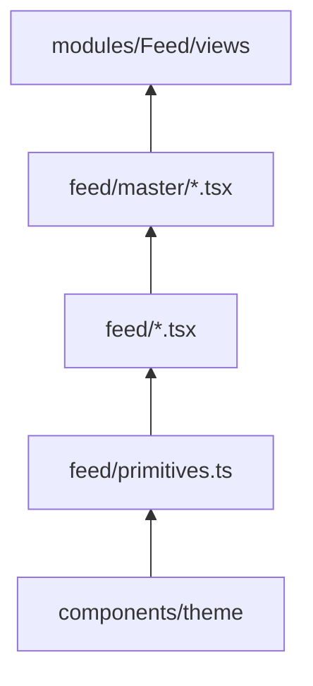

# Feed UI architecture (import hierarchy)

Logical layers only — **folder names stay** `features/feed/`, `features/feed/master/`, `modules/Feed/views/`.

**Rule:** imports flow **up** the stack only. No visual/markup changes when refactoring structure.

## Layers (bottom → top)

| Layer | Path | May import |
|-------|------|------------|
| **1 — Primitives** | `primitives.ts` | `@/components/theme` only |
| **2 — Building blocks** | `features/feed/*.tsx` | `primitives`, other building blocks (not `master/`) |
| **3 — Composites** | `features/feed/master/*.tsx` | `primitives`, `../` building blocks, `utils/`, hooks/API for data |
| **4 — Views** | `modules/Feed/views/*.tsx` | `@/components/features/feed` barrel, hooks, shell |

## Dependency diagram

## File map

### Primitives

- `primitives.ts` — `Typography`, `Button`, `Textarea`, `SearchInput`, `cx`

### Building blocks (`features/feed/`)

- `FeedCard`, `FeedCaption`, `FeedHashtagList`, `CreatorIdentity`, `FeedResourceLink`, `FeedOverlayGradient`
- `FeedSearchInput`, `FeedSearchSidebar`, `FeedActionRail`, `FeedSnapScrollControls`, `FeedFilterTrigger`
- Custom markup (no theme): `FeedMedia` lives in `master/` but is a leaf player; `FeedActionRail` is custom SVG/CSS

### Composites (`features/feed/master/`)

- `FeedViewport` — `FeedCard` + `FeedMedia` + overlay children
- `FeedCommentPanel`, `FeedShareSheet`, `FeedAuthGateModal`, `FeedClipFilterPanel`, `FeedFilterPanel`, `FeedStatePanel`
- `LandingClipSlide` — landing snap slide (viewport + rail)
- `LandingCommentSidebar` — portal wrapper + `FeedCommentPanel`
- `landingActionRail.ts` — rail template helpers (no UI)

### Utils (no UI)

- `utils/feedCountFormat.ts` — `formatCompactCount`, `parseCompactCountLabel`

### Views

- `LandingPageView` — orchestration only; composes composites + shell
- `FeedExplorerShell` — grid layout; uses building blocks for default search/filter

## Public API

Import from `@/components/features/feed` (see `index.ts`). Views should prefer the barrel over deep paths.
