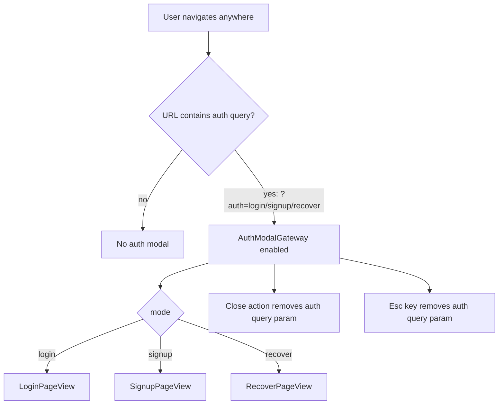
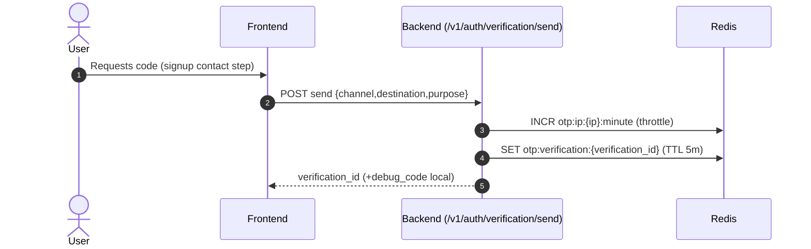

## AU Auth feature flows (detailed)

This document is the **detailed AU (“feature flow”) view** of authentication in Delta Labs, based directly on:

- **Backend routes**: `deltalabs-backend/app/api/v1/auth.py`
- **Backend orchestration**: `app/domain/identity/*` (`Service`, `SignupFlowService`, `VerificationService`, `RecoverService`)
- **Frontend integration**: `deltalabs-frontend/src/modules/Auth/*` and `deltalabs-frontend/src/components/features/auth/*`

It intentionally focuses on **user-visible flows + system interactions** (browser ↔ frontend ↔ backend ↔ Mongo/Redis).

---

## Auth feature inventory (what exists today)

### Entry points (AU)

- **Modal auth**: query param `?auth=login|signup|recover` opens `AuthModalGateway`
- **Standalone pages**:
  - `/login` renders `LoginPageView`
  - `/signup` renders `SignupPageView`
  - recover is typically routed via `/login?auth=recover` (also works in modal)

### Supported user flows (features)

- **Login**
- **Signup (multi-step UI)**
  - Identity (username)
  - Date of birth
  - Contact (phone + email)
  - OTP verification
  - Password set + account creation (backend session issued)
- **Verification (OTP)**
  - Send code
  - Resend code
  - Verify code (marks verification “used” in Redis)
- **Recover / Reset password**
  - Request recovery (anti-enumeration)
  - Verify recovery OTP (issues reset token)
  - Reset password (revokes all sessions)
- **Session**
  - Establish session on successful login/signup
  - Persist in localStorage + cookie marker for middleware
  - Attach bearer access token to API client calls

---

## Global AU: “Auth modal gateway” routing flow

Frontend supports an AU where auth is an overlay modal controlled by the URL query string.



### Key UX/system behaviors

- **Closing modal**: the “X” uses `closeHref` which is the current pathname **without** the `auth` query param.
- **Escape to close**: when enabled, `AuthModalGateway` listens for `Escape` and removes `auth`.
- **Safety**: if the modal is disabled externally (`enabled=false`) but a mode is present, it force-removes `auth` from the URL.

---

## Feature flow 1: Login (AU)

### User intent

“I already have an account. Let me sign in using email/phone/username + password.”

### System flow (sequence)

```mermaid
sequenceDiagram
  autonumber
  actor U as User
  participant UI as Frontend (LoginPageView)
  participant H as Auth hooks (useLoginMutation)
  participant API as Backend (/v1/auth/login)
  participant DB as MongoDB (users, user_sessions)

  U->>UI: Fill identity + password; submit
  UI->>H: loginMutation.mutateAsync({identifier,password,rememberMe})
  H->>API: POST /v1/auth/login { identity, password }
  API->>DB: find_user_by_identity(identity)
  alt invalid user/password
    API-->>H: 4xx ValidationError (invalid_credentials)
    H-->>UI: throw error -> banner message
  else valid
    API->>DB: create_session(user_id, token_hash, ttl)
    API-->>H: { access_token, session, user }
    H->>UI: establishSession(session payload)
    UI-->>U: Redirect to redirectAfterLoginHref
  end
```

### Data touched

- **MongoDB**
  - `users` lookup by `username_normalized` OR `email_normalized` OR `phone_e164`
  - `user_sessions` insert (token hash, expiry, revoked_at)
- **Browser**
  - localStorage: `dl.auth.session.v1` (payload with `accessToken`, `expiresAt`, `user`)
  - cookie marker: `AUTH_SESSION_COOKIE=1` (presence marker, not the token)

---

## Feature flow 2: Signup (AU) — UI multi-step, backend state machine

Signup in this repo is a **hybrid**:

- **UI** is multi-step and collects: identity → DOB → contact → OTP → password
- **Backend** uses a **Redis-backed “signup flow” state machine** (`SignupFlowService`)
- **OTP verification** is also Redis-backed (`VerificationService`)
- **Final completion** creates a Mongo user and issues a session token

### High-level flowchart

```mermaid
flowchart TD
  U[User] --> UI[SignupPageView (stepper)]

  UI --> I[Step 0: Identity (username)]
  I --> C1[/POST /v1/auth/signup/step/identity/]
  C1 --> FID[Redis signup:flow:{flow_id}]

  UI --> DOB[Step 1: Date of birth (client-only until API)]
  UI --> CONTACT[Step 2: Contact (phone + email)]
  CONTACT --> C2[/POST /v1/auth/signup/step/contact/]
  C2 --> FCT[Redis signup:flow:{flow_id} updated]

  CONTACT --> OTP_SEND[/POST /v1/auth/verification/send purpose=signup/]
  OTP_SEND --> OTP_STATE[Redis otp:verification:{verification_id}]

  UI --> OTP[Step 3: Enter OTP]
  OTP --> OTP_VERIFY[/POST /v1/auth/verification/verify/]
  OTP_VERIFY --> OTP_USED[Redis otp:verification:{verification_id} used=true]

  OTP --> C3[/POST /v1/auth/signup/step/verification/]
  C3 --> FVER[Redis signup:flow state verification_id set]

  UI --> PW[Step 4: Password]
  PW --> C4[/POST /v1/auth/signup/step/dob/]
  C4 --> FDOB[Redis signup:flow date_of_birth set]

  PW --> COMPLETE[/POST /v1/auth/signup/complete/]
  COMPLETE --> MONGO[(MongoDB users + user_sessions)]
  COMPLETE --> CLEAR_FLOW[DEL Redis signup:flow:{flow_id}]
  COMPLETE --> SESSION[AuthIssuedResponse access_token+session+user]
```

### Step-by-step AU details

#### Step 0: Identity (username)

- **UI** validates required fields.
- **Backend**: `POST /v1/auth/signup/step/identity`
  - checks username uniqueness (`find_user_by_identity`)
  - creates `flow_id = uuid4()`
  - stores signup flow state in Redis:
    - key: `signup:flow:{flow_id}`
    - TTL: 24 hours (server constant)
    - `current_step="identity"`, `completed_steps=["identity"]`

#### Step 1: Date of birth (DOB)

- Currently in UI, DOB selection occurs before calling the backend DOB step.
- Backend DOB is recorded later as `POST /v1/auth/signup/step/dob` after verification step is completed.

#### Step 2: Contact (phone/email)

- **UI** expects both phone and email (current UX), validates both formats.
- **Backend**: `POST /v1/auth/signup/step/contact`
  - requires previous step `current_step == "identity"`
  - requires at least one of `email` or `phone_e164`
  - checks uniqueness of provided email/phone (same `find_user_by_identity`)
  - updates flow state to `current_step="contact"`

#### Step 2b: Send OTP (verification issuance)

- **Backend**: `POST /v1/auth/verification/send`
  - validates channel in `{sms,email}`
  - stores OTP verification state in Redis:
    - key: `otp:verification:{verification_id}`
    - TTL: 5 minutes
    - anti-abuse:
      - IP throttle: max 20 / minute
      - resend cooldown: 45 seconds
      - max attempts: 5
  - returns `verification_id` (+ `debug_code` only in local env)

#### Step 3: Verify OTP (proof)

- **Backend**: `POST /v1/auth/verification/verify`
  - validates attempts/expiry
  - sets `used=true` on success (prevents replay)

#### Step 3b: Attach verification to signup flow

- **Backend**: `POST /v1/auth/signup/step/verification`
  - requires `current_step == "contact"`
  - reads `otp:verification:{verification_id}` from Redis
  - requires `used == true` (meaning the OTP was verified)
  - requires that verification destination matches the flow’s contact (email or phone)
  - stores `verification_id` in the flow and advances `current_step="verification"`

#### Step 4: DOB server step

- **Backend**: `POST /v1/auth/signup/step/dob`
  - requires `current_step == "verification"`
  - validates format `YYYY-MM-DD`
  - advances `current_step="dob"`

#### Step 5: Complete (create account + issue session)

- **Backend**: `POST /v1/auth/signup/complete`
  - requires `current_step == "dob"`
  - validates password policy
  - creates Mongo `users` record with password hash
  - issues bearer token and stores `user_sessions` with `token_hash` and TTL
  - deletes the signup flow key `signup:flow:{flow_id}`
  - returns `AuthIssuedResponse` to client

---

## Feature flow 3: Verification (OTP) — send / resend / verify

### Send OTP



### Resend OTP

- Endpoint: `POST /v1/auth/verification/resend`
- Reuses the same `verification_id`
- Enforces resend cooldown (45 seconds)

### Verify OTP

- Endpoint: `POST /v1/auth/verification/verify`
- Enforces attempt limits and expiry
- Marks the verification state as `used=true` if correct

---

## Feature flow 4: Recover / Reset password (AU)

Recover is designed to be **anti-enumeration**: requesting recover for an unknown account returns a generic success message.

```mermaid
sequenceDiagram
  autonumber
  actor U as User
  participant UI as Frontend (RecoverPageView)
  participant API as Backend
  participant DB as MongoDB
  participant R as Redis

  U->>UI: Stage 1: request reset code (identifier)
  UI->>API: POST /v1/auth/recover/request { identity }
  API->>R: Rate limit by IP + identity
  API->>DB: find_user_by_identity(identity)
  alt no user found
    API-->>UI: 200 accepted (generic message)
  else user found
    API->>R: SET recover:state:{recover_id} (TTL 15m, debug_code local)
    API-->>UI: 200 accepted (+ recover_id)
  end

  U->>UI: Stage 2: enter OTP + new password
  UI->>API: POST /v1/auth/recover/verify { recover_id, code }
  API->>R: load recover:state; validate code; issue reset_token
  API-->>UI: reset_token

  UI->>API: POST /v1/auth/recover/reset { recover_id, reset_token, new_password }
  API->>DB: update users.password_hash
  API->>DB: revoke_all_sessions_for_user(user_id)
  API->>R: mark reset_used=true
  API-->>UI: password_reset
```

### Data touched

- Redis key: `recover:state:{recover_id}` with:
  - `code_hash`, `attempts`, `verified`, `reset_token_hash`, `reset_used`
- Mongo:
  - updates `users.password_hash`
  - revokes all active sessions by setting `revoked_at` (bulk update)

---

## Feature flow 5: Session hydration + API token attachment (AU)

Even before any auth flow is opened, the app can hydrate session state client-side.

```mermaid
flowchart TD
  A[Browser loads app] --> B[AuthSessionProvider useLayoutEffect hydrate]
  B --> C{localStorage dl.auth.session.v1 exists?}
  C -- no --> D[session=null, isAuthenticated=false]
  C -- yes --> E{expiresAt valid and accessToken present?}
  E -- no --> F[clear storage + session=null]
  E -- yes --> G[session set in context]
  G --> H[setApiAccessTokenGetter(() => accessToken)]
  G --> I[write cookie marker AUTH_SESSION_COOKIE=1 Max-Age=...]
```

Notes:

- The cookie is a **presence marker**, not the bearer token.
- API client uses the access token getter to attach `Authorization: Bearer ...` to requests that need it.

---

## Backend endpoint map (used by these flows)

- `POST /v1/auth/login`
- `GET /v1/auth/session`
- `POST /v1/auth/logout`

- `POST /v1/auth/signup/step/identity`
- `POST /v1/auth/signup/step/contact`
- `POST /v1/auth/signup/step/verification`
- `POST /v1/auth/signup/step/dob`
- `POST /v1/auth/signup/complete`
- `GET /v1/auth/signup/state?flow_id=...`

- `POST /v1/auth/verification/send`
- `POST /v1/auth/verification/resend`
- `POST /v1/auth/verification/verify`

- `POST /v1/auth/recover/request`
- `POST /v1/auth/recover/verify`
- `POST /v1/auth/recover/reset`

