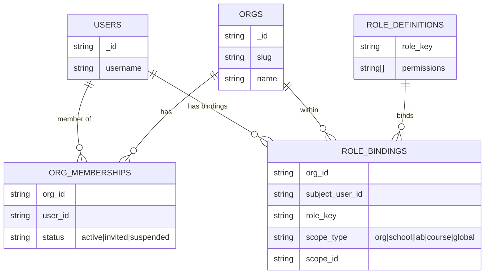
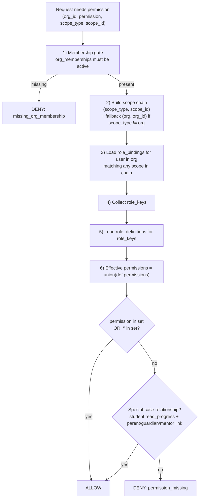

# (AU Page) AuthZ design — Org-based RBAC (architecture diagram)

This document explains **why Authorization (AuthZ) is org-based** in Delta Labs and how the RBAC model is designed **in the implemented code**.

Evidence (source of truth):

- AuthZ engine: `deltalabs-backend/app/domain/authorization/service.py`
- AuthZ types: `deltalabs-backend/app/domain/authorization/schemas.py`

---

## Why “org” is the AuthZ boundary (design intent)

- **Organization = tenant boundary**: data, policies, and admin control are scoped by `org_id`.
- **Least privilege gate**: if you are not an **active member** of the org, you are denied before roles/permissions are even evaluated.
- **Role reuse**: org-wide roles (owner/admin) can apply across multiple resources inside the tenant, while still allowing narrower scopes (school/lab/course).

---

## Diagram 1 — Data model (membership → role bindings → permissions)

**How to read it:**

- `org_memberships` answers: **“Is this user allowed to operate in this tenant at all?”**
- `role_bindings` answers: **“Which roles does this user have in this org (and scope)?”**
- `role_definitions` answers: **“What permissions does each role grant?”**

---

## Diagram 2 — Authorization decision flow (what happens per request)

**Key design detail (implemented):** the scope chain includes an **org fallback**, so org-wide roles still apply when evaluating a narrower scope.

---

## Speaker notes (simple explanation)

- “AuthN tells us who you are; AuthZ decides what you can do.”
- “AuthZ is org-based because org is the tenant boundary. We always check membership first.”
- “Then we resolve roles bound to the user within that org, optionally scoped to a specific resource.”
- “Those roles map to permissions via the role catalog, and the engine returns allow/deny.”

