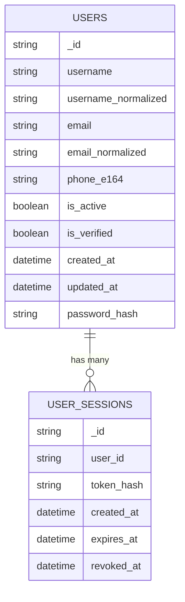

## Backend auth data model & diagrams (detailed)

This document explains **how backend auth works end-to-end at the data layer**: MongoDB collections + Redis keys, their fields, indexes/TTL, and how the services compose them.

Source of truth (code):

- Routes: `deltalabs-backend/app/api/v1/auth.py`
- Identity storage: `deltalabs-backend/app/domain/identity/repository.py`
- Identity auth service: `deltalabs-backend/app/domain/identity/service.py`
- Signup flow orchestration: `deltalabs-backend/app/domain/identity/signup_flow_service.py`
- OTP verification: `deltalabs-backend/app/domain/identity/verification_service.py`
- Recover pipeline: `deltalabs-backend/app/domain/identity/recover_service.py`
- Response/request schemas: `deltalabs-backend/app/domain/identity/schemas.py`

---

## System overview (Mongo + Redis responsibility split)

### MongoDB (durable, canonical)

- `users`: canonical identity record (username/email/phone + password_hash)
- `user_sessions`: server-side session documents (token_hash + expiry + revoke support)

### Redis (ephemeral, state machines + throttles)

- OTP verification state (`otp:verification:{verification_id}`)
- Signup flow state (`signup:flow:{flow_id}`)
- Recover flow state (`recover:state:{recover_id}`)
- Rate-limit counters:
  - `otp:ip:{ip}:minute`
  - `recover:ip:{ip}:minute`
  - `recover:identity:{normalized_identity}:minute`

This architecture keeps Mongo **clean and minimal**, while Redis hosts **short-lived** workflow state and anti-abuse counters.

---

## Data model diagram (entities + relationships)

The backend is not relational, but there are still clear “entity” relationships (via ids, hashes, and key conventions).

Notes:

- MongoDB stores ids as `_id` but code maps them to `UserRecord.id` etc.
- “Relationships” are by reference: `user_sessions.user_id` references `users._id` (not enforced by Mongo).

---

## MongoDB collections (detailed)

### Collection: `users`

Canonical identity record.

**Fields (from `UserRecord` + repository insert)**

- `_id`: UUID string
- `username`: original username
- `username_normalized`: `username.strip().lower()`
- `email`: optional
- `email_normalized`: optional, `email.strip().lower()`
- `phone_e164`: optional (stored as provided; find uses exact match)
- `is_active`: boolean
- `is_verified`: boolean
- `created_at`, `updated_at`: UTC datetimes
- `password_hash`: hash output from `hash_password()`

**Lookup behavior**

Repository function `find_user_by_identity(identity_raw)` matches:

- `username_normalized == normalized(identity)`
- OR `email_normalized == normalized(identity)`
- OR `phone_e164 == identity_raw.strip()` (exact)

**Indexes**

Created in `Repository.ensure_indexes()`:

- Unique:
  - `username_normalized` unique
  - `email_normalized` unique but only when it is a string (partial index)
  - `phone_e164` unique but only when it is a string (partial index)

Why partial unique indexes:

- Email/phone are optional. Without partial indexing, multiple `null` values would conflict with uniqueness.

### Collection: `user_sessions`

Server-side session documents keyed by **token hash**.

**Fields**

- `_id`: session UUID string
- `user_id`: UUID string referencing `users._id`
- `token_hash`: SHA/hash of raw bearer token (raw token never stored)
- `created_at`: UTC datetime
- `expires_at`: UTC datetime
- `revoked_at`: nullable datetime

**Behavior**

- Active session = `revoked_at == None` and `expires_at > now`.
- Logout sets `revoked_at=now` (if present).
- Password reset revokes **all sessions** for a user.

**Indexes**

- `token_hash` unique
- `expires_at` TTL index with `expireAfterSeconds=0`

TTL index meaning:

- Mongo will automatically delete expired session documents after `expires_at`.

---

## Redis keys (detailed)

### Key: `otp:verification:{verification_id}`

Owned by `VerificationService`.

**TTL**: 5 minutes

**Stored JSON fields** (`VerificationState`):

- `verification_id`
- `channel`: `"sms"` or `"email"`
- `destination`: raw phone/email destination
- `purpose`: e.g. `"signup"`
- `code_hash`: sha256(code)
- `attempts`: current attempts
- `max_attempts`: constant (5)
- `created_at_epoch`, `last_sent_at_epoch`
- `used`: boolean (set true only after successful verify)

**Anti-abuse**

- IP throttle counter: `otp:ip:{ip}:minute` (INCR + EXPIRE 60)
- Resend cooldown: 45s computed from `last_sent_at_epoch`
- Attempt limit: blocks after \(attempts >= max_attempts\)
- Replay protection: `used=true` causes verify to fail

### Key: `signup:flow:{flow_id}`

Owned by `SignupFlowService`.

**TTL**: 24 hours

**Stored JSON fields** (`SignupFlowState`):

- `flow_id`
- `current_step`: `"identity" | "contact" | "verification" | "dob"`
- `completed_steps`: step history
- `username`, `email`, `phone_e164`
- `verification_id`: set after step_verification
- `date_of_birth`: `"YYYY-MM-DD"` string
- `created_at_epoch`

**Step enforcement**

Every step checks strict order via `current_step`:

- `step_contact` requires `"identity"`
- `step_verification` requires `"contact"`
- `step_dob` requires `"verification"`
- `complete` requires `"dob"`

### Key: `recover:state:{recover_id}`

Owned by `RecoverService`.

**TTL**: 15 minutes

**Stored JSON fields** (`RecoverState`):

- `recover_id`
- `user_id`
- `code_hash`: sha256(code)
- `attempts`, `max_attempts` (6)
- `verified`: set true after correct OTP
- `reset_token_hash`: sha256(reset_token) after verify
- `reset_used`: set true after successful password reset
- `created_at_epoch`

**Rate limiting keys**

- `recover:ip:{ip}:minute` max 20/min
- `recover:identity:{normalized}:minute` max 5/min

**Security properties**

- Anti-enumeration: if user not found, response is generic and does not create a recover state.
- Reset token is never stored raw; only hash is stored and compared.
- Reset token is one-time use (`reset_used`).

---

## Auth endpoints ↔ data access mapping

### Login/session/logout (Service + Repository)

- `POST /v1/auth/login`
  - reads `users`
  - writes `user_sessions`
- `GET /v1/auth/session`
  - reads `user_sessions` by `token_hash`
  - reads `users` by id
- `POST /v1/auth/logout`
  - updates `user_sessions.revoked_at`

### Signup (SignupFlowService + Repository + Redis OTP)

- `POST /v1/auth/signup/step/identity`
  - reads `users` for uniqueness
  - writes `signup:flow:*`
- `POST /v1/auth/signup/step/contact`
  - reads `users` for uniqueness
  - updates `signup:flow:*`
- `POST /v1/auth/verification/send`
  - writes `otp:verification:*`
  - updates `otp:ip:*` throttle counter
- `POST /v1/auth/verification/verify`
  - reads/writes `otp:verification:*` (`attempts`, `used`)
- `POST /v1/auth/signup/step/verification`
  - reads `otp:verification:*` and requires `used=true`
  - updates `signup:flow:*`
- `POST /v1/auth/signup/step/dob`
  - updates `signup:flow:*`
- `POST /v1/auth/signup/complete`
  - reads `signup:flow:*`
  - writes `users`
  - writes `user_sessions`
  - deletes `signup:flow:*`

### Recover (RecoverService + Repository)

- `POST /v1/auth/recover/request`
  - rate limit keys
  - reads `users`
  - writes `recover:state:*` if user exists
- `POST /v1/auth/recover/verify`
  - reads/writes `recover:state:*`
  - issues reset_token (client receives raw, server stores hash)
- `POST /v1/auth/recover/reset`
  - reads/writes `recover:state:*`
  - updates `users.password_hash`
  - revokes all `user_sessions` for the user

