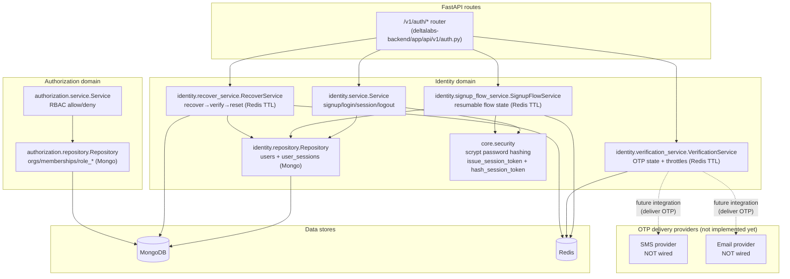

# (AU Page) Backend design diagram — Task submission

## What the subtask requires

- A backend design diagram for AU (Authentication) covering:
  - The **auth API boundary** and internal service decomposition
  - Where **durable** data is stored (MongoDB) vs **ephemeral** state (Redis TTL)
  - The **security primitives** used (password hashing, session token hashing)
  - Clear statement of what’s **not implemented** (OTP delivery providers)

## Verified implementation (evidence)

- Auth router: `deltalabs-backend/app/api/v1/auth.py`
- Identity service + session issuance: `deltalabs-backend/app/domain/identity/service.py`
- Signup orchestration: `deltalabs-backend/app/domain/identity/signup_flow_service.py`
- OTP state + throttles (Redis): `deltalabs-backend/app/domain/identity/verification_service.py`
- Recover pipeline + anti-enumeration + session revocation: `deltalabs-backend/app/domain/identity/recover_service.py`
- Security primitives (scrypt + SHA-256 token hashing): `deltalabs-backend/app/core/security.py`

## Diagram (service architecture)

## Implemented security guarantees (what we can claim)

- **Passwords**: hashed with **scrypt + salt** (`deltalabs-backend/app/core/security.py`).
- **Sessions**: raw token issued, only **SHA-256 hash stored** (`user_sessions.token_hash`) with expiry (`expires_at` + TTL index).
- **OTP/recover**: Redis TTL + attempt limits + resend cooldown + throttles (no real provider delivery wired).

## Walkthrough (implemented, backend-only)

1. `auth.py` routes call Identity services for login/signup/session/logout, plus OTP and recovery orchestration.
2. Passwords are hashed with **scrypt** before being stored in `users`.
3. Sessions are created by issuing a raw token and storing only its **SHA‑256 hash** in `user_sessions` with `expires_at`.
4. OTP/signup-flow/recover are **Redis-backed TTL states** with anti-abuse controls (cooldowns, attempt limits, throttles).
5. Authorization checks (separate domain) enforce **org membership** and **RBAC** via role bindings/definitions in MongoDB.

