## Frontend AUTH component hierarchy (simple)

This document explains the AUTH UI structure in **simple layers**, so anyone can quickly see how the frontend pieces connect.

The structure is:

- **Layer 1**: Theme primitives (shared UI building blocks)
- **Layer 2**: Auth atoms / molecules (auth-specific components built from primitives)
- **Layer 3**: Auth views (compose atoms into full flows)
- **Layer 4**: Entry points (Next.js pages + modal gateway)

---

### Diagram (layer-separated “lined cards”)

```mermaid
flowchart TB
  %% No arrows/edges — just clear layers and "Refers - X" text.
  %% =========================
  %% Styles (high-contrast lined cards)
  %% =========================
  classDef layer fill:#f3f4f6,stroke:#111827,stroke-width:3px,rx:10,ry:10;
  classDef card fill:#ffffff,stroke:#111827,stroke-width:2px,rx:8,ry:8;
  classDef primitive fill:#eef2ff,stroke:#111827,stroke-width:2px,rx:8,ry:8;
  classDef entry fill:#ecfeff,stroke:#111827,stroke-width:2px,rx:8,ry:8;

  %% =========================
  %% Layer 1 — primitives
  %% =========================
  subgraph L1["Layer 1 — Theme primitives (A–F)"]
    direction LR
    A["A — Field<br/>components/theme/Field.tsx"]:::primitive
    B["B — Input<br/>components/theme/Input.tsx"]:::primitive
    C["C — Typography<br/>components/theme/Typography.tsx"]:::primitive
    D["D — RadioGroup<br/>components/theme/RadioGroup.tsx"]:::primitive
    E["E — utils (cx)<br/>components/theme/utils.ts"]:::primitive
    F["F — buttonStyles<br/>components/theme/buttonStyles.ts"]:::primitive
  end
  class L1 layer;

  %% =========================
  %% Layer 2 — auth atoms/molecules
  %% =========================
  subgraph L2["Layer 2 — Auth atoms / molecules + helpers (G–U)"]
    direction TB
    subgraph L2A["Fields"]
      direction LR
      G["G — AuthTextField<br/>features/auth/AuthFields.tsx<br/>Refers - A, B, C"]:::card
      H["H — AuthCheckboxField<br/>features/auth/AuthFields.tsx<br/>Refers - C"]:::card
      I["I — AuthPhoneField<br/>features/auth/AuthPhoneField.tsx<br/>Refers - A, B"]:::card
      J["J — AuthPasswordField<br/>features/auth/AuthPasswordField.tsx<br/>Refers - A, B"]:::card
      K["K — AuthSelectField<br/>features/auth/AuthSelectField.tsx<br/>Refers - A, E"]:::card
      L["L — AuthOtpField<br/>features/auth/AuthOtpField.tsx<br/>Refers - (none from Layer 1)"]:::card
    end
    subgraph L2B["Buttons / links / helpers"]
      direction LR
      M["M — AuthPrimaryButton<br/>features/auth/AuthPrimaryButton.tsx<br/>Refers - E, F"]:::card
      N["N — AuthDivider<br/>features/auth/AuthDivider.tsx<br/>Refers - C"]:::card
      O["O — AuthBottomSwitchLink<br/>features/auth/AuthBottomSwitchLink.tsx<br/>Refers - C"]:::card
    end
    subgraph L2C["Choice inputs"]
      direction LR
      P["P — AuthRadioGroup<br/>features/auth/AuthRadioGroup.tsx<br/>Refers - D"]:::card
    end
    subgraph L2D["Feedback / social (UI)"]
      direction LR
      Q["Q — AuthStatusBanner<br/>features/auth/AuthStatusBanner.tsx<br/>Refers - (none from Layer 1)"]:::card
      R["R — useAuthResponseBanner<br/>features/auth/useAuthResponseBanner.ts<br/>Refers - (none from Layer 1)"]:::card
      S["S — SocialProviderGlyphs<br/>features/auth/SocialProviderGlyphs.tsx<br/>Refers - (none from Layer 1)"]:::card
      T["T — SocialProvidersRow<br/>features/auth/SocialProvidersRow.tsx<br/>Refers - S"]:::card
    end
    subgraph L2E["Style helpers (used by auth atoms)"]
      direction LR
      U["U — AUTH_FIELD_LABEL_CLASS<br/>features/auth/authFormClasses.ts<br/>Refers - (none from Layer 1)"]:::card
      V["V — getAuthInputClassName<br/>features/auth/authInputStyles.ts<br/>Refers - E"]:::card
      W["W — getAuthPrimaryButtonClassName<br/>features/auth/authPrimaryButtonStyles.ts<br/>Refers - E, F"]:::card
    end
  end
  class L2 layer;

  %% =========================
  %% Layer 3 — views
  %% =========================
  subgraph L3["Layer 3 — Auth views (X–AA)"]
    direction LR
    X["X — AuthModalShell<br/>features/auth/master/AuthModalShell.tsx<br/>Refers - (wraps Y, Z, AA)"]:::card
    Y["Y — LoginPageView<br/>modules/Auth/views/LoginPageView.tsx<br/>Refers - X + G, H, J, M, N, O, Q, R, T"]:::card
    Z["Z — SignupPageView<br/>modules/Auth/views/SignupPageView.tsx<br/>Refers - X + G, I, J, K, M, N, O, Q, R, T"]:::card
    AA["AA — RecoverPageView<br/>modules/Auth/views/RecoverPageView.tsx<br/>Refers - X + G, J, L, M, O, Q, R"]:::card
  end
  class L3 layer;

  %% =========================
  %% Layer 4 — entry points
  %% =========================
  subgraph L4["Layer 4 — Entry points (AB–AD)"]
    direction LR
    AB["AB — AuthModalGateway<br/>features/auth/master/AuthModalGateway.tsx<br/>Refers - Y, Z, AA"]:::entry
    AC["AC — /login page<br/>app/(public)/login/page.tsx<br/>Refers - Y"]:::entry
    AD["AD — /signup page<br/>app/(public)/signup/page.tsx<br/>Refers - Z"]:::entry
  end
  class L4 layer;
```

### Layer 1 — Theme primitives (used by AUTH)

Each primitive is referenced by a letter (A–F) so higher layers can say “Refers - A, B …”.

- **A — `Field`**: `deltalabs-frontend/src/components/theme/Field.tsx`
- **B — `Input`**: `deltalabs-frontend/src/components/theme/Input.tsx`
- **C — `Typography`**: `deltalabs-frontend/src/components/theme/Typography.tsx`
- **D — `RadioGroup`**: `deltalabs-frontend/src/components/theme/RadioGroup.tsx`
- **E — `cx` (utility)**: `deltalabs-frontend/src/components/theme/utils.ts`
- **F — `buttonStyles` (ButtonSize + base button classes)**: `deltalabs-frontend/src/components/theme/buttonStyles.ts`

---

### Layer 2 — Auth atoms / molecules (built from Layer 1)

Each box below lists:

- **Component**
- **File**
- **Refers** (which primitives A–F are used directly)

#### Fields

- **`AuthTextField`**
  - **file**: `deltalabs-frontend/src/components/features/auth/AuthFields.tsx`
  - **refers**: A, B, C
- **`AuthCheckboxField`**
  - **file**: `deltalabs-frontend/src/components/features/auth/AuthFields.tsx`
  - **refers**: C
- **`AuthPhoneField`**
  - **file**: `deltalabs-frontend/src/components/features/auth/AuthPhoneField.tsx`
  - **refers**: A, B
- **`AuthPasswordField`**
  - **file**: `deltalabs-frontend/src/components/features/auth/AuthPasswordField.tsx`
  - **refers**: A, B
- **`AuthSelectField`**
  - **file**: `deltalabs-frontend/src/components/features/auth/AuthSelectField.tsx`
  - **refers**: A, E
  - **note**: Custom select UX (button + listbox) wrapped by `Field`.
- **`AuthOtpField`**
  - **file**: `deltalabs-frontend/src/components/features/auth/AuthOtpField.tsx`
  - **refers**: (none of A–F directly)
  - **note**: OTP uses raw `<input>` cells + `getAuthInputClassName` styling helper.

#### Buttons / links / layout helpers

- **`AuthPrimaryButton`**
  - **file**: `deltalabs-frontend/src/components/features/auth/AuthPrimaryButton.tsx`
  - **refers**: E, F
  - **note**: Uses `getAuthPrimaryButtonClassName` which uses `cx` and `ButtonSize`.
- **`AuthDivider`**
  - **file**: `deltalabs-frontend/src/components/features/auth/AuthDivider.tsx`
  - **refers**: C
- **`AuthBottomSwitchLink`**
  - **file**: `deltalabs-frontend/src/components/features/auth/AuthBottomSwitchLink.tsx`
  - **refers**: C

#### Choice inputs

- **`AuthRadioGroup`**
  - **file**: `deltalabs-frontend/src/components/features/auth/AuthRadioGroup.tsx`
  - **refers**: D

#### Feedback / banners

- **`AuthStatusBanner`**
  - **file**: `deltalabs-frontend/src/components/features/auth/AuthStatusBanner.tsx`
  - **refers**: (none of A–F directly)
- **`useAuthResponseBanner`**
  - **file**: `deltalabs-frontend/src/components/features/auth/useAuthResponseBanner.ts`
  - **refers**: (none of A–F directly)

#### Social sign-in (UI only)

- **`SocialProvidersRow`**
  - **file**: `deltalabs-frontend/src/components/features/auth/SocialProvidersRow.tsx`
  - **refers**: (none of A–F directly)
- **`SocialProviderGlyphs`**
  - **file**: `deltalabs-frontend/src/components/features/auth/SocialProviderGlyphs.tsx`
  - **refers**: (none of A–F directly)
  - **note**: Icons only; OAuth wiring is separate.

---

### Layer 3 — Auth views (compose Layer 2)

Views are the “full UI” building blocks used by pages or modal routing.

- **`AuthModalShell`**
  - **file**: `deltalabs-frontend/src/components/features/auth/master/AuthModalShell.tsx`
  - **uses**: wraps the content area for all auth views (title/subtitle, nav controls, optional banner strip)

- **`LoginPageView`**
  - **file**: `deltalabs-frontend/src/modules/Auth/views/LoginPageView.tsx`
  - **uses (main)**: `AuthModalShell`, `AuthTextField`, `AuthPasswordField`, `AuthCheckboxField`, `AuthPrimaryButton`, `AuthDivider`, `SocialProvidersRow`, `AuthBottomSwitchLink`, `useAuthResponseBanner`, `AuthStatusBanner`

- **`SignupPageView`** (multi-step)
  - **file**: `deltalabs-frontend/src/modules/Auth/views/SignupPageView.tsx`
  - **uses (main)**: `AuthModalShell`, `AuthTextField`, `AuthPhoneField`, `AuthSelectField`, `AuthPasswordField`, `AuthPrimaryButton`, `AuthDivider`, `SocialProvidersRow`, `AuthBottomSwitchLink`, `useAuthResponseBanner`, `AuthStatusBanner`

- **`RecoverPageView`** (multi-stage: request → reset → done)
  - **file**: `deltalabs-frontend/src/modules/Auth/views/RecoverPageView.tsx`
  - **uses (main)**: `AuthModalShell`, `AuthTextField`, `AuthOtpField`, `AuthPasswordField`, `AuthPrimaryButton`, `AuthBottomSwitchLink`, `useAuthResponseBanner`, `AuthStatusBanner`

---

### Layer 4 — Entry points (pages + modal gateway)

These are the “final” integration points that show auth UI in the app.

- **`AuthModalGateway`** (query-param modal routing)
  - **file**: `deltalabs-frontend/src/components/features/auth/master/AuthModalGateway.tsx`
  - **how it works**: reads `?auth=login|signup|recover` and renders the matching view in a modal overlay

- **`/login` page**
  - **file**: `deltalabs-frontend/src/app/(public)/login/page.tsx`
  - **renders**: `LoginPageView`

- **`/signup` page**
  - **file**: `deltalabs-frontend/src/app/(public)/signup/page.tsx`
  - **renders**: `SignupPageView`

---

### Related reference (detailed)

If someone needs the full dependency tree + mermaid diagram, see:

- `docs/au-page/frontend-auth-component-hierarchy.md`

