## Frontend Auth component hierarchy (atomic → full modals) (detailed)

This document is a **complete “tree diagram” style** breakdown of the frontend Auth UI as implemented today, from **theme primitives (atomic)** up to full-page and modal experiences.

Source of truth (code):

- Auth views: `deltalabs-frontend/src/modules/Auth/views/*`
- Auth API + hooks: `deltalabs-frontend/src/modules/Auth/api/authApi.ts`, `deltalabs-frontend/src/modules/Auth/hooks/useAuthMutations.ts`
- Auth UI components: `deltalabs-frontend/src/components/features/auth/*`
- Session context: `deltalabs-frontend/src/contexts/AuthSession_Context.tsx`
- Theme primitives: `deltalabs-frontend/src/components/theme/*`

---

## Big-picture UI architecture

Auth in the frontend is composed as:

- **Theme primitives (atomic)**: `Field`, `Input`, `Typography`, `RadioGroup`, `utils.cx`, etc.
- **Auth atoms/molecules**: `AuthTextField`, `AuthPasswordField`, `AuthSelectField`, `AuthOtpField`, `AuthPrimaryButton`, …
- **Auth “shell”**: `AuthModalShell` (shared chrome: header controls, title/subtitle, banner slot, footer slot)
- **Auth views (organisms/pages)**:
  - `LoginPageView`
  - `SignupPageView` (multi-step)
  - `RecoverPageView` (multi-stage)
- **Modal gateway (routing wrapper)**: `AuthModalGateway` (driven by `?auth=...`)
- **Session provider**: `AuthSessionProvider` + `useAuthSession`

---

## Component export surface (what other code imports)

### Auth UI exports

`deltalabs-frontend/src/components/features/auth/index.ts` exports:

- `AuthModalGateway`
- `AuthModalShell`
- Fields: `AuthTextField`, `AuthCheckboxField`, `AuthPhoneField`, `AuthPasswordField`, `AuthSelectField`, `AuthOtpField`
- Feedback: `AuthStatusBanner`, `useAuthResponseBanner`
- Buttons and helpers: `AuthPrimaryButton`, `AuthDivider`, `AuthBottomSwitchLink`, `AuthRadioGroup`, styles/constants
- Social: `SocialProvidersRow`

### Auth module exports

`deltalabs-frontend/src/modules/Auth/index.ts` exports:

- Views: `LoginPageView`, `SignupPageView`, `RecoverPageView`
- Hooks: `useLoginMutation`, `useSignupMutation`, `useRecoverRequestMutation`, `useResetPasswordMutation`
- Types: `AuthSessionPayload` etc.
- API: `authApi`

---

## Tree diagram: theme primitives → auth atoms → auth shells → auth views

This is the “don’t miss anything” hierarchy for auth UI composition.

```mermaid
flowchart TB
  %% =========================
  %% THEME PRIMITIVES (atomic)
  %% =========================
  subgraph THEME["Theme primitives (src/components/theme/*)"]
    Field["Field (Field.tsx)"]
    Input["Input (Input.tsx)"]
    Typography["Typography (Typography.tsx)"]
    RadioGroup["RadioGroup (RadioGroup.tsx)"]
    Utils["utils.cx (utils.ts)"]
    ButtonStyles["buttonStyles (buttonStyles.ts)"]
  end

  %% =========================
  %% AUTH STYLES / TOKENS
  %% =========================
  subgraph AUTH_STYLES["Auth style helpers (src/components/features/auth/*)"]
    FormClasses["AUTH_FIELD_LABEL_CLASS (authFormClasses.ts)"]
    InputStyles["getAuthInputClassName (authInputStyles.ts)"]
    PrimaryBtnStyles["getAuthPrimaryButtonClassName (authPrimaryButtonStyles.ts)"]
  end

  %% =========================
  %% AUTH ATOMS / MOLECULES
  %% =========================
  subgraph AUTH_ATOMS["Auth atoms & molecules"]
    AuthTextField["AuthTextField (AuthFields.tsx)"]
    AuthCheckboxField["AuthCheckboxField (AuthFields.tsx)"]
    AuthPhoneField["AuthPhoneField (AuthPhoneField.tsx)"]
    AuthPasswordField["AuthPasswordField (AuthPasswordField.tsx)"]
    AuthSelectField["AuthSelectField (AuthSelectField.tsx)"]
    AuthOtpField["AuthOtpField (AuthOtpField.tsx)"]
    AuthDivider["AuthDivider (AuthDivider.tsx)"]
    AuthBottomSwitchLink["AuthBottomSwitchLink (AuthBottomSwitchLink.tsx)"]
    AuthRadioGroup["AuthRadioGroup (AuthRadioGroup.tsx)"]
    AuthPrimaryButton["AuthPrimaryButton (AuthPrimaryButton.tsx)"]
    AuthStatusBanner["AuthStatusBanner (AuthStatusBanner.tsx)"]
    useAuthResponseBanner["useAuthResponseBanner (useAuthResponseBanner.ts)"]
    SocialProviderGlyphs["SocialProviderGlyphs (SocialProviderGlyphs.tsx)"]
    SocialProvidersRow["SocialProvidersRow (SocialProvidersRow.tsx)"]
  end

  %% =========================
  %% AUTH SHELL / WRAPPERS
  %% =========================
  subgraph AUTH_SHELLS["Auth shells / wrappers"]
    AuthModalShell["AuthModalShell (master/AuthModalShell.tsx)"]
    AuthModalGateway["AuthModalGateway (master/AuthModalGateway.tsx)"]
  end

  %% =========================
  %% AUTH VIEWS (full modals/pages)
  %% =========================
  subgraph AUTH_VIEWS["Auth views (modules/Auth/views/*)"]
    LoginPageView["LoginPageView"]
    SignupPageView["SignupPageView (stepper)"]
    RecoverPageView["RecoverPageView (staged)"]
  end

  %% =========================
  %% SESSION / DATA LAYER
  %% =========================
  subgraph AUTH_STATE["Auth state + mutations"]
    AuthSessionProvider["AuthSessionProvider (AuthSession_Context.tsx)"]
    useAuthSession["useAuthSession (AuthSession_Context.tsx)"]
    useLoginMutation["useLoginMutation"]
    useSignupMutation["useSignupMutation"]
    useRecoverRequestMutation["useRecoverRequestMutation"]
    useResetPasswordMutation["useResetPasswordMutation"]
    authApi["authApi (modules/Auth/api/authApi.ts)"]
    apiClient["apiClient (src/lib/apiClient.ts)"]
  end

  %% Dependencies: styles
  FormClasses --> AuthTextField
  FormClasses --> AuthPhoneField
  FormClasses --> AuthPasswordField
  FormClasses --> AuthSelectField
  FormClasses --> AuthOtpField

  Utils --> InputStyles
  InputStyles --> AuthTextField
  InputStyles --> AuthPhoneField
  InputStyles --> AuthPasswordField
  InputStyles --> AuthSelectField
  InputStyles --> AuthOtpField

  PrimaryBtnStyles --> AuthPrimaryButton
  ButtonStyles --> AuthPrimaryButton

  %% Dependencies: theme primitives
  Field --> AuthTextField
  Input --> AuthTextField
  Typography --> AuthTextField

  Field --> AuthPhoneField
  Input --> AuthPhoneField

  Field --> AuthPasswordField
  Input --> AuthPasswordField

  Field --> AuthSelectField
  RadioGroup --> AuthRadioGroup

  Typography --> AuthDivider
  Typography --> AuthBottomSwitchLink

  %% Social
  SocialProviderGlyphs --> SocialProvidersRow

  %% Shell composition
  AuthModalShell --> LoginPageView
  AuthModalShell --> SignupPageView
  AuthModalShell --> RecoverPageView

  AuthTextField --> LoginPageView
  AuthPasswordField --> LoginPageView
  AuthCheckboxField --> LoginPageView
  AuthPrimaryButton --> LoginPageView
  AuthDivider --> LoginPageView
  SocialProvidersRow --> LoginPageView
  AuthBottomSwitchLink --> LoginPageView
  useAuthResponseBanner --> LoginPageView
  AuthStatusBanner --> LoginPageView

  AuthTextField --> SignupPageView
  AuthPhoneField --> SignupPageView
  AuthSelectField --> SignupPageView
  AuthPasswordField --> SignupPageView
  AuthPrimaryButton --> SignupPageView
  AuthDivider --> SignupPageView
  SocialProvidersRow --> SignupPageView
  AuthBottomSwitchLink --> SignupPageView
  useAuthResponseBanner --> SignupPageView
  AuthStatusBanner --> SignupPageView

  AuthTextField --> RecoverPageView
  AuthOtpField --> RecoverPageView
  AuthPasswordField --> RecoverPageView
  AuthPrimaryButton --> RecoverPageView
  AuthBottomSwitchLink --> RecoverPageView
  useAuthResponseBanner --> RecoverPageView
  AuthStatusBanner --> RecoverPageView

  %% Modal gateway routes views
  AuthModalGateway --> LoginPageView
  AuthModalGateway --> SignupPageView
  AuthModalGateway --> RecoverPageView

  %% State layer connections
  useAuthSession --> AuthSessionProvider
  useLoginMutation --> useAuthSession
  useSignupMutation --> useAuthSession
  useLoginMutation --> authApi
  useSignupMutation --> authApi
  useRecoverRequestMutation --> authApi
  useResetPasswordMutation --> authApi
  authApi --> apiClient
```

---

## Auth “full modal” composition (exact shells & props)

### `AuthModalGateway` (modal routing wrapper)

Responsibilities:

- Reads query param `auth` from `useSearchParams()`
- Valid modes: `"login" | "signup" | "recover"`
- Computes `closeHref` = same pathname but with `auth` removed
- Renders the appropriate view:
  - `LoginPageView` (no back control)
  - `SignupPageView` (back to login)
  - `RecoverPageView` (back to login)

Key UX:

- `Escape` closes the modal (removes query param)

### `AuthModalShell` (shared chrome)

`AuthModalShell` is the common layout for login/signup/recover. It provides:

- Header controls:
  - Back (button or link, optional)
  - Close (link)
- Title and subtitle
- Banner slot (centered in muted header strip when present)
- Footer slot (optional)
- Content area for the actual form

---

## Auth views (page-level components) — internal composition

### `LoginPageView`

Composition inside `AuthModalShell`:

- Form:
  - `AuthTextField` (email/phone)
  - `AuthPasswordField`
  - `AuthCheckboxField` (“Remember Me”)
  - `AuthPrimaryButton`
- Social:
  - `AuthDivider`
  - `SocialProvidersRow`
- Switch link:
  - `AuthBottomSwitchLink` (to signup)
- Response banner:
  - `useAuthResponseBanner` + `AuthStatusBanner`

Data flow:

- Submits via `useLoginMutation` → `authApi.login` → on success `establishSession()`

### `SignupPageView` (stepper)

Step titles/subtitles are mapped by an integer `step`:

- Step 0: Identity fields:
  - `AuthTextField` firstName, lastName, userName
- Step 1: DOB selection:
  - 3 × `AuthSelectField` (day/month/year)
- Step 2: Contact:
  - `AuthPhoneField`
  - `AuthTextField` email
  - side-effect: calls `authApi.sendSignupVerification()` before moving to step 3
- Step 3: OTP entry:
  - `AuthTextField` otp (note: currently not using `AuthOtpField` in signup)
- Step 4: Password:
  - 2 × `AuthPasswordField` (password + confirm)

Shared elements:

- `AuthPrimaryButton` to advance steps / final submit
- `useAuthResponseBanner` + `AuthStatusBanner`
- `AuthDivider` + `SocialProvidersRow`
- `AuthBottomSwitchLink` (to signin)

Data flow:

- Final submit uses `useSignupMutation` → `authApi.signup`, which performs the backend step chain:
  - `/signup/step/identity` → `/signup/step/contact` → `/verification/verify` → `/signup/step/verification` → `/signup/step/dob` → `/signup/complete`

### `RecoverPageView` (staged: request → reset → done)

Stage “request”:

- `AuthTextField` identifier
- `AuthPrimaryButton`
- `useRecoverRequestMutation` → `authApi.requestRecover`

Stage “reset”:

- `AuthOtpField` (6 cells)
- `AuthPasswordField` new password
- `AuthPasswordField` confirm password
- `useResetPasswordMutation` → `authApi.resetPassword`

Stage “done”:

- message + `AuthPrimaryButton` (Go to login)

Shared:

- `AuthModalShell` back button uses `onBackClick` to go stage-by-stage (not a URL change)

---

## Session layer composition (UI ↔ state)

### `AuthSessionProvider`

- Hydrates `dl.auth.session.v1` from `localStorage` in `useLayoutEffect` (prevents logged-out flash)
- Updates:
  - API auth header integration (`setApiAccessTokenGetter`)
  - cookie presence marker `AUTH_SESSION_COOKIE=1` with `Max-Age` derived from `expiresAt`
- Exposes:
  - `establishSession(next)` used by login/signup mutations
  - `clearSession()` used by logout flows elsewhere

---

## Notes (coverage + current “sharp edges” worth knowing)

- Signup OTP UI:
  - Signup uses `AuthTextField` for OTP, while Recover uses `AuthOtpField` (different UX components).
- Social providers:
  - `SocialProvidersRow` is purely UI (buttons + icons). It does not wire OAuth flows yet.
- Cookie contents:
  - Cookie is a presence marker only; bearer token is in localStorage and attached by API client getter.

