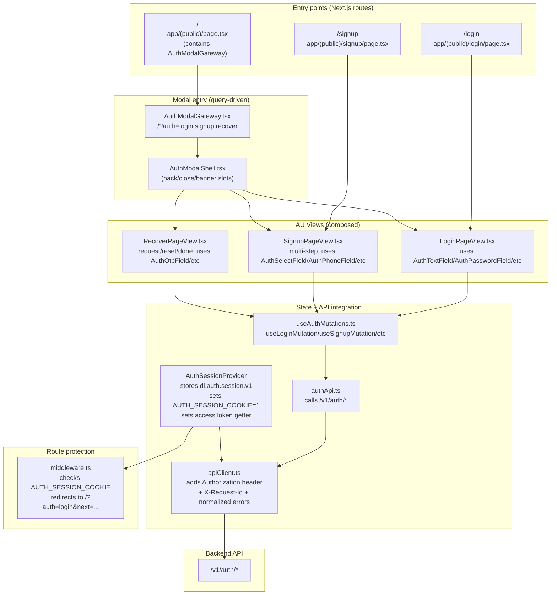

# (AU Page) Frontend component optimization & integration design — Task submission

## What the subtask requires

- A frontend design showing how AU (Authentication page) is integrated:
  - AU views (login/signup/recover) and how they trigger backend calls
  - Session lifecycle integration (establish/clear, persistence)
  - Route gating strategy (middleware)
  - “Optimization” decisions that reduce UX issues and integration mistakes

## Verified implementation (evidence)

- Auth API integration layer: `deltalabs-frontend/src/modules/Auth/api/authApi.ts`
- Mutations establish session on success: `deltalabs-frontend/src/modules/Auth/hooks/useAuthMutations.ts`
- Session provider (localStorage hydrate + cookie marker + token getter): `deltalabs-frontend/src/contexts/AuthSession_Context.tsx`
- Middleware gate: `deltalabs-frontend/middleware.ts`
- Redirect target pattern (`/?auth=login&next=/...`): `deltalabs-frontend/src/lib/authRedirect.ts`
- API client attaches bearer header: `deltalabs-frontend/src/lib/apiClient.ts`

## Diagram (integration architecture)

## Optimization choices (implemented)

- **Hydration before paint**: `useLayoutEffect` prevents “logged-out flash” while reading session storage.
- **Single token attachment point**: only `apiClient` sets `Authorization: Bearer …` (reduces integration errors).
- **Fast route gating**: middleware uses a cookie marker (not a token) for quick redirects on protected paths.

## Walkthrough (implemented, frontend-only)

1. AU can render as **pages** (`/login`, `/signup`) via `app/(public)/login|signup/page.tsx`, which mount `LoginPageView` / `SignupPageView`.
2. AU can also render as a **modal** on the public landing route (`/`) via `AuthModalGateway` when the URL includes `?auth=...`.
3. Views trigger backend operations through React Query mutations (`useAuthMutations.ts`) which call `authApi.ts` and ultimately `apiClient.ts`.
4. On successful login/signup, `useAuthMutations.ts` establishes the session through `AuthSessionProvider`, which persists to localStorage (`dl.auth.session.v1`) and sets the cookie marker.
5. `middleware.ts` uses the cookie marker for redirect decisions on protected routes; backend authorization remains enforced server-side.

## Reusable AU components (what/where/how reused)

This subtask also requires showing **which components are reused** across Login/Signup/Recover, and where they live.

### Composition points (AU “pages”)

- **Login view**: `deltalabs-frontend/src/modules/Auth/views/LoginPageView.tsx`
- **Signup view**: `deltalabs-frontend/src/modules/Auth/views/SignupPageView.tsx`
- **Recover view**: `deltalabs-frontend/src/modules/Auth/views/RecoverPageView.tsx`

### Reusable “auth kit” components (defined once)

**Modal framework**

- `AuthModalGateway` (query-driven `?auth=login|signup|recover`): `deltalabs-frontend/src/components/features/auth/master/AuthModalGateway.tsx`
- `AuthModalShell` (standard layout + back/close + optional banner slot): `deltalabs-frontend/src/components/features/auth/master/AuthModalShell.tsx`

**Field components** (reused across multiple views)

- `AuthTextField`, `AuthCheckboxField`: `deltalabs-frontend/src/components/features/auth/AuthFields.tsx`
- `AuthPasswordField`: `deltalabs-frontend/src/components/features/auth/AuthPasswordField.tsx`
- `AuthPhoneField`: `deltalabs-frontend/src/components/features/auth/AuthPhoneField.tsx`
- `AuthOtpField`: `deltalabs-frontend/src/components/features/auth/AuthOtpField.tsx` (used in Recover reset stage)
- `AuthSelectField`: `deltalabs-frontend/src/components/features/auth/AuthSelectField.tsx` (used for DOB step in Signup)

**Shared UI building blocks**

- `AuthPrimaryButton`: `deltalabs-frontend/src/components/features/auth/AuthPrimaryButton.tsx`
- `AuthDivider`: `deltalabs-frontend/src/components/features/auth/AuthDivider.tsx`
- `AuthBottomSwitchLink`: `deltalabs-frontend/src/components/features/auth/AuthBottomSwitchLink.tsx`
- `AuthStatusBanner`: `deltalabs-frontend/src/components/features/auth/AuthStatusBanner.tsx`
- `SocialProvidersRow`: `deltalabs-frontend/src/components/features/auth/SocialProvidersRow.tsx`

### Reusable integration layers (defined once)

- **Backend contract wrapper** (`/v1/auth/*` calls): `deltalabs-frontend/src/modules/Auth/api/authApi.ts`
- **Mutation orchestration** (establish session on success): `deltalabs-frontend/src/modules/Auth/hooks/useAuthMutations.ts`
- **Session lifecycle** (persist + cookie marker + token getter): `deltalabs-frontend/src/contexts/AuthSession_Context.tsx`
- **Token attachment + error normalization**: `deltalabs-frontend/src/lib/apiClient.ts`

## Not wired yet (accuracy)

- Centralized frontend **logout** calling `POST /v1/auth/logout` is not yet a single global action.
- Proactive **boot revalidation** via `GET /v1/auth/session` is not currently the default (session is hydrated from storage).

