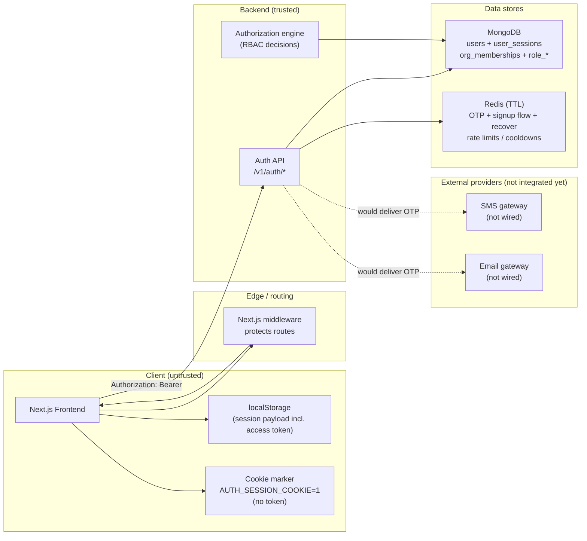
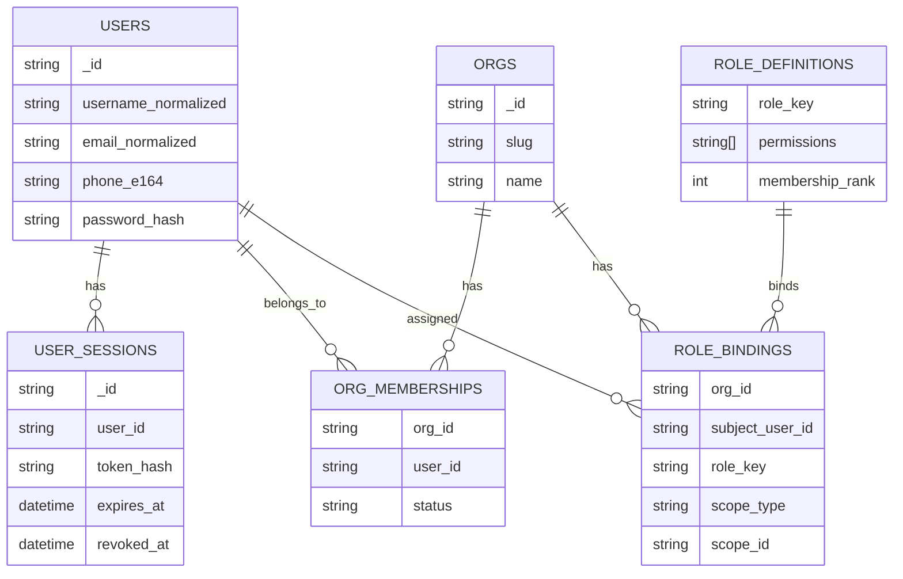

# Auth (One‑Pager)

**Audience:** stakeholders and reviewers who want the “big picture” of Authentication & Authorization in Delta Labs.

**Detailed version:** see `docs/auth-overview.md`.

---

## 1) What we built (today)

- **Authentication (AuthN)**: login/signup/recover + session issuance via `/v1/auth/*` using **bearer access tokens**.
- **Authorization (AuthZ)**: tenant-scoped permissions using **organization membership** + **RBAC** (roles → permissions).
- **Ephemeral security flows**: OTP + signup/recover state stored in **Redis with TTL + throttles**.

---

## 2) Architecture (trust boundaries + data stores)

**Key design decisions**

- **Bearer token in header, not cookies**: reduces classic CSRF exposure (browser won’t auto-attach `Authorization` cross-site).
- **Cookie marker is not a credential**: it only helps middleware do fast redirects; backend security never depends on it.
- **Mongo vs Redis split**: Mongo for durable identity/session/RBAC; Redis for **short-lived** OTP + flow state with TTL and throttles.

---

## 3) Data model (AuthZ is org-scoped)

**How AuthZ decisions work (one sentence):** must be an **active org member**, then RBAC roles are resolved into an effective permission set (including `"*"` for full access).

---

## 4) Security posture (what’s implemented vs next)

### Implemented protections (today)

- **Passwords**: hashed with **scrypt** + per-password salt.
- **Sessions**:
  - raw bearer token generated with `secrets`
  - server stores **only `token_hash`** (not raw token)
  - sessions have `expires_at` and are invalid after expiry (TTL cleanup in Mongo is eventual)
- **OTP / recovery**:
  - OTP stored in Redis as **hash**, with TTL
  - resend cooldown + attempt limits + per-IP throttles
  - recovery request uses **anti-enumeration** behavior for unknown identities
  - password reset revokes **all sessions**
- **CSRF**:
  - backend auth uses `Authorization: Bearer …` (not cookie auth)
  - cookie marker is not used as backend credential

### Not implemented yet (important accuracy notes)

- **OTP delivery providers**: no real email/SMS gateway integration is wired in yet (only state + debug code in `local`).
- **Login brute-force throttling**: OTP/recover throttle exists; login should also be rate-limited (recommended next).
- **Central “revalidate session on boot”**: frontend currently hydrates from storage; a `/v1/auth/session` validation step can be added.

---

## 5) Where to verify in the repo

- **Big picture (detailed)**: `docs/auth-overview.md`
- **Backend routes**: `deltalabs-backend/app/api/v1/auth.py`
- **Password/token primitives**: `deltalabs-backend/app/core/security.py`
- **OTP / recover / signup flow**:
  - `deltalabs-backend/app/domain/identity/verification_service.py`
  - `deltalabs-backend/app/domain/identity/recover_service.py`
  - `deltalabs-backend/app/domain/identity/signup_flow_service.py`
- **AuthZ engine (RBAC)**: `deltalabs-backend/app/domain/authorization/service.py`
- **Frontend session provider + middleware**:
  - `deltalabs-frontend/src/contexts/AuthSession_Context.tsx`
  - `deltalabs-frontend/middleware.ts`

