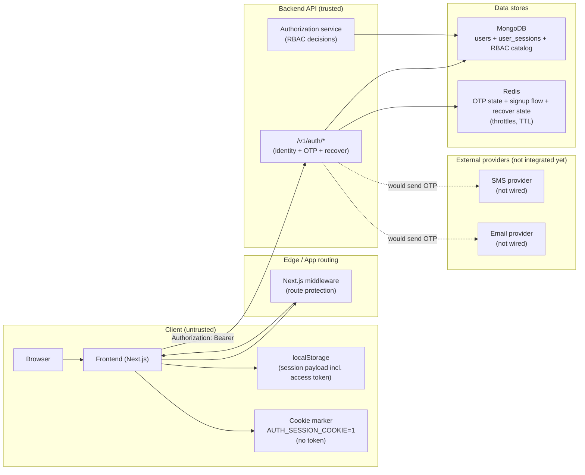
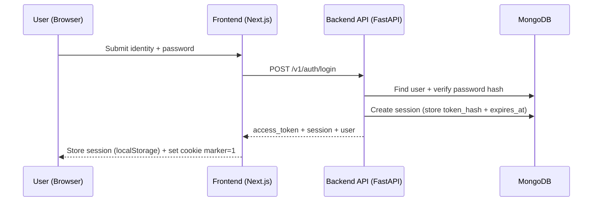
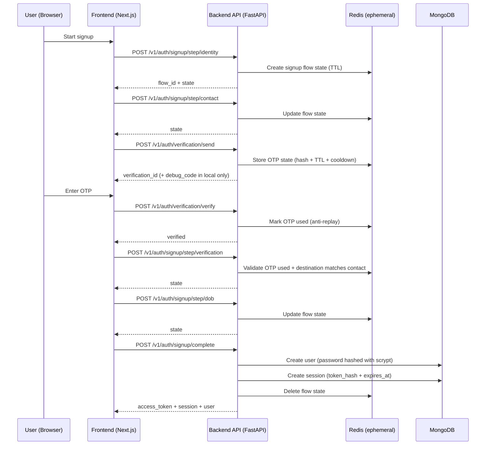
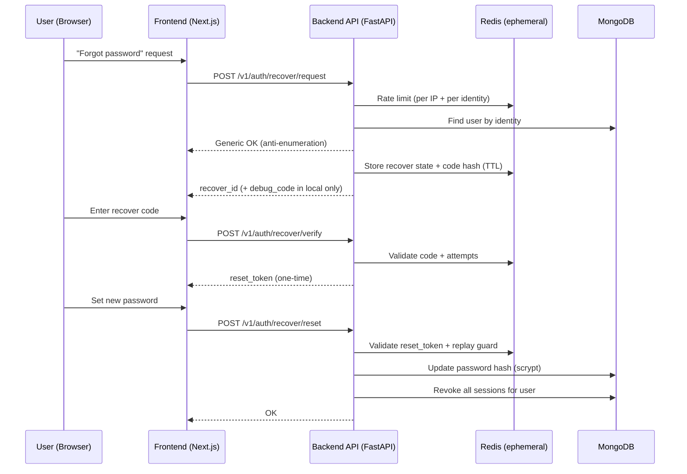

# Authentication & Authorization (Stakeholder Overview)

This document explains **how Delta Labs handles sign-in, sessions, and permissions**, without requiring you to read the code.

If you only read one thing:

- **Authentication** (AuthN): “Who are you?” → handled by `/v1/auth/*` and a bearer access token.
- **Authorization** (AuthZ): “What can you do?” → handled by org membership + RBAC roles/permissions.

---

## Why these frameworks & packages (and why we chose them)

This is the “what we use + why” section stakeholders typically ask for.

### Backend (Python)

- **FastAPI**
  - **What it does**: HTTP API framework for the `/v1/auth/*` endpoints.
  - **Why**: Type-driven request/response contracts, strong ecosystem, and good async performance for IO-heavy services.
- **Motor (MongoDB async driver)**
  - **What it does**: Stores durable identity records (`users`) and sessions (`user_sessions`).
  - **Why**: Async Mongo access matches FastAPI concurrency, and Mongo is a good fit for evolving product documents.
- **redis.asyncio (+ hiredis)**
  - **What it does**: Short-lived state for OTP, signup flow state, recovery flows, idempotency and throttling.
  - **Why**: Built for TTL-based ephemeral data and rate-limiting primitives.
- **pydantic-settings**
  - **What it does**: Strict, typed environment configuration.
  - **Why**: Reduces “misconfigured env” risk; improves deploy safety.
- **Security primitives (standard library)**
  - **Passwords**: **scrypt** hashing (via Python stdlib `hashlib.scrypt`) with per-password random salt.
  - **Session tokens**: opaque random tokens issued with `secrets`, stored server-side as **SHA-256 hash** only.
  - **Why**: Strong baseline security without external crypto dependencies; easy to audit.

### Frontend (TypeScript)

- **Next.js (App Router)**
  - **What it does**: UI + routing + middleware gate for protected pages.
  - **Why**: Production-grade routing and middleware; good DX and deployment story.
- **TanStack React Query**
  - **What it does**: Manages API calls and caches server state.
  - **Why**: Consistent mutation/query patterns, retries, caching, and invalidation logic.
- **Redux Toolkit**
  - **What it does**: Global client-side UI state (not the auth token itself).
  - **Why**: Predictable state management for cross-route UI behaviors.
- **Fetch-based API client**
  - **What it does**: Centralizes `Authorization: Bearer <token>`, request IDs, and error normalization.
  - **Why**: One safe place to enforce token attachment + consistent error UX.

---

## What exists today (scope)

### Implemented (today)

- **Login / signup / session / logout**
  - `POST /v1/auth/login`
  - `POST /v1/auth/signup/init` (direct signup path)
  - `GET /v1/auth/session`
  - `POST /v1/auth/logout`
- **Multi-step signup flow** (resumable)
  - `POST /v1/auth/signup/step/*`, `POST /v1/auth/signup/complete`, `GET /v1/auth/signup/state`
- **OTP verification** (email/SMS)
  - `POST /v1/auth/verification/send|verify|resend`
- **Account recovery** (forgot password)
  - `POST /v1/auth/recover/request|verify|reset`
- **RBAC authorization engine** (tenant-scoped)
  - Membership gate + role bindings + permissions catalog, plus a small relationship-based exception.
- **Frontend session handling**
  - Session persisted in browser storage; access token is attached to API calls.
  - Next.js middleware protects app routes using a lightweight “presence” cookie marker.

### Known gaps (explicitly not wired yet)

- Frontend does not centrally call `GET /v1/auth/session` to revalidate on boot; it hydrates from localStorage and relies on API failures to clear state.
- Frontend logout is not yet a single “global logout action” wired to `POST /v1/auth/logout`.
- Frontend signup currently uses the multi-step flow; it does not use `POST /v1/auth/signup/init`.

---

## Architecture at a glance

### Auth system architecture (components + trust boundaries)



**Design intent:**

- **Tokens stay out of cookies**: middleware uses a **presence marker** cookie; the real bearer token stays in client storage and is sent explicitly in the `Authorization` header.
- **Durable vs ephemeral split**: MongoDB stores identity + sessions + RBAC; Redis stores **TTL** state for OTP/signup/recover and throttling.
- **Provider integration is intentionally decoupled**: OTP “send” is implemented as state issuance + throttles; real SMS/email delivery is a separate adapter (not shipped yet).

### Backend responsibilities (FastAPI)

- **Identity domain** (`app/domain/identity/*`)
  - Creates users, verifies passwords, issues sessions (access tokens), revokes sessions
  - Owns signup/recover orchestration and OTP verification (Redis-backed)
- **Authorization domain** (`app/domain/authorization/*`)
  - Checks org membership
  - Resolves role bindings → role definitions → effective permissions

### Frontend responsibilities (Next.js)

- **Session UX & token storage**
  - Stores the session payload locally (incl. `accessToken` + `expiresAt`)
  - Adds `Authorization: Bearer <token>` to backend calls via a shared API client getter
- **Route protection**
  - Next.js middleware redirects unauthenticated users away from protected routes
  - Uses a **cookie marker** (not the token) so middleware can decide quickly

---

## Appendix: request flows (implementation detail)

These show how the implemented endpoints interact, but they are secondary to the architecture diagram above.

### Login (authenticate + establish session)



### Multi-step signup (resumable) + OTP verification



### Password recovery (request → verify → reset)



### Login flow

```text
Browser → POST /v1/auth/login (identity + password)
        ← access_token (raw) + session (expiry) + user (public profile)

Browser stores:
  - localStorage: full session payload (includes access_token)
  - cookie: "AUTH_SESSION_COOKIE=1" (presence marker only; no token)
```

### Session lookup

```text
Browser → GET /v1/auth/session  (Authorization: Bearer <token>)
Server  → hashes token → finds session by token_hash (Mongo)
        → returns session + user
```

### Logout

```text
Browser → POST /v1/auth/logout  (Authorization: Bearer <token>)
Server  → revokes session (by token_hash)
Browser → clears local session + cookie marker
```

---

## Session model (why it’s designed this way)

### What is stored where

- **Access token (raw)**: stored **only on the client** (localStorage).
- **Access token hash**: stored in MongoDB (`user_sessions.token_hash`) so the backend never needs to store the raw token.
- **Session expiry**: stored as `expires_at` in MongoDB with a **TTL index**, so expired sessions are deleted automatically by MongoDB over time.
- **Cookie marker (`AUTH_SESSION_COOKIE=1`)**: only answers “does a session exist in this browser?” so middleware can redirect quickly.

### Why hash tokens server-side

- If a database dump happened, attackers would not get usable raw tokens from the `token_hash` column alone.

### Why a cookie marker exists at all

Next.js middleware runs before React renders. We use a **cookie marker** so middleware can do a fast allow/redirect check without exposing tokens to cookies.

- **Security intent**: avoid putting bearer tokens into cookies where they can be sent automatically to servers and increase CSRF risk.
- **Trade-off**: middleware can only know “a session exists” (not whether the token is still valid). Full validity is enforced by the backend.

---

## OTP verification (email/SMS)

OTP is used for signup verification and recovery flows.

- **Implemented now**:
  - Generates a 6-digit OTP, stores **only a SHA-256 hash** in **Redis** with a TTL.
  - Enforces **resend cooldown**, **attempt limits**, and **per-IP throttling**.
  - Returns `destination_masked` and timing metadata.
  - Returns `debug_code` **only when** `env == "local"` (for development).
- **Not implemented yet**:
  - There is **no integration** in this repo that actually delivers the OTP via a real **email** or **SMS** provider.
  - Production delivery would require adding a provider adapter (e.g., email/SMS gateway) and wiring it into `send_code()`.

---

## Password recovery (forgot password)

High level:

1. **Request**: user submits an identifier → system sends OTP (anti-enumeration behavior for unknown users).
2. **Verify**: user submits OTP → system issues a one-time reset token.
3. **Reset**: user submits reset token + new password → system updates password and **revokes all sessions**.

Security intent:

- Makes account takeover harder by limiting OTP attempts and enforcing TTLs.
- Revoking sessions forces re-login everywhere after a password reset.

---

## Authorization (AuthZ): who can do what

AuthZ is tenant-based: permissions are evaluated within an **organization (org_id)**.

### Decision engine (simplified)

```text
1) Must be an ACTIVE member of the org (org_memberships)
2) Load role bindings for the request scope (and also org scope as fallback)
3) Load role definitions for those role keys
4) Union all permissions into an effective set
5) Allow if permission exists, or if role grants "*" (org_owner)
6) Special-case: student progress can be granted by relationship edges (parent/guardian/mentor)
```

### Roles and permissions

- A **role** is a named bundle of permissions (e.g. `org_admin`).
- A **binding** assigns a role to a user for a scope (org-wide or specific scope types).
- A request passes `org_id`, `scope_type`, `scope_id`, and `permission` into the engine.

Note: Some school-level concepts also exist separately (e.g. `school_memberships` with `school_owner`), but the core RBAC engine is **org-scoped**.

---

## Security choices (stakeholder-friendly)

- **No raw tokens in the database**: only hashes are stored.
- **Session expiry and cleanup**: TTL index automatically removes expired sessions.
- **Password policy enforcement**: signup and reset enforce a password policy (length + mixed case + digit).
- **Modern password hashing**: passwords are stored using **scrypt** with per-password salt.
- **Anti-enumeration** (recovery): unknown identities don’t reveal whether an account exists.
- **Rate limiting & throttling inputs**: OTP/recovery track IP and enforce cooldowns / attempt limits.
- **Server-side permission checks**: access is enforced on the backend; frontend gating is UX only.

---

## Threat model (what we protect against)

This section maps common auth threats to the **mitigations implemented in this repo today**.

### Token theft

**Threat:** An attacker obtains a user’s bearer token (e.g., stolen device, malicious extension, XSS).

**Mitigations implemented:**

- **Token-at-rest hardening (server-side)**: only **`token_hash`** is stored in Mongo (`user_sessions`), not the raw token.
- **Expiry**: sessions have `expires_at` and are invalid after expiry (Mongo TTL cleanup is eventual; validity is checked by lookup).
- **Revocation**: logout and password reset revoke sessions (password reset revokes **all** sessions for the user).
- **No token in cookies**: we do not store the bearer token in a cookie (reduces exposure to CSRF and automatic cookie sending).

**Residual risk / note:**

- If XSS occurs, any token stored in localStorage can be read. Preventing XSS is primarily a frontend hardening concern (CSP, safe rendering, dependency hygiene).

### Replay (OTP or reset flows)

**Threat:** Reusing a previously valid OTP / verification / reset artifact to take over an account.

**Mitigations implemented:**

- **Redis TTL**: OTP and recovery/signup flow state are short-lived.
- **Attempt limits + cooldown**: verification and recovery include resend cooldown and attempt limits.
- **One-time state transitions**: recovery verify issues a reset token only after OTP verification; flows guard against reuse (“already used” style states).

### Brute force (password guessing)

**Threat:** Trying many passwords against `POST /v1/auth/login`.

**Mitigations implemented:**

- **Password hashing**: scrypt slows offline attacks if password hashes are leaked.

**Not implemented yet (recommended next):**

- **Login rate limiting** (per IP / per identity) similar to OTP throttling. OTP/recover already capture IP and throttle, but login should also be rate-limited.

### Enumeration (does this account exist?)

**Threat:** Using recover/signup endpoints to learn whether a username/email/phone is registered.

**Mitigations implemented:**

- **Recovery anti-enumeration**: recover request returns a generic response for unknown identities (does not confirm existence).

**Not implemented / depends on endpoint:**

- Signup endpoints must balance UX (“this email is taken”) vs privacy. Where we explicitly report conflicts, that can leak existence by design.

### CSRF (Cross-Site Request Forgery)

**Threat:** A malicious site causes a victim’s browser to perform authenticated actions automatically.

**Why our design helps:**

- We use **bearer tokens in the `Authorization` header**, not cookies, for backend authentication. Browsers do not attach `Authorization` automatically cross-site, so classical CSRF is significantly reduced.
- The cookie used in the frontend (`AUTH_SESSION_COOKIE=1`) is a **presence marker only**; it is **not** an auth credential for backend APIs.

**Residual risk / note:**

- If you later add cookie-based backend auth, you must add CSRF defenses (SameSite, CSRF tokens, origin checks).

---

## Where to verify in the repo (for auditors / engineers)

- **Backend routes**: `deltalabs-backend/app/api/v1/auth.py`
- **Identity service (issue/verify/revoke sessions)**: `deltalabs-backend/app/domain/identity/service.py`
- **Authorization engine (RBAC)**: `deltalabs-backend/app/domain/authorization/service.py`
- **Frontend session provider**: `deltalabs-frontend/src/contexts/AuthSession_Context.tsx`
- **Frontend route middleware**: `deltalabs-frontend/middleware.ts`
- **Auth implementation report** (detailed checklist): `deltalabs-frontend/docs/auth-implementation-task-report.md`

