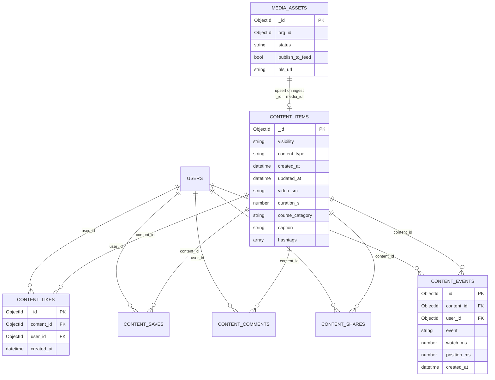
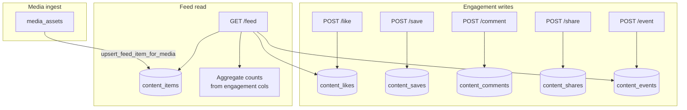

# Feed — Backend data model and collection diagrams

## Overview

Feed persistence splits into:

1. **`content_items`** — public read model for feed/search playback metadata
2. **Engagement collections** — likes, saves, comments, shares
3. **`content_events`** — telemetry for FYP signals
4. **`media_assets`** — upload/ingest lifecycle (source for feed upsert)
5. **`users`** — read-only for commenter display names

MongoDB holds durable state. Redis is **not** a source of truth for feed documents (idempotency + async only).

---

## Entity relationship (logical)



---

## Collection reference

### `content_items`

**Role:** Canonical feed card / clip document served by `GET /v1/feed`.

| Field | Type | Notes |
|-------|------|--------|
| `_id` | ObjectId | Content id (may equal `media_id` after ingest) |
| `visibility` | string | Feed queries require `"public"` |
| `content_type` | string | `video`, `audio`, … |
| `created_at` | datetime | Sort key (with `_id`) |
| `updated_at` | datetime | |
| `video_src` | string | Playback URL (HLS or fallback) |
| `duration_s` | number | Optional; filterable |
| `course_category` | string | `research` \| `lab` \| `course` |
| `media_tone` | number | Presentation metadata |
| `caption` | string | |
| `hashtags` | string[] | Used in affinity scoring |
| `pdf_label` | string | Optional resource link label |
| `like_count` | string | Legacy/demo; **live counts from engagement at read time** |

**Indexes** (`ContentRepository.ensure_indexes`):

```
ix_content_items_visibility_created_id  →  (visibility, created_at DESC, _id DESC)
ix_content_items_type_created           →  (content_type, created_at DESC)
```

**Cursor pagination:** opaque token encodes `(created_at, _id)` for stable descending pages.

---

### `content_likes` / `content_saves`

**Role:** Per-user toggles; unique pair enforces one row per user per item.

| Field | Type |
|-------|------|
| `_id` | ObjectId |
| `content_id` | ObjectId |
| `user_id` | ObjectId |
| `created_at` | datetime |

**Index:** unique `(content_id, user_id)`

**Behavior:** POST like/save **toggles** — second call removes row.

---

### `content_comments`

**Role:** Append-only thread.

| Field | Type |
|-------|------|
| `_id` | ObjectId |
| `content_id` | ObjectId |
| `user_id` | ObjectId |
| `body` | string |
| `created_at` | datetime |

**Index:** `(content_id, created_at)` — list chronological.

---

### `content_shares`

**Role:** Append-only share events (count = number of rows).

| Field | Type |
|-------|------|
| `_id` | ObjectId |
| `content_id` | ObjectId |
| `user_id` | ObjectId |
| `created_at` | datetime |

**Index:** `(content_id, created_at)`

---

### `content_events`

**Role:** FYP telemetry and ranking signals.

| Field | Type |
|-------|------|
| `_id` | ObjectId |
| `content_id` | ObjectId |
| `user_id` | ObjectId |
| `event` | string | `view_start`, `view_complete`, `skip`, `hide` |
| `watch_ms` | number | Optional |
| `position_ms` | number | Optional |
| `created_at` | datetime |

**Indexes:**

```
ix_content_events_user_created           →  (user_id, created_at)
ix_content_events_content_event_created  →  (content_id, event, created_at)
```

**Event semantics (ranking):**

| `event` | Ranking effect |
|---------|----------------|
| `hide` | Hard exclude + negative boost |
| `view_complete` | Positive; marks watched |
| `view_start` | Small positive |
| `skip` | Negative |
| (high `watch_ms`) | Bounded positive; watched if ≥ 25s |

---

### `media_assets`

**Role:** Upload pipeline; not queried by feed list directly.

| Field | Type | Notes |
|-------|------|--------|
| `_id` | ObjectId | Becomes `content_items._id` when published |
| `org_id` | ObjectId | Tenant scope |
| `owner_user_id` | ObjectId | |
| `status` | string | `upload_pending` → `ready` |
| `visibility` | string | Must be `public` for feed publish |
| `publish_to_feed` | bool | Gate for upsert |
| `caption`, `hashtags` | | Copied to feed item |
| `hls_url`, `upload_url_fallback` | string | Playback sources |
| `duration_seconds` | number | Not always copied to `content_items` today |

**Feed upsert trigger:** ingest callback with `status=ready` + flags above.

---

### `users` (read-only in feed)

Used when listing comments to resolve **display name** (`username`, `email`, or `phone_e164`).

---

## Data flow diagram (collections)



---

## Engagement snapshot at read time

Feed responses embed computed fields (not stored on `content_items`):

| Response field | Source |
|----------------|--------|
| `like_count`, `save_count`, `comment_count`, `share_count` | Aggregations |
| `liked_by_me`, `saved_by_me` | Existence in likes/saves for `user_id` |

---

## Seed and demo data

| Script | Purpose |
|--------|---------|
| `scripts/seed_public_feed_videos.py` | Insert demo `content_items` (video) |
| `scripts/seed_public_feed_audio.py` | Insert demo audio items |

Frontend may also use `MOCK_VIDEO_FEED` when debug env flag is set and API returns empty.

---

## Index bootstrap

Repositories expose `ensure_indexes` / `bootstrap_indexes` called during app startup or migrations — see `ContentRepository` and `EngagementRepository` in code.

---

## Design decisions (data layer)

| Decision | Why |
|----------|-----|
| Separate engagement collections | Clear toggles vs append-only; simple aggregates |
| Events collection for telemetry | High write volume; indexed per user for profile build |
| `content_items` as denormalized read model | Fast feed pages without joining media pipeline |
| Cursor on `(created_at, _id)` | Stable order under concurrent inserts |
| No blobs in Mongo | URLs point to CDN/object storage |
