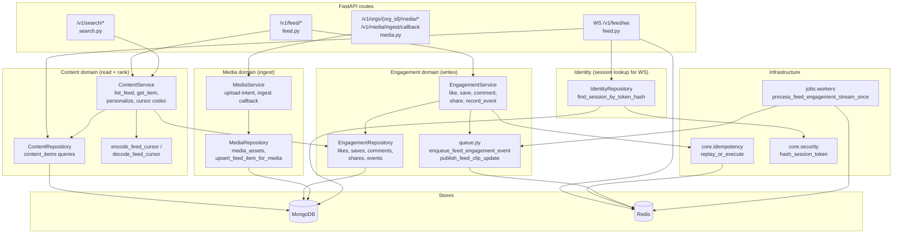
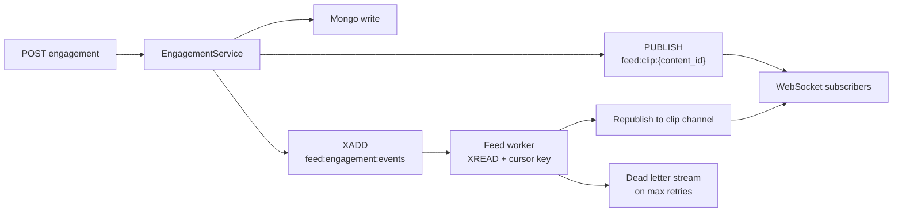
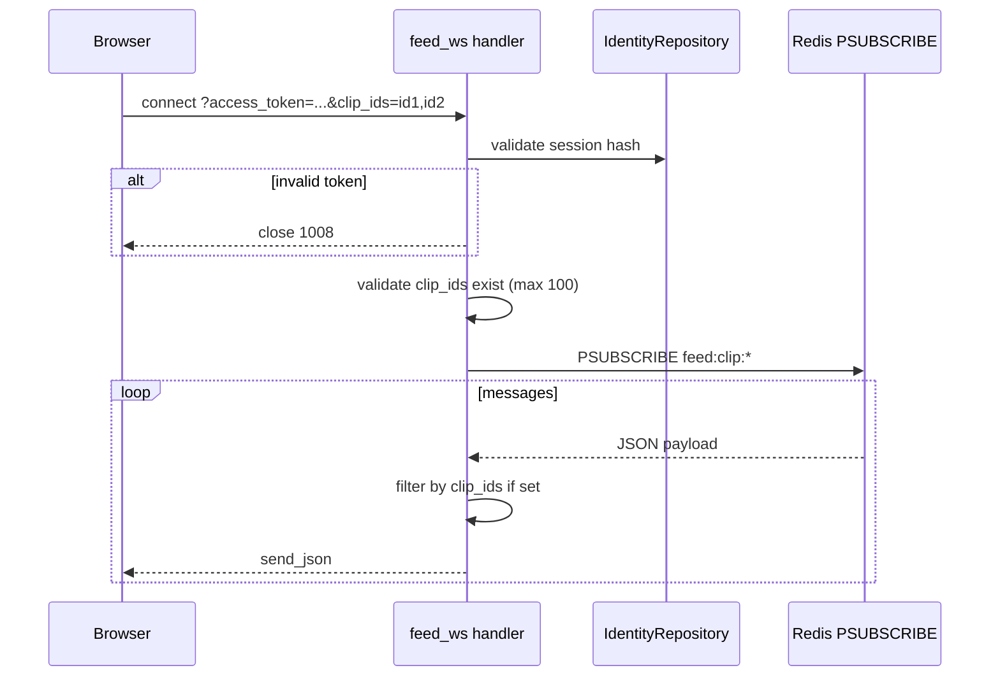

# Feed — Backend design (services, API, realtime)

## What this document covers

- FastAPI **route boundary** and dependency injection
- **Domain service** decomposition (content vs engagement vs media)
- **Redis** streams, Pub/Sub, idempotency
- **WebSocket** contract
- Service architecture diagram (copy-paste Mermaid)

**Evidence (code):**

- `deltalabs-backend/app/api/v1/feed.py`
- `deltalabs-backend/app/domain/content/service.py`
- `deltalabs-backend/app/domain/content/repository.py`
- `deltalabs-backend/app/domain/engagement/service.py`
- `deltalabs-backend/app/domain/engagement/repository.py`
- `deltalabs-backend/app/domain/engagement/queue.py`
- `deltalabs-backend/app/core/idempotency.py`
- `deltalabs-backend/app/jobs/workers.py`

---

## Service architecture diagram



---

## HTTP API surface

Base prefix: `/v1` (from app settings).

| Method | Path | Auth | Purpose |
|--------|------|------|---------|
| `GET` | `/feed` | Optional | Paginated feed; personalization when bearer present |
| `GET` | `/feed/{item_id}` | Public | Single public item + engagement snapshot |
| `POST` | `/feed/{item_id}/like` | Required | Toggle like |
| `POST` | `/feed/{item_id}/save` | Required | Toggle save (bookmark) |
| `POST` | `/feed/{item_id}/comment` | Required | Create comment |
| `GET` | `/feed/{item_id}/comments` | Public | List comments with display names |
| `POST` | `/feed/{item_id}/share` | Required | Record share |
| `POST` | `/feed/{item_id}/enroll` | Required | **Placeholder** enrollment |
| `POST` | `/feed/{item_id}/event` | Required | Telemetry: `view_start`, `view_complete`, `skip`, `hide` |
| `GET` | `/feed/telemetry/summary` | Public | Aggregated event stats (ops/debug) |
| `GET` | `/feed/worker/health` | Required | Redis stream lag / DLQ snapshot |
| `WS` | `/feed/ws` | `access_token` query | Realtime engagement fanout |

### Query parameters — `GET /feed`

| Param | Notes |
|-------|--------|
| `limit` | 1–50, default 12 |
| `cursor` | Opaque; invalid → validation error `feed_cursor_invalid` |
| `content_type` | e.g. `video`, `audio` |
| `hashtag` | Regex filter on tags |
| `course_category` | `research` \| `lab` \| `course` |
| `min_duration_s` / `max_duration_s` | Duration bounds |

---

## ContentService responsibilities

**Primary method:** `list_feed(user_id?, cursor, limit, filters…)`

1. `decode_feed_cursor` — validate pagination token.
2. `_build_signal_profile` (authenticated) — hashtag weights, event boosts, hidden/watched sets.
3. `list_public_items` — Mongo page with optional `exclude_content_ids`.
4. **Fallback** — if exclusion yields empty page, re-query without exclusions.
5. `_personalize_docs` — in-memory rerank (does not break cursor contract).
6. `_apply_engagement_snapshot_to_docs` — counts + `liked_by_me` / `saved_by_me`.
7. `encode_feed_cursor` — `next_cursor`, `has_more`.

**Single item:** `get_feed_item` — public lookup + engagement snapshot.

**Search helper:** `project_feed_items_with_engagement` — attach counts without full list/rank pipeline.

See [feed-ranking-algorithms.md](./feed-ranking-algorithms.md) for scoring detail.

---

## EngagementService responsibilities

| Action | Mongo | Side effects |
|--------|-------|--------------|
| Like / save | Toggle in `content_likes` / `content_saves` | Stream + Pub/Sub |
| Comment | Insert `content_comments` | Stream + Pub/Sub |
| Share | Insert `content_shares` | Stream + Pub/Sub |
| Event | Insert `content_events` | Stream + Pub/Sub (ranking input) |

All writes go through **`replay_or_execute`** when `Idempotency-Key` header is sent.

### Idempotency scopes

| Action | Redis scope pattern |
|--------|---------------------|
| Like | `like:{user_id}:{content_id}` |
| Save | `save:{user_id}:{content_id}` |
| Comment | `comment:{user_id}:{content_id}:{body_hash}` |
| Share | `share:{user_id}:{content_id}` |
| Event | `event:{user_id}:{content_id}:{event}` |

Key format: `idempotency:response:{sha256(scope + idempotency_key)}` with TTL (default 86400s).

---

## Redis pipeline



### Config keys (defaults)

| Setting | Default |
|---------|---------|
| `feed_engagement_stream_key` | `feed:engagement:events` |
| `feed_engagement_dead_letter_stream_key` | `feed:engagement:dead_letter` |
| `feed_engagement_pubsub_channel_prefix` | `feed:clip:` |
| Worker cursor | `feed:engagement:worker:last_id` |

---

## WebSocket design

**Endpoint:** `WS /v1/feed/ws`



**Outbound message shape:**

```json
{
  "content_id": "…",
  "user_id": "…",
  "action": "like_toggled | save_toggled | comment_created | shared | telemetry_event",
  "payload": { }
}
```

---

## Media → feed bridge

When ingest callback reports `status=ready`, `publish_to_feed=true`, and `visibility=public`:

- `MediaRepository.upsert_feed_item_for_media` upserts `content_items` with `_id = media_id`.
- Sets `video_src` from `hls_url` or fallback URL, `caption`, `hashtags`, `content_type=video`.

Feed read path does not read `media_assets` directly for listing — only `content_items`.

---

## Security

| Control | Implementation |
|---------|----------------|
| Session on writes | `get_current_user` dependency |
| Optional auth on read | `get_current_user_optional` |
| Idempotency | Prevents duplicate side effects on retries |
| Ingest callback | `X-Ingest-Secret` header |
| Org-scoped upload | `org_id` on upload-intent |
| WS auth | Session token hash lookup (not cookie) |

---

## Tests (backend)

| File | Focus |
|------|--------|
| `tests/test_feed_http.py` | HTTP shapes, 401, 404, filter validation |
| `tests/unit/test_feed_cursor.py` | Cursor encode/decode |
| `tests/unit/test_feed_personalization.py` | Ranking, hide, watched, shuffle |
| `tests/unit/test_media_service.py` | Ingest callback, feed upsert hook |

---

## Walkthrough (backend-only)

1. `GET /v1/feed` hits `ContentService.list_feed`.
2. Repository fetches `content_items` where `visibility=public`, sorted by `(created_at DESC, _id DESC)`.
3. If user is logged in, recent engagement + `content_events` build a signal profile; hidden/watched ids excluded.
4. Documents are scored and reranked in memory; engagement aggregates merged from engagement collections.
5. `POST /v1/feed/{id}/like` hits `EngagementService`; Mongo toggles like; Redis idempotency may return cached response; Pub/Sub notifies WS clients.
6. Background worker optionally drains Redis stream for durability/metrics (non-blocking for HTTP success path).
