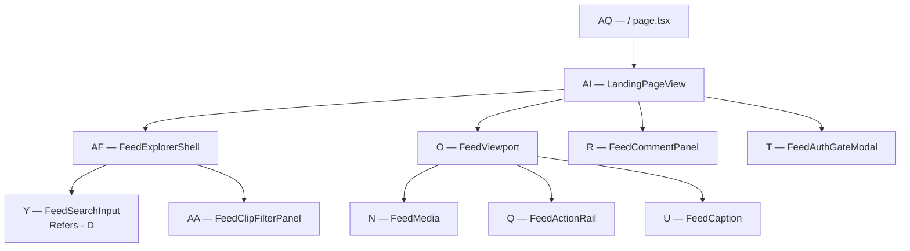

# Feed — Frontend component hierarchy (simple)

Layered breakdown of the **Feed web UI**, from **theme primitives** up to **App Router pages** — same *idea* as [frontend-auth-component-hierarchy-simple.md](../au-page/frontend-auth-component-hierarchy-simple.md) (bottom → top), but **without** renaming folders to things like `atoms/`, `molecules/`, or `organisms/`.

**Read left → right:** primitives → shared shell → feed components → module views → routes.

### Logical layers vs folders (important)

| Logical layer | What it means | Where it lives in code (unchanged) |
|---------------|---------------|-------------------------------------|
| **1 — Primitives** | Theme building blocks | `src/components/theme/*` |
| **2 — Shared shell** | Public chrome used by feed routes | `src/components/navigation/*` |
| **3 — Feed building blocks** | Small, reusable feed UI pieces | `src/components/features/feed/*.tsx` |
| **4 — Feed composites** | Larger feed UI assembled from layer 3 | `src/components/features/feed/master/*.tsx` |
| **5 — Module views** | Full screens + layout (`FeedExplorerShell`) | `src/modules/Feed/views/*` |
| **6 — App routes** | Next.js pages | `src/app/(public)/**/page.tsx` |

Refactors should **preserve markup and styles** (no visual change). Hierarchy is for **documentation and import direction** (primitives → feed → views), not for new directory names.

**Enforced in code:** see `deltalabs-frontend/src/components/features/feed/ARCHITECTURE.md` (`primitives.ts`, `master/` composites, `LandingClipSlide` / `LandingCommentSidebar` extracted from the view).

---

## Diagram (primitives → routes)

```mermaid
flowchart LR
  classDef layer fill:#f3f4f6,stroke:#111827,stroke-width:3px,rx:10,ry:10;
  classDef primitive fill:#eef2ff,stroke:#111827,stroke-width:2px,rx:8,ry:8;
  classDef shared fill:#f0fdf4,stroke:#111827,stroke-width:2px,rx:8,ry:8;
  classDef feature fill:#ffffff,stroke:#111827,stroke-width:2px,rx:8,ry:8;
  classDef view fill:#fff7ed,stroke:#111827,stroke-width:2px,rx:8,ry:8;
  classDef route fill:#ecfeff,stroke:#111827,stroke-width:2px,rx:8,ry:8;

  subgraph L1["Layer 1 — Theme primitives (A–G)"]
    direction TB
    A["A — Typography<br/>theme/Typography.tsx"]:::primitive
    B["B — Button<br/>theme/Button.tsx"]:::primitive
    C["C — Textarea<br/>theme/Textarea.tsx"]:::primitive
    D["D — SearchInput<br/>theme/SearchInput.tsx"]:::primitive
    E["E — Card<br/>theme/Card.tsx"]:::primitive
    F["F — cx<br/>theme/utils.ts"]:::primitive
    G["G — buttonStyles<br/>theme/buttonStyles.ts"]:::primitive
  end
  class L1 layer;

  subgraph L2["Layer 2 — Shared shell & cross-feature (H–L)"]
    direction TB
    H["H — PublicLayoutShell<br/>navigation/PublicLayoutShell.tsx"]:::shared
    I["I — TopNav + category tabs<br/>navigation/TopNav.tsx"]:::shared
    J["J — SearchVideoTile<br/>modules/Search/SearchResultsView.tsx"]:::shared
    K["K — AuthModalGateway<br/>features/auth (login from feed)"]:::shared
    L["L — PersistentAudioPlayer<br/>(audio detail context)"]:::shared
  end
  class L2 layer;

  subgraph L3["Layer 3 — Feed feature components (M–AF)"]
    direction TB
    subgraph L3A["Playback"]
      M["M — FeedCard"]:::feature
      N["N — FeedMedia"]:::feature
      O["O — FeedViewport<br/>Refers - M, N"]:::feature
      P["P — FeedOverlayGradient"]:::feature
    end
    subgraph L3B["Engagement"]
      Q["Q — FeedActionRail"]:::feature
      R["R — FeedCommentPanel<br/>Refers - B, C, A"]:::feature
      S["S — FeedShareSheet"]:::feature
      T["T — FeedAuthGateModal"]:::feature
    end
    subgraph L3C["Metadata"]
      U["U — FeedCaption<br/>Refers - A"]:::feature
      V["V — FeedHashtagList<br/>Refers - A"]:::feature
      W["W — CreatorIdentity<br/>Refers - A"]:::feature
      X["X — FeedResourceLink<br/>Refers - A"]:::feature
    end
    subgraph L3D["Discovery"]
      Y["Y — FeedSearchInput<br/>Refers - D"]:::feature
      Z["Z — FeedSearchSidebar<br/>Refers - D"]:::feature
      AA["AA — FeedClipFilterPanel<br/>Refers - A, F"]:::feature
      AB["AB — FeedFilterPanel<br/>Refers - A"]:::feature
      AC["AC — FeedFilterTrigger"]:::feature
    end
    subgraph L3E["UX / state UI"]
      AD["AD — FeedStatePanel<br/>Refers - A"]:::feature
      AE["AE — FeedSnapScrollControls"]:::feature
    end
  end
  class L3 layer;

  subgraph L4["Layer 4 — Module views & layout (AG–AP)"]
    direction TB
    AF["AF — FeedExplorerShell<br/>Refers - Y, AB, F"]:::view
    AG["AG — FeedLoadingState"]:::view
    AH["AH — FeedWorkerHealthDebugPanel"]:::view
    AI["AI — LandingPageView<br/>Refers - AF, O, Q–T, hooks, WS"]:::view
    AJ["AJ — AudioExplorerView<br/>Refers - AF, Y, AA"]:::view
    AK["AK — AudioDetailView<br/>Refers - L"]:::view
    AL["AL — FilterResultsView<br/>Refers - AF, AA, J"]:::view
    AM["AM — SearchResultsView<br/>Refers - AF, Z, J"]:::view
    AN["AN — ExploreAllView"]:::view
    AO["AO — AIExplorerView"]:::view
    AP["AP — SimulationHubView"]:::view
  end
  class L4 layer;

  subgraph L5["Layer 5 — App routes (AQ–AX)"]
    direction TB
    AQ["AQ — /<br/>page.tsx → AI"]:::route
    AR["AR — /audio → AJ"]:::route
    AS["AS — /audio/[id] → AK"]:::route
    AT["AT — /feed/filter → AL"]:::route
    AU["AU — /search → AM"]:::route
    AV["AV — /explore → AN"]:::route
    AW["AW — /ai → AO"]:::route
    AX["AX — /simulation → AP"]:::route
  end
  class L5 layer;

  L1 --> L2
  L2 --> L3
  L3 --> L4
  L4 --> L5
```

---

## Layer 1 — Theme primitives (used by Feed)

Each primitive has a letter so higher layers can say **Refers - A, B, …**.

| Letter | Primitive | Path |
|--------|-----------|------|
| **A** | `Typography` | `src/components/theme/Typography.tsx` |
| **B** | `Button` | `src/components/theme/Button.tsx` |
| **C** | `Textarea` | `src/components/theme/Textarea.tsx` |
| **D** | `SearchInput` | `src/components/theme/SearchInput.tsx` |
| **E** | `Card` | `src/components/theme/Card.tsx` |
| **F** | `cx` | `src/components/theme/utils.ts` |
| **G** | `buttonStyles` | `src/components/theme/buttonStyles.ts` |

**Note:** `FeedMedia`, `FeedActionRail`, and modals use mostly **custom markup + Tailwind** (and `lucide-react` icons), not Layer 1 directly.

---

## Layer 2 — Shared shell & cross-feature

Used by Feed but live outside `features/feed/`.

| Letter | Component | Path | Role |
|--------|-----------|------|------|
| **H** | `PublicLayoutShell` | `src/components/navigation/PublicLayoutShell.tsx` | Wraps all `(public)` routes |
| **I** | `TopNav` | `src/components/navigation/TopNav.tsx` | Video / Audio / AI / Simulation / All tabs |
| **J** | `SearchVideoTile` | `src/modules/Search/views/SearchResultsView.tsx` | Grid tile for filter + search |
| **K** | `AuthModalGateway` | `src/components/features/auth/master/AuthModalGateway.tsx` | `?auth=login\|signup` from landing |
| **L** | `PersistentAudioPlayer` | audio player context | `/audio/[id]` playback |

---

## Layer 3 — Feed feature components

**Root:** `src/components/features/feed/`  
**Barrel:** `src/components/features/feed/index.ts`

### Playback

| Letter | Component | File | Refers |
|--------|-----------|------|--------|
| **M** | `FeedCard` | `FeedCard.tsx` | — |
| **N** | `FeedMedia` | `master/FeedMedia.tsx` | — (native `<video>`, telemetry) |
| **O** | `FeedViewport` | `master/FeedViewport.tsx` | M, N, P |
| **P** | `FeedOverlayGradient` | `FeedOverlayGradient.tsx` | — |

### Engagement

| Letter | Component | File | Refers |
|--------|-----------|------|--------|
| **Q** | `FeedActionRail` | `FeedActionRail.tsx` | — |
| **R** | `FeedCommentPanel` | `master/FeedCommentPanel.tsx` | A, B, C + Feed hooks |
| **S** | `FeedShareSheet` | `master/FeedShareSheet.tsx` | — (portal + lucide) |
| **T** | `FeedAuthGateModal` | `master/FeedAuthGateModal.tsx` | — (portal + lucide) |

### Metadata (overlay copy)

| Letter | Component | File | Refers |
|--------|-----------|------|--------|
| **U** | `FeedCaption` | `FeedCaption.tsx` | A |
| **V** | `FeedHashtagList` | `FeedHashtagList.tsx` | A |
| **W** | `CreatorIdentity` | `CreatorIdentity.tsx` | A |
| **X** | `FeedResourceLink` | `FeedResourceLink.tsx` | A |

### Discovery (left rail)

| Letter | Component | File | Refers |
|--------|-----------|------|--------|
| **Y** | `FeedSearchInput` | `FeedSearchInput.tsx` | D |
| **Z** | `FeedSearchSidebar` | `FeedSearchSidebar.tsx` | D + Feed API search |
| **AA** | `FeedClipFilterPanel` | `master/FeedClipFilterPanel.tsx` | A, F → `/feed/filter` URL |
| **AB** | `FeedFilterPanel` | `master/FeedFilterPanel.tsx` | A (decorative chips) |
| **AC** | `FeedFilterTrigger` | `FeedFilterTrigger.tsx` | — |

### UX / feedback

| Letter | Component | File | Refers |
|--------|-----------|------|--------|
| **AD** | `FeedStatePanel` | `master/FeedStatePanel.tsx` | A |
| **AE** | `FeedSnapScrollControls` | `FeedSnapScrollControls.tsx` | — |

---

## Layer 4 — Module views & layout

**Root:** `src/modules/Feed/views/`

| Letter | View / layout | File | Refers |
|--------|---------------|------|--------|
| **AF** | `FeedExplorerShell` | `FeedExplorerShell.tsx` | Y, AB, F; slots for center / right |
| **AG** | `FeedLoadingState` | `features/layout/FeedLoadingState.tsx` | — |
| **AH** | `FeedWorkerHealthDebugPanel` | `features/layout/FeedWorkerHealthDebugPanel.tsx` | debug only |
| **AI** | `LandingPageView` | `LandingPageView.tsx` | AF, O, Q–T, Z, AA; **full engagement + WS** |
| **AJ** | `AudioExplorerView` | `AudioExplorerView.tsx` | AF, Y, AA; wrappers: `AudioHubView`, `AudioLibraryView` |
| **AK** | `AudioDetailView` | `AudioDetailView.tsx` | L, `useFeedItem` |
| **AL** | `FilterResultsView` | `FilterResultsView.tsx` | AF, AA, J |
| **AM** | `SearchResultsView` | `modules/Search/views/SearchResultsView.tsx` | AF, Z, J |
| **AN** | `ExploreAllView` | `ExploreAllView.tsx` | AF (static hub) |
| **AO** | `AIExplorerView` | `AIExplorerView.tsx` | AF (static shell) |
| **AP** | `SimulationHubView` | `SimulationHubView.tsx` | AF (static shell) |

### Data layer (used by views, not UI components)

| Piece | Path |
|-------|------|
| API client | `src/modules/Feed/api/index.ts` |
| React Query hooks | `src/modules/Feed/hooks/useFeedQueries.ts` |
| Query keys | `src/modules/Feed/hooks/feedQueryKeys.ts` |
| Redux | `src/store/feedUiSlice.ts` (`commentPanelOpen`) |
| i18n | `src/i18n/feedMessages.ts` → `useFeedMessages()` |
| Presenter / mocks | `src/modules/Feed/data/landingFeedPresenter.ts`, `mockVideoFeed.ts` |

---

## Layer 5 — App routes

| Letter | Route | Page file | Renders |
|--------|-------|-----------|---------|
| **AQ** | `/` | `app/(public)/page.tsx` | **AI** `LandingPageView` |
| **AR** | `/audio` | `app/(public)/audio/page.tsx` | **AJ** via `AudioHubView` |
| **AS** | `/audio/[id]` | `app/(public)/audio/[id]/page.tsx` | **AK** |
| **AT** | `/feed/filter` | `app/(public)/feed/filter/page.tsx` | **AL** |
| **AU** | `/search` | `app/(public)/search/page.tsx` | **AM** |
| **AV** | `/explore` | `app/(public)/explore/page.tsx` | **AN** |
| **AW** | `/ai` | `app/(public)/ai/page.tsx` | **AO** |
| **AX** | `/simulation` | `app/(public)/simulation/page.tsx` | **AP** |

**Layout for all above:** `app/(public)/layout.tsx` → **H** `PublicLayoutShell` → **I** `TopNav`.

---

## Composition example — video landing (`/`)

---

## Full vs partial integration

| Integration | Views |
|-------------|--------|
| **Full** (API + engagement + WS) | **AI** `LandingPageView` only |
| **List / browse** | **AJ**, **AL**, **AM**, **AK** |
| **Shell only** (no feed API) | **AN**, **AO**, **AP** |

---

## Related

- Detailed tree + export lists: [feed-frontend-component-hierarchy.md](./feed-frontend-component-hierarchy.md)
- User flows: [feed-user-flows.md](./feed-user-flows.md)
