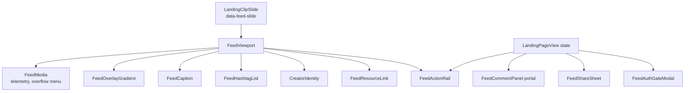
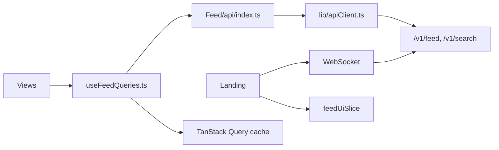

# Feed — Frontend component hierarchy (Web)

## Purpose

Complete **tree diagram** of Feed web UI from **theme primitives** → **shared shell** → **feed building blocks** → **feed composites** → **module views** → **App Router pages**, matching the *spirit* of [frontend-auth-component-hierarchy.md](../au-page/frontend-auth-component-hierarchy.md).

**Quick layered diagram (A–AX letter cards):** [feed-frontend-component-hierarchy-simple.md](./feed-frontend-component-hierarchy-simple.md)

**Folder policy:** Layers are **logical only**. We do **not** use `atoms/`, `molecules/`, or `organisms/` as directory names. Code stays under `components/features/feed/`, `components/features/feed/master/`, and `modules/Feed/views/`.

**Scope:** Feed + shared search/filter surfaces (Auth gateway referenced only where feed opens login).

**Source of truth (code):**

- Primitives: `deltalabs-frontend/src/components/theme/*`
- Feed UI: `deltalabs-frontend/src/components/features/feed/*`
- Views: `deltalabs-frontend/src/modules/Feed/views/*`
- Search (shared): `deltalabs-frontend/src/modules/Search/views/SearchResultsView.tsx`
- Navigation: `deltalabs-frontend/src/components/navigation/*`
- Data: `deltalabs-frontend/src/modules/Feed/api/index.ts`, `hooks/useFeedQueries.ts`
- State: `deltalabs-frontend/src/store/feedUiSlice.ts`
- i18n: `deltalabs-frontend/src/i18n/feedMessages.ts`
- App routes: `deltalabs-frontend/src/app/(public)/*`

---

## Big-picture UI architecture (bottom → top)

1. **Theme primitives** — `Typography`, `Button`, `Textarea`, `SearchInput`, `cx`, … (`components/theme/`)
2. **Shared shell** — `PublicLayoutShell`, `TopNav`, `SearchVideoTile`, `AuthModalGateway`
3. **Feed building blocks** — caption, card, search input, action rail, … (`features/feed/*.tsx`)
4. **Feed composites** — viewport, comment panel, filter panel, … (`features/feed/master/*.tsx`)
5. **Module views** — `FeedExplorerShell`, `LandingPageView`, … (`modules/Feed/views/*`)
6. **App routes** — `(public)/**/page.tsx` map URLs to views
7. **Data layer** (parallel) — React Query, API module, Redux `feedUiSlice`, WebSocket on landing

---

## Export surface

### `components/features/feed/index.ts`

Exports: `CreatorIdentity`, `FeedActionRail`, `FeedCard`, `FeedCaption`, `FeedCommentPanel`, `FeedAuthGateModal`, `FeedFilterPanel`, `FeedClipFilterPanel`, `FeedFilterTrigger`, `FeedHashtagList`, `FeedMedia`, `FeedOverlayGradient`, `FeedResourceLink`, `FeedSearchInput`, `FeedSearchSidebar`, `FeedShareSheet`, `FeedSnapScrollControls`, `FeedStatePanel`, `FeedViewport`.

### `modules/Feed/index.ts`

Re-exports views, hooks, types, API helpers used by pages.

---

## Tree diagram: primitives → feed components → views → routes

```mermaid
flowchart TB
  subgraph THEME["Theme primitives (components/theme/*)"]
    Typography["Typography"]
    Button["Button"]
    Textarea["Textarea"]
    SearchInput["SearchInput"]
    Utils["utils.cx"]
  end

  subgraph NAV["Shared navigation"]
    PublicLayoutShell["PublicLayoutShell"]
    TopNav["TopNav + TopNavCategoryTabs"]
    SearchVideoTile["SearchVideoTile"]
    AuthModalGateway["AuthModalGateway"]
  end

  subgraph FEED_BLOCKS["Feed building blocks & composites (features/feed/*)"]
    FeedCaption["FeedCaption"]
    FeedHashtagList["FeedHashtagList"]
    CreatorIdentity["CreatorIdentity"]
    FeedSearchInput["FeedSearchInput"]
    FeedClipFilterPanel["FeedClipFilterPanel"]
    FeedFilterPanel["FeedFilterPanel"]
    FeedCard["FeedCard"]
    FeedMedia["FeedMedia"]
    FeedViewport["FeedViewport"]
    FeedActionRail["FeedActionRail"]
    FeedCommentPanel["FeedCommentPanel"]
    FeedShareSheet["FeedShareSheet"]
    FeedAuthGateModal["FeedAuthGateModal"]
    FeedStatePanel["FeedStatePanel"]
    FeedSnapScrollControls["FeedSnapScrollControls"]
    FeedSearchSidebar["FeedSearchSidebar"]
  end

  subgraph FEED_SHELL["Feed module layout"]
    FeedExplorerShell["FeedExplorerShell"]
    FeedLoadingState["FeedLoadingState"]
  end

  subgraph FEED_VIEWS["Feed views (modules/Feed/views/*)"]
    LandingPageView["LandingPageView"]
    AudioExplorerView["AudioExplorerView"]
    AudioDetailView["AudioDetailView"]
    FilterResultsView["FilterResultsView"]
    SearchResultsView["SearchResultsView"]
    ExploreAllView["ExploreAllView"]
    AIExplorerView["AIExplorerView"]
    SimulationHubView["SimulationHubView"]
  end

  subgraph ROUTES["App routes (app/(public))"]
    RouteHome["/ → page.tsx"]
    RouteAudio["/audio"]
    RouteSearch["/search"]
    RouteFilter["/feed/filter"]
  end

  subgraph FEED_DATA["Data & state"]
    useFeedQueries["useFeedQueries"]
    feedApi["modules/Feed/api"]
    feedUiSlice["feedUiSlice"]
    feedWS["WebSocket /v1/feed/ws"]
  end

  Typography --> FeedCaption
  Typography --> FeedHashtagList
  Typography --> CreatorIdentity
  Typography --> FeedClipFilterPanel
  Typography --> FeedStatePanel
  SearchInput --> FeedSearchInput
  SearchInput --> FeedSearchSidebar
  Button --> FeedCommentPanel
  Textarea --> FeedCommentPanel
  Utils --> FeedExplorerShell
  Utils --> FeedClipFilterPanel

  FeedCard --> FeedViewport
  FeedMedia --> FeedViewport
  FeedSearchInput --> FeedExplorerShell
  FeedFilterPanel --> FeedExplorerShell
  FeedClipFilterPanel --> FeedExplorerShell

  FeedExplorerShell --> LandingPageView
  FeedExplorerShell --> AudioExplorerView
  FeedExplorerShell --> FilterResultsView
  FeedExplorerShell --> SearchResultsView
  FeedViewport --> LandingPageView
  FeedActionRail --> LandingPageView
  FeedCommentPanel --> LandingPageView
  FeedAuthGateModal --> LandingPageView
  FeedShareSheet --> LandingPageView
  SearchVideoTile --> FilterResultsView
  SearchVideoTile --> SearchResultsView

  PublicLayoutShell --> RouteHome
  TopNav --> RouteHome
  LandingPageView --> RouteHome
  AudioExplorerView --> RouteAudio
  FilterResultsView --> RouteFilter
  SearchResultsView --> RouteSearch

  useFeedQueries --> LandingPageView
  useFeedQueries --> AudioExplorerView
  feedApi --> useFeedQueries
  feedWS --> LandingPageView
  feedUiSlice --> LandingPageView
  AuthModalGateway --> LandingPageView
```

---

## `FeedExplorerShell` — shared grid

**File:** `modules/Feed/views/FeedExplorerShell.tsx`

| Slot | Default | Used by |
|------|---------|---------|
| `leftAside` | `FeedSearchInput` + filter slot | All explorers |
| `center` | (required) | Feed scroll, hub body, result grid |
| `rightAside` | optional | Landing worker debug |
| `afterGrid` | optional | `FeedSnapScrollControls` on landing |
| `expandMainToFullWidth` | false | Landing, filter, search, audio |
| `filterPanel` | `FeedFilterPanel` or `FeedClipFilterPanel` | Filter page uses clip filters |

Responsive: 2-column (expanded) or 3-column with right rail on `lg+`.

---

## View composition matrix

| View | FeedExplorerShell | Center | Data hooks | Engagement |
|------|-------------------|--------|------------|------------|
| **LandingPageView** | Custom search + `FeedClipFilterPanel` | Vertical snap slides × N | `useFeedClips`, mutations, WS | Full |
| **AudioExplorerView** | Search + clip filters | Episode cards | `useFeedClips(audio)` | None |
| **AudioDetailView** | — | Player + metadata | `useFeedItem` | None |
| **FilterResultsView** | Controlled `fp=1` | `SearchVideoTile` grid | `useFeedClips(URL)` | None |
| **SearchResultsView** | Shell + filters | Tabbed results | `fetchGlobalSearch` | None |
| **AIExplorerView** | Default | Static cards | — | None |
| **SimulationHubView** | Default | Static cards | — | None |
| **ExploreAllView** | Default | Module links | — | None |

---

## Landing clip slide (richest composition)

`LandingPageView` renders each clip roughly as:

**Parent-owned state (LandingPageView):**

- `activeClipId`, `hiddenClipIds`, like/save/share counts, `isFeedMuted`
- `useFeedEventMutation`, like/save/share/comment mutations
- WebSocket merge for realtime counts
- Redux: `commentPanelOpen`

---

## Component reference (by role)

### Playback & telemetry

| Component | File | Role |
|-----------|------|------|
| `FeedViewport` | `master/FeedViewport.tsx` | Wraps media + overlay children; passes `preloadStrategy`, `onFeedEvent` |
| `FeedMedia` | `master/FeedMedia.tsx` | `<video>`, play/pause, scrub, time badge, overflow (hide, report), emits telemetry |

### Engagement chrome

| Component | File | Role |
|-----------|------|------|
| `FeedActionRail` | `FeedActionRail.tsx` | Like, comment, save, share, goToCourse, profile |
| `FeedCommentPanel` | `master/FeedCommentPanel.tsx` | Thread + composer; `useFeedComments` / `useFeedCommentMutation` |
| `FeedShareSheet` | `master/FeedShareSheet.tsx` | Channel picker; parent records share |
| `FeedAuthGateModal` | `master/FeedAuthGateModal.tsx` | Prompt login/signup for gated actions |

### Metadata display

| Component | File | Role |
|-----------|------|------|
| `FeedCaption` | `FeedCaption.tsx` | Caption text |
| `FeedHashtagList` | `FeedHashtagList.tsx` | Tag chips |
| `CreatorIdentity` | `CreatorIdentity.tsx` | Creator row |
| `FeedResourceLink` | `FeedResourceLink.tsx` | PDF / resource link |
| `FeedOverlayGradient` | `FeedOverlayGradient.tsx` | Bottom gradient for readability |

### Discovery

| Component | File | Role |
|-----------|------|------|
| `FeedSearchInput` | `FeedSearchInput.tsx` | Search field + filter funnel |
| `FeedSearchSidebar` | `FeedSearchSidebar.tsx` | Typeahead overlay |
| `FeedClipFilterPanel` | `master/FeedClipFilterPanel.tsx` | Real API filters → URL |
| `FeedFilterPanel` | `master/FeedFilterPanel.tsx` | Decorative category chips |
| `FeedFilterTrigger` | `FeedFilterTrigger.tsx` | Standalone filter button |

### UX helpers

| Component | File | Role |
|-----------|------|------|
| `FeedSnapScrollControls` | `FeedSnapScrollControls.tsx` | Prev/next on snap feed |
| `FeedStatePanel` | `master/FeedStatePanel.tsx` | Error / empty |
| `FeedCard` | `FeedCard.tsx` | Generic card wrapper (hubs) |
| `FeedLoadingState` | `features/layout/FeedLoadingState.tsx` | Loading skeleton |
| `FeedWorkerHealthDebugPanel` | `features/layout/FeedWorkerHealthDebugPanel.tsx` | Dev worker health |

### Search module (shared tile)

| Component | File | Role |
|-----------|------|------|
| `SearchVideoTile` | `modules/Search/...` | Grid tile for filter + search results |

---

## Data layer diagram

### Hooks (`modules/Feed/hooks/useFeedQueries.ts`)

| Hook | Purpose |
|------|---------|
| `useFeedClips` | List with filter selection |
| `useFeedInfiniteQuery` | Cursor pages (not used on landing yet) |
| `useFeedItem` | Single clip |
| `useFeedComments` | Comment thread |
| `useFeedLikeMutation` / `Save` / `Share` / `Comment` / `Event` / `Enroll` | POST engagement |
| `useFeedWorkerHealth` | Debug polling |
| `useFeedTelemetrySummary` | Ops summary |

### Presenters & mocks

| File | Role |
|------|------|
| `data/mockVideoFeed.ts` | Local debug clips |
| `data/landingFeedPresenter.ts` | API DTO → UI clip model |
| `types/feedClipFilters.ts` | URL ↔ filter model |

---

## i18n

`useFeedMessages()` from `LocaleContext` supplies `browseCategories` labels (nav tabs, search sidebar, search results, filters). Auth copy remains in `useAuthMessages()`.

---

## Entry points (pages → views)

| Page file | View |
|-----------|------|
| `app/(public)/page.tsx` | `LandingPageView` |
| `app/(public)/audio/page.tsx` | `AudioHubView` |
| `app/(public)/audio/library/page.tsx` | `AudioLibraryView` |
| `app/(public)/audio/[id]/page.tsx` | `AudioDetailView` |
| `app/(public)/feed/filter/page.tsx` | `FilterResultsView` |
| `app/(public)/search/page.tsx` | `SearchResultsView` |
| `app/(public)/explore/page.tsx` | `ExploreAllView` |
| `app/(public)/ai/page.tsx` | `AIExplorerView` |
| `app/(public)/simulation/page.tsx` | `SimulationHubView` |

---

## Related docs

- Simple layered diagram: [feed-frontend-component-hierarchy-simple.md](./feed-frontend-component-hierarchy-simple.md)
- User journeys: [feed-user-flows.md](./feed-user-flows.md)
- System architecture: [feed-system-architecture.md](./feed-system-architecture.md)
