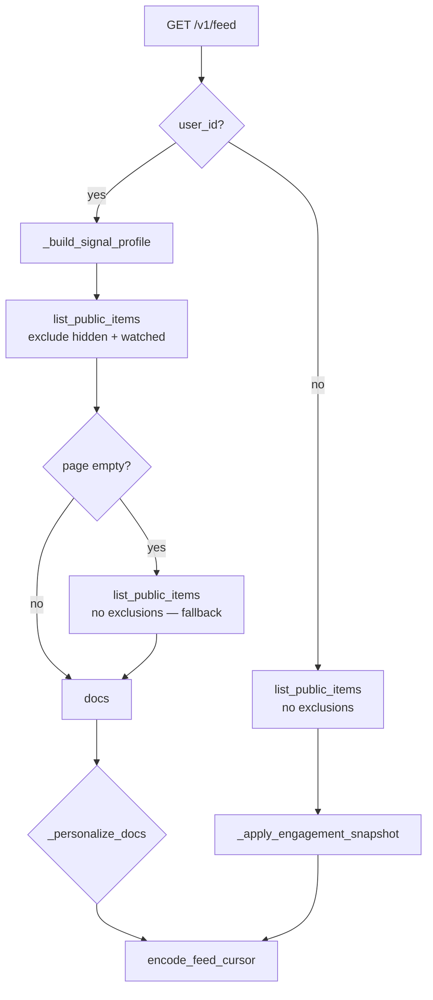

# Feed — Ranking and personalization algorithms

## Summary

Delta Labs FYP ranking today is a **heuristic, in-memory rerank** over a **cursor-paginated Mongo candidate page** — not an ML model. It is designed to:

- Personalize when signals exist (logged-in users)
- Stay **deterministic** per user/page (stable UX, testable)
- **Never return an empty feed** solely because of hide/watched filters when inventory is low

**Implementation:** `deltalabs-backend/app/domain/content/service.py`  
**Tests:** `deltalabs-backend/tests/unit/test_feed_personalization.py`

---

## Pipeline overview



---

## Step 1 — Candidate retrieval

**Method:** `ContentRepository.list_public_items`

- Filter: `visibility = public`
- Optional: `content_type`, `hashtag`, `course_category`, duration bounds
- Sort: `created_at DESC`, `_id DESC`
- Page size: `limit` (default 12)
- **Exclusion list** (authenticated): `hidden_ids ∪ watched_ids` from signal profile

**Fallback:** If the excluded query returns **zero** documents, repeat **without** exclusions.

---

## Step 2 — Signal profile

**Method:** `_build_signal_profile(user_id)` → `_SignalProfile`

| Signal | Source | Used for |
|--------|--------|----------|
| Hashtag weights | Recent engaged items (likes/saves/comments/shares, up to ~120) | Affinity score |
| Event boosts | Recent `content_events` | Per-item boost/penalty |
| `hidden_ids` | `hide` events | Hard skip in rerank + Mongo exclusion |
| `watched_ids` | `view_complete` or `watch_ms ≥ 25000` | Mongo exclusion |

### Hashtag affinity

**Method:** `_build_hashtag_weights`

1. Load tags from items the user recently engaged with.
2. Normalize to weights (higher weight for more recent engagement).
3. At score time: overlap between item `hashtags` and user weights → `hashtag_score ∈ [0, 1]`.

### Event boosts

**Method:** `_event_boosts_hidden_and_watched`

| Event | Boost | Side effect |
|-------|-------|-------------|
| `hide` | `-1.0` | Add to `hidden_ids` |
| `view_complete` | `+0.35` | Add to `watched_ids` |
| `view_start` | `+0.07` | |
| `skip` | `-0.22` | |
| `watch_ms` | up to `+0.15` = `min(watch_ms/60000, 0.15)` | `watched_ids` if `watch_ms ≥ 25000` |

---

## Step 3 — Score and rerank

**Method:** `_personalize_docs`

For each candidate document (skip if in `hidden_ids`):

```
score = 0.50 * recency_score
      + 0.28 * hashtag_score
      + 0.17 * event_boost[item_id]
      + 0.05 * seeded_jitter
```

### Recency score

Derived from `created_at` relative to page candidates (newer → higher within the page window).

### Seeded jitter

**Method:** `_seeded_unit_interval(seed)`

- `seed = f"{user_id}:{content_type}:{cursor_token}:{item_id}"`
- Deterministic pseudo-random in `[0, 1]` — breaks ties without changing page-to-page cursor semantics.

### Sort order

1. `score` DESC  
2. `created_at` DESC  
3. `_id` DESC  

### Acceptance rule

If `len(ranked) >= max(3, len(docs) // 2)` → return **ranked** list.  
Else → **`_stable_user_shuffle`** (cold / weak signals).

---

## Step 4 — Cold-start shuffle

**Method:** `_stable_user_shuffle(docs, user_id, cursor_token)`

Used when:

- User has **no** meaningful hashtag/event signals, or
- Too few documents pass the ranking threshold

**Algorithm:**

1. `seed_text = f"{user_id}:{cursor_token or 'first'}"`
2. `seed = int(sha256(seed_text).hexdigest()[:16], 16)`
3. `random.Random(seed).shuffle(docs)`

**Properties:**

| Property | Behavior |
|----------|----------|
| Same user + same cursor page | Same order (stable pagination) |
| Different users | Different permutations |
| Next cursor | New seed input → new order for that page |

---

## Anonymous users

No signal profile → **no exclusions**, **no rerank** (repository order only) + engagement snapshot if ever extended.

---

## Pagination contract

**Important:** Personalization runs **inside** each cursor page only. The opaque `cursor` still reflects Mongo `(created_at, _id)` — rerank does not rewrite global ordering across pages.

**Frontend note:** Landing page currently fetches **first page only**; infinite scroll cursor is not wired in UI yet.

---

## Algorithm decision log

| Decision | Alternatives considered | Why we chose this |
|----------|-------------------------|-------------------|
| Heuristic weighted blend | ML ranker, pure recency | Low inventory, fast iteration, explainable |
| In-memory rerank per page | Precomputed user feeds | Simpler ops; good enough at current scale |
| Deterministic jitter + shuffle | Random per request | Avoids flicker; reproducible tests |
| Exclude watched/hidden at query | Only downrank | Stronger “don’t show again”; with empty fallback |
| Empty-page fallback | Show nothing | MVP must not blank feed for early adopters |
| Toggle likes/saves | Count-only | Standard UX; idempotent retries |
| Telemetry in Mongo | Stream-only analytics | Durable signals for profile without separate warehouse yet |
| Redis stream + Pub/Sub | WS-only from HTTP | Durability path + multi-subscriber fanout |

---

## Future phases (not implemented)

Documented in `BACKEND_FEED_FYP_ARCHITECTURE.md`:

- Creator affinity, diversity constraints, exploration quota
- Feature store + batch jobs
- ML model serving with A/B tests
- Moderation / trust scores

---

## Formula card (copy-paste)

```
recency_weight     = 0.50
hashtag_weight     = 0.28
event_weight       = 0.17
jitter_weight      = 0.05

score(doc) = recency_weight * recency(doc)
           + hashtag_weight * hashtag_affinity(user, doc)
           + event_weight   * event_boost[user, doc.id]
           + jitter_weight  * seeded_unit_interval(user, cursor, doc.id)

hide     → exclude from Mongo query + skip in rerank
watched  → exclude from Mongo query (view_complete or watch_ms ≥ 25000)
weak rank → stable_user_shuffle(sha256(user_id:cursor) seed)
empty page after exclude → re-fetch without exclude
```
