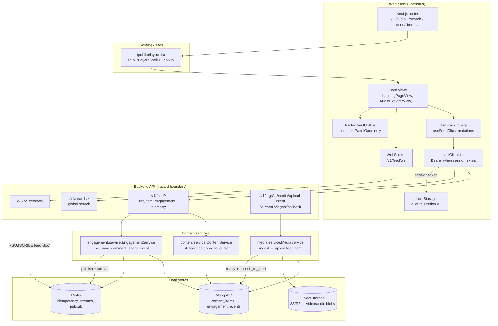
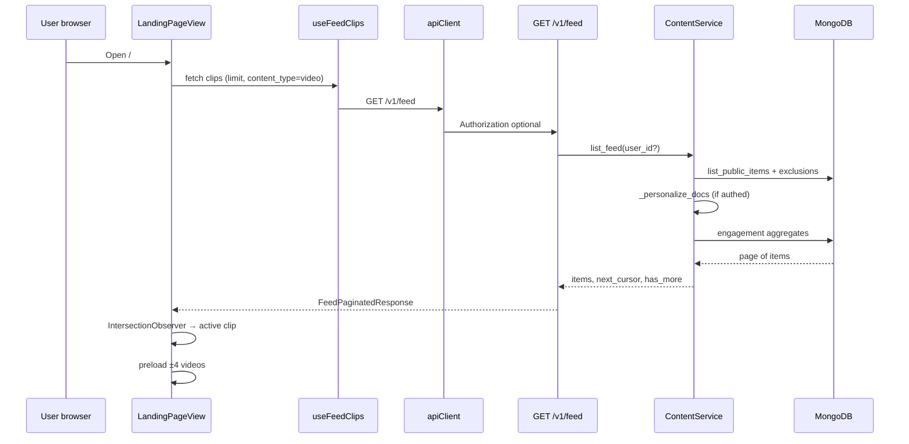
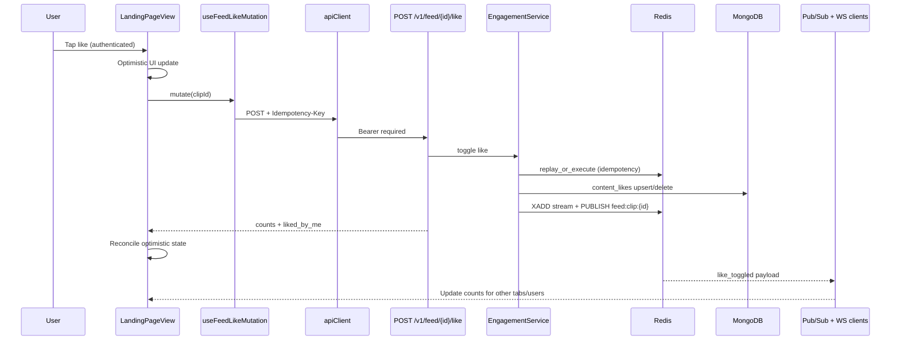
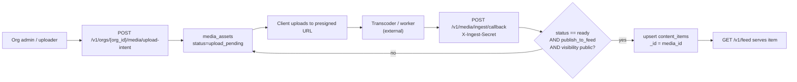

# Feed — System architecture (Web + Backend)

## Purpose

This document describes the **system-level** Feed architecture: how the public web client, backend API, data stores, and realtime layer work together for video/audio discovery, engagement, and personalization.

**Scope:** `deltalabs-frontend` + `deltalabs-backend` only.

---

## Architecture style (what we use)

| Layer | Choice | Rationale |
|-------|--------|-----------|
| **API** | REST (`/v1/feed`, `/v1/search`) + WebSocket (`/v1/feed/ws`) | Simple caching for reads; WS for live count updates on the landing feed |
| **Backend** | FastAPI + domain services (`content`, `engagement`, `media`) | Clear boundary: read/rank in content; writes in engagement |
| **Primary store** | MongoDB | Durable feed items, engagement, telemetry |
| **Ephemeral / async** | Redis | Idempotency cache, engagement stream, Pub/Sub fanout, worker cursor |
| **Frontend** | Next.js App Router + TanStack Query + minimal Redux | Server components for routes; client state for active clip, counts, comment panel |
| **Auth on feed** | Optional bearer on read; required on writes | Anonymous users browse; personalization and engagement need session |
| **Media** | Object storage + ingest callback → `content_items` | No video blobs in Mongo; playback URLs on feed documents |

---

## High-level system diagram

---

## Read path: load feed page

---

## Write path: like (representative engagement)

---

## Content ingestion → feed (school uploads)

---

## Frontend route map (public shell)

| Route | View | Feed API usage |
|-------|------|----------------|
| `/` | `LandingPageView` | Full FYP: clips, engagement, WS, telemetry |
| `/audio`, `/audio/library` | `AudioExplorerView` | `content_type=audio` list |
| `/audio/[id]` | `AudioDetailView` | `GET /v1/feed/{id}` |
| `/feed/filter` | `FilterResultsView` | Filtered `GET /v1/feed` from URL params |
| `/search` | `SearchResultsView` | `GET /v1/search` |
| `/explore`, `/ai`, `/simulation` | Hub shells | Mostly static UI (no feed list yet) |

TopNav category tabs link: Video → `/`, Audio → `/audio`, AI → `/ai`, Simulation → `/simulation`, All → `/explore`.

---

## Cross-cutting concerns

### Authentication

- **Read feed:** public; optional `Authorization: Bearer` enables personalization (exclude hidden/watched, rerank).
- **Write engagement / telemetry:** `401` without valid session.
- **WebSocket:** `access_token` query param validated against hashed session in Mongo.

### Resilience

- **Low inventory:** if hide/watched filters empty the page, backend re-lists without exclusions.
- **Cold start:** deterministic per-user shuffle when signal profile is weak.
- **Frontend offline:** mock local clips when `NEXT_PUBLIC_FEED_DEBUG_USE_LOCAL_VIDEOS_WHEN_EMPTY` and API empty (dev only).
- **Redis down:** idempotency/stream may degrade; HTTP writes still persist to Mongo; WS may be unavailable.

### Search vs feed

- **Feed list:** cursor pagination on `content_items`, optional filters (`hashtag`, `course_category`, duration, `content_type`).
- **Search:** separate `/v1/search` endpoint; shares filter navigation to `/feed/filter` on the web.

---

## Implemented vs not implemented (accuracy)

| Area | Status |
|------|--------|
| Video landing feed + engagement | Implemented |
| Audio list + detail | Implemented (list + single item) |
| Cursor pagination in landing UI | **Not wired** (first page only) |
| `POST …/enroll` | Backend placeholder; **no UI** |
| AI / Simulation / Explore hubs | **Shell UI** only |
| Go to Course rail action | **UI only** |
| Report content | **UI only** |
| ML ranking model | **Not implemented** (weighted heuristic today) |

---

## Walkthrough (one session)

1. User opens `/` — `PublicLayoutShell` renders TopNav + `LandingPageView`.
2. `useFeedClips` calls `GET /v1/feed`; backend returns public videos, personalized if logged in.
3. User scrolls snap-feed; `IntersectionObserver` sets active clip; `FeedMedia` emits `view_start` / `view_complete` / `skip` when authenticated.
4. User likes a clip — optimistic UI, `POST /v1/feed/{id}/like`, Redis idempotency, Mongo toggle, Pub/Sub updates WS subscribers.
5. User opens comments — Redux opens panel; `GET/POST` comments; realtime may bump count via WS.
6. User searches from left rail — navigates to `/search?q=…` or applies filters → `/feed/filter?…&fp=1`.
7. School uploads video — ingest callback upserts `content_items`; item appears on next feed read.
