# Feed — User flows (what users can do)

## Scope

User-visible flows on the **public web** feed experience: browsing, engagement, search, filters, and auth gates.  
**Fully wired** vs **shell-only** surfaces are labeled explicitly.

**Evidence:** `deltalabs-frontend/src/modules/Feed/views/*`, `src/modules/Search/views/SearchResultsView.tsx`

---

## Feature inventory

### Routes and surfaces

| Route | Surface | Feed API | Engagement |
|-------|---------|----------|------------|
| `/` | Video snap feed (`LandingPageView`) | Yes | **Full** |
| `/audio` | Audio hub grid | Yes (`audio`) | Browse only |
| `/audio/library` | Audio library grid | Yes | Browse only |
| `/audio/[id]` | Episode detail + player | Single item | Browse only |
| `/feed/filter` | Filtered clip grid | Yes (filtered) | Browse only |
| `/search` | Search results | `/v1/search` | Browse only |
| `/explore` | Module hub tiles | No | Navigation only |
| `/ai` | AI explorer cards | No | **Shell** |
| `/simulation` | Simulation hub | No | **Shell** |

### Actions on video landing (`/`)

| Action | Guest | Signed in | API |
|--------|-------|-----------|-----|
| Scroll / snap between clips | Yes | Yes | — |
| Play / pause / scrub video | Yes | Yes | — |
| Mute | Yes | Yes | — |
| Like | Gate modal | Yes | `POST …/like` |
| Save (bookmark) | Gate modal | Yes | `POST …/save` |
| Comment (read) | Yes | Yes | `GET …/comments` |
| Comment (post) | Gate modal | Yes | `POST …/comment` |
| Share | UI always | Count on share | `POST …/share` |
| Hide (“Not interested”) | Local hide | + `hide` event | `POST …/event` |
| View telemetry | No | Yes | `view_start`, `view_complete`, `skip` |
| Search (left rail) | Yes | Yes | Navigate → `/search` |
| Apply clip filters | Yes | Yes | Navigate → `/feed/filter?…` |
| Go to Course | UI | UI | **Not wired** |
| Report | UI | UI | **Not wired** |
| Login / Sign up from gate | Yes | — | `?auth=login\|signup` |

---

## Global navigation flow (categories)

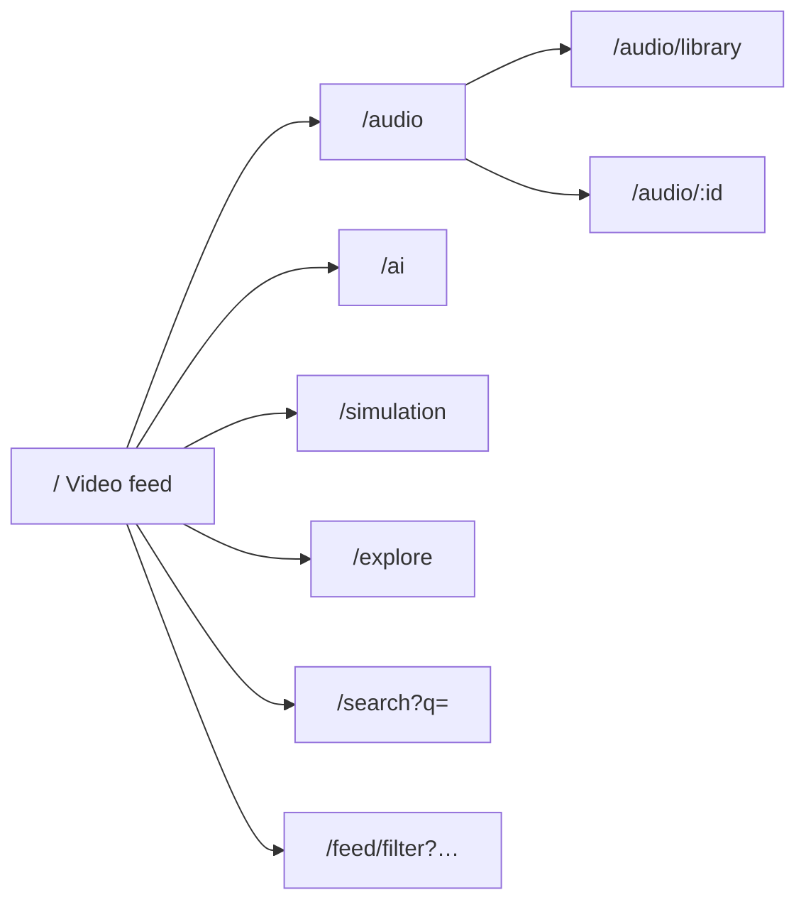

TopNav tabs switch category routes without losing the public shell (`PublicLayoutShell`).

---

## Flow 1 — Browse video feed (guest or signed in)

### User intent

“Watch short educational clips in a vertical feed.”

### Steps (numbered)

| Step | Actor | Action |
|------|-------|--------|
| **1** | User | Opens `/` (home video feed). |
| **2** | `LandingPageView` | Calls `GET /v1/feed` with `content_type=video`. |
| **3** | Backend | Returns paginated `items[]` (personalized if signed in). |
| **4** | `LandingPageView` | Renders vertical snap slides (`FeedViewport` × N). |
| **5** | User | Scrolls or uses arrow keys to move between clips. |
| **6** | `LandingPageView` | Sets `activeClipId` via `IntersectionObserver` on `[data-feed-slide]`. |
| **7** | `FeedMedia` | Preloads active index ±4 with `preload="auto"`; others `metadata`. |
| **8** | `FeedMedia` | *(Signed in only)* Sends `view_start`, `view_complete`, or `skip` to `POST …/event`. |

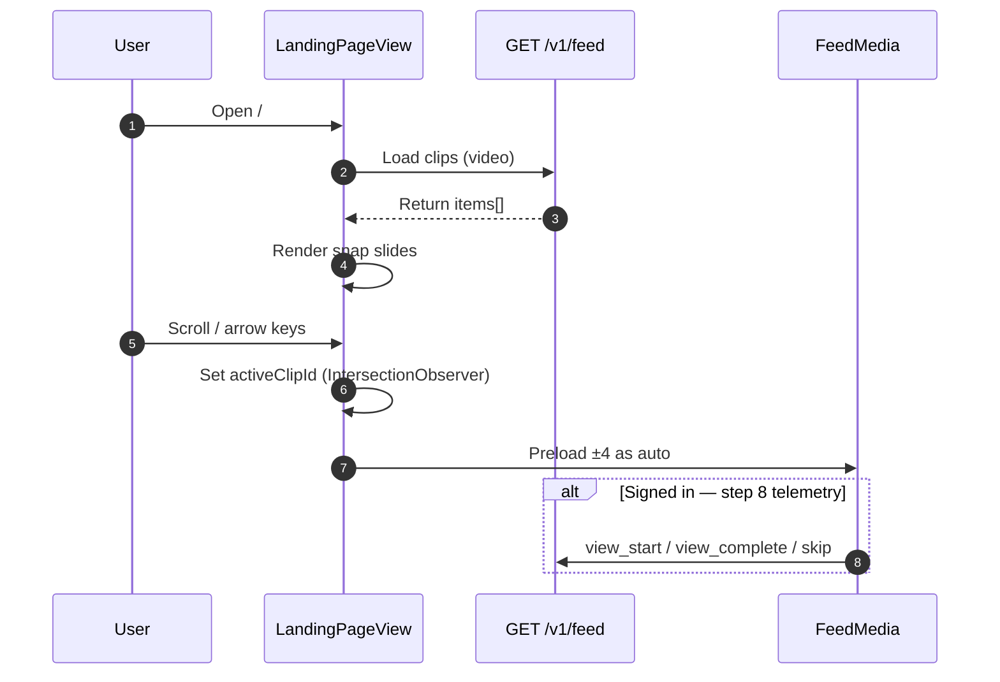

### Behaviors

1. **Loading / error / empty** — `FeedLoadingState`, `FeedStatePanel`, refetch on error.
2. **Hidden clips** — local `hiddenClipIds`; if all hidden, show full list again (non-destructive).
3. **Debug** — optional local mock videos when API empty (`NEXT_PUBLIC_FEED_DEBUG_*`).

---

## Flow 2 — Like / save (auth gated)

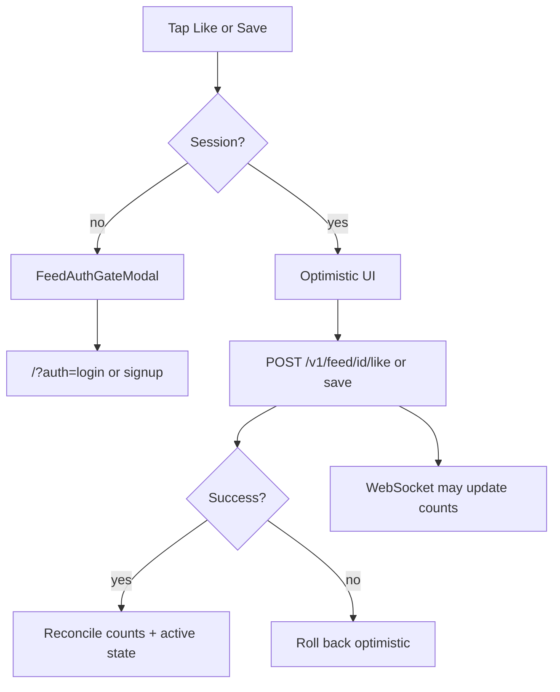

**Idempotency:** client sends `Idempotency-Key` per request (safe retries).

---

## Flow 3 — Comments

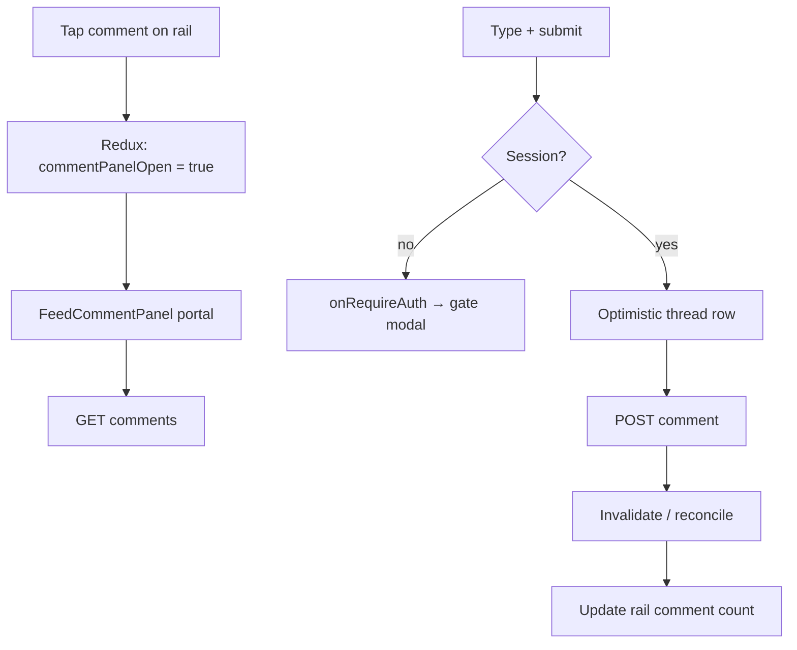

- **Escape** closes panel.
- **Realtime:** WS `comment_created` may bump count on landing.

---

## Flow 4 — Share

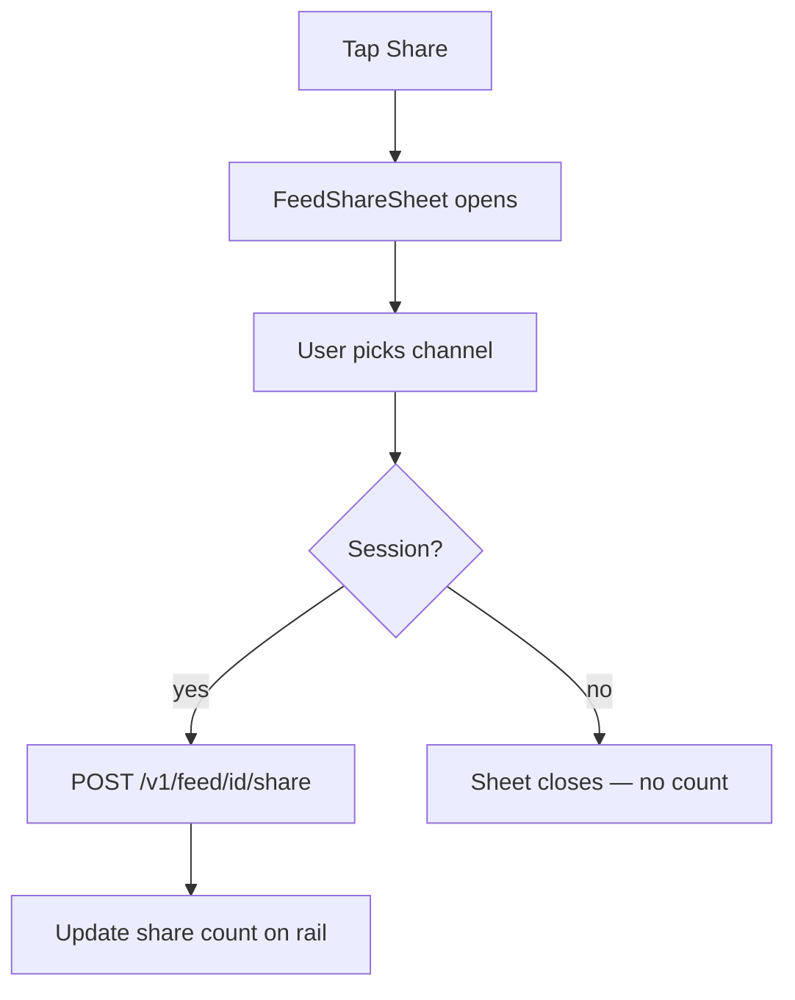

---

## Flow 5 — Hide / not interested

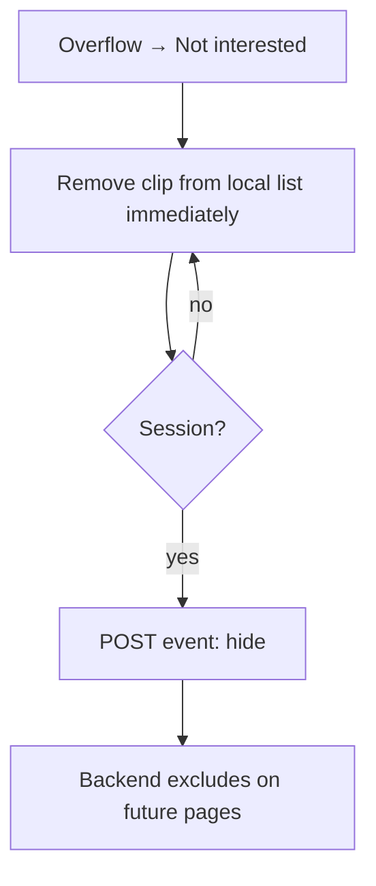

Guest users still get instant local removal; ranking exclusion requires signed-in telemetry.

---

## Flow 6 — Search

```mermaid
flowchart TD
  A[Type in left search field] --> B[FeedSearchSidebar typeahead]
  B --> C[fetchGlobalSearch preview]
  A --> D[Press Enter]
  D --> E["/search?q=…"]
  E --> F[SearchResultsView tabs: Top | Users]
  F --> G[Click result tile]
  G --> H[Navigate to clip or profile]
```

**Close search:** return to previous category (e.g. Video or Audio) via back control.

---

## Flow 7 — Filter clips

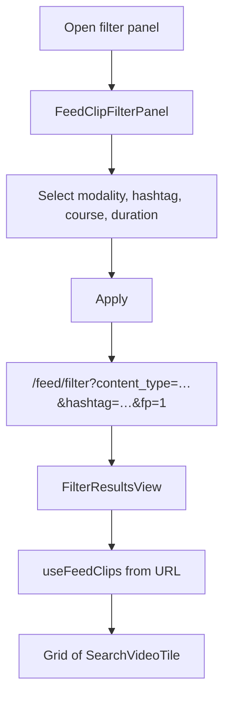

`FeedFilterPanel` (default category chips) is **decorative** — real filters use `FeedClipFilterPanel`.

---

## Flow 8 — Audio hub and detail

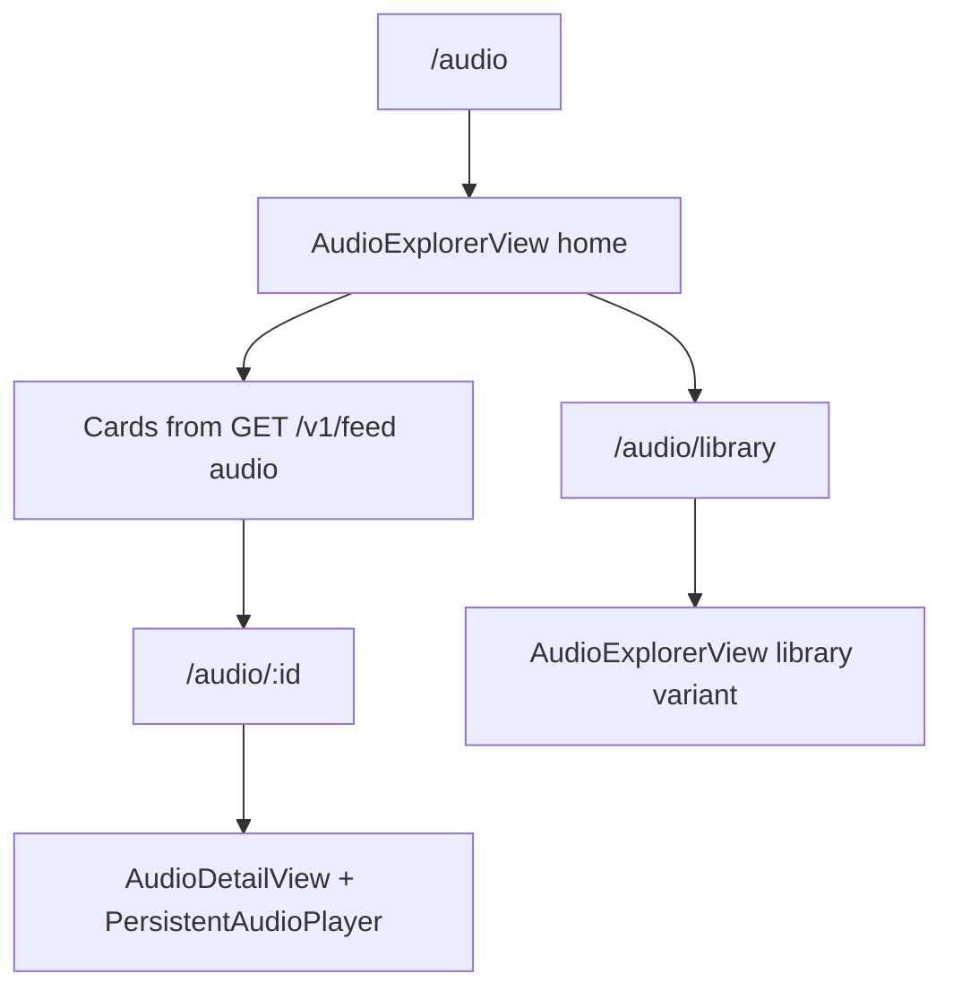

No like/comment rail on audio hub today — playback-focused.

---

## Flow 9 — Auth from feed

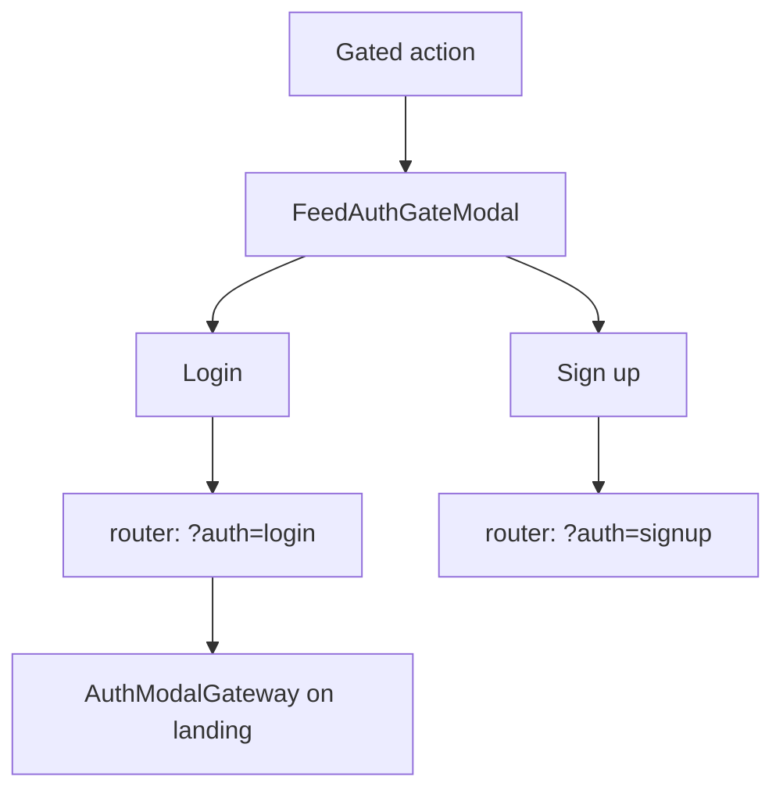

Same auth modal pattern as the rest of the public site.

---

## Flow 10 — Realtime updates (signed in, landing only)

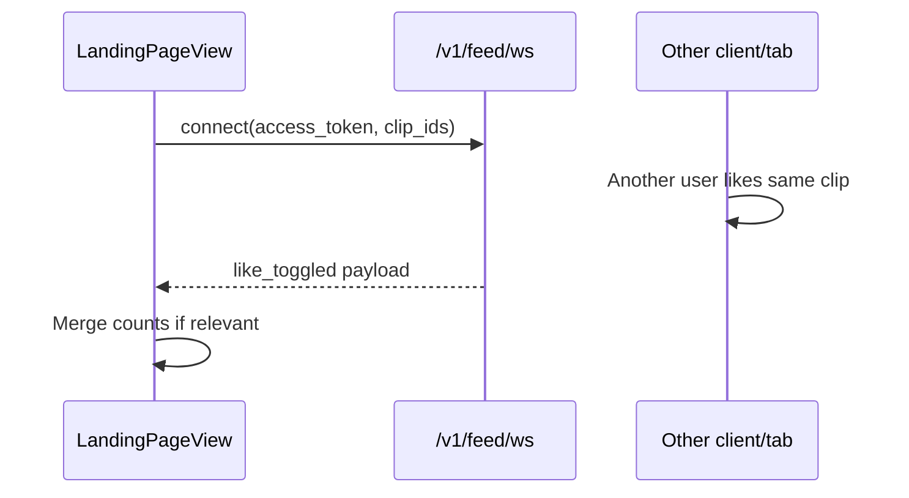

Actions handled: `like_toggled`, `save_toggled`, `comment_created`, `shared`.

---

## Shell-only flows (not wired to feed API)

| User action | Route | Current behavior |
|-------------|-------|------------------|
| Open AI models | `/ai` | Static cards |
| Open simulation scenarios | `/simulation` | Static cards |
| Pick module from Explore | `/explore` | Links to other routes |
| Enroll in course | Landing rail | Button present; **no API call** |

---

## User journey map (one diagram)

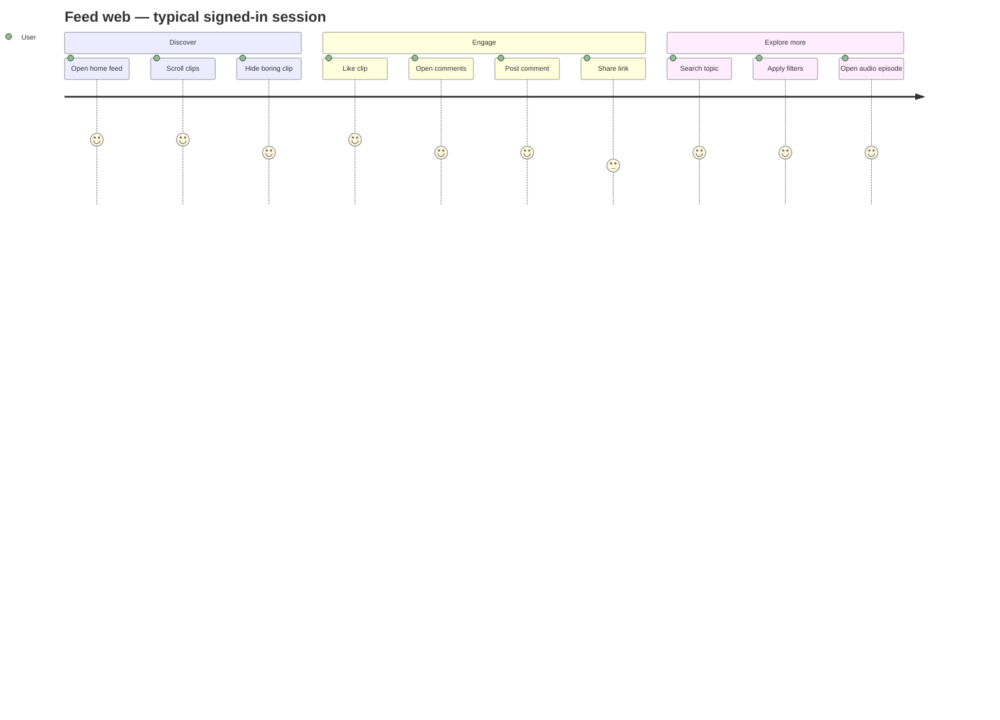

---

## Related docs

- System context: [feed-system-architecture.md](./feed-system-architecture.md)
- Ranking behind hide/watched: [feed-ranking-algorithms.md](./feed-ranking-algorithms.md)
- UI structure: [feed-frontend-component-hierarchy.md](./feed-frontend-component-hierarchy.md)


sequenceDiagram
  autonumber
  participant U as User (browser)
  participant LP as LandingPageView
  participant REST as POST /v1/feed/{id}/like
  participant Eng as EngagementService
  participant Mongo as MongoDB
  participant Redis as Redis Pub/Sub<br/>channel feed:clip:{id}
  participant WS as WS /v1/feed/ws
  participant Other as Other tab / user<br/>(optional)

  Note over LP,WS: Prerequisites — signed in, clips loaded on /

  LP->>WS: connect(?access_token, clip_ids)
  WS->>WS: Validate session + clip_ids (max 100)
  WS->>Redis: PSUBSCRIBE feed:clip:*

  alt User likes a clip (this tab)
    U->>LP: Tap Like
    LP->>LP: Optimistic UI (count + heart)
    LP->>REST: POST like + Idempotency-Key
    REST->>Eng: toggle like
    Eng->>Mongo: content_likes upsert/delete
    Eng-->>REST: { count, active }
    REST->>Redis: PUBLISH like_toggled payload
    REST-->>LP: HTTP 200 + counts
    LP->>LP: Reconcile optimistic state
  else Someone else engages (or other tab)
    Other->>REST: POST like / comment / share / save
    REST->>Eng: write engagement
    Eng->>Mongo: persist
    REST->>Redis: PUBLISH action payload
  end

  Redis-->>WS: message JSON
  WS->>WS: Filter by clip_ids subscription
  WS-->>LP: { content_id, user_id, action, payload }

  alt action = like_toggled
    LP->>LP: setLikeCounts(clipId, count)
    LP->>LP: setLikedByClip only if user_id = me
  else action = save_toggled
    LP->>LP: setSaveCounts + savedByClip if me
  else action = comment_created
    LP->>LP: setCommentCounts
  else action = shared
    LP->>LP: setShareCounts
  end
