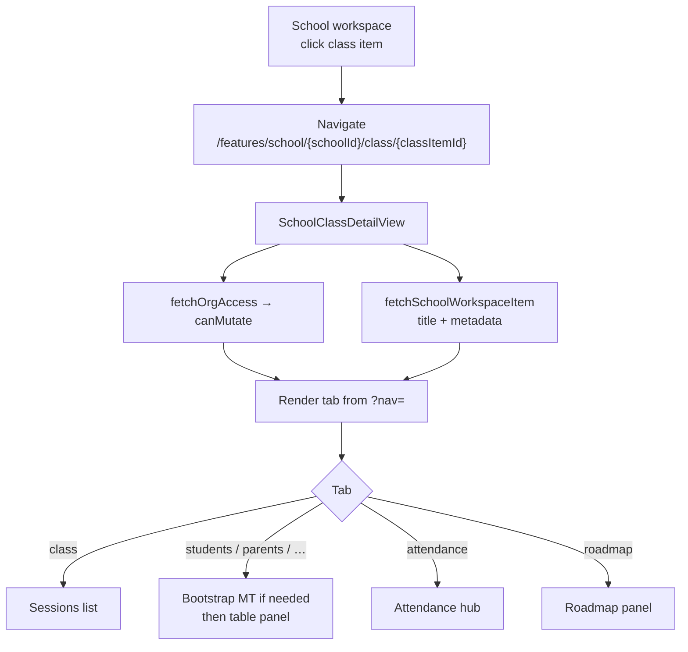
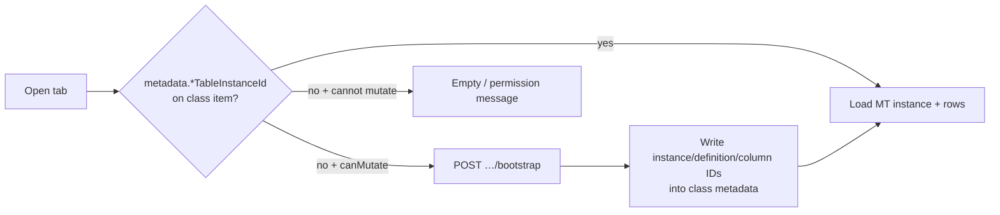
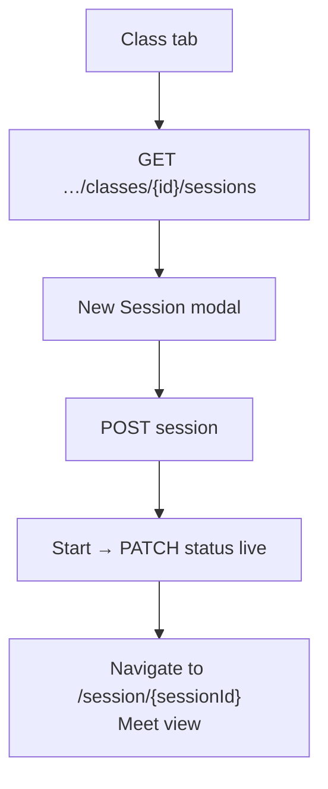
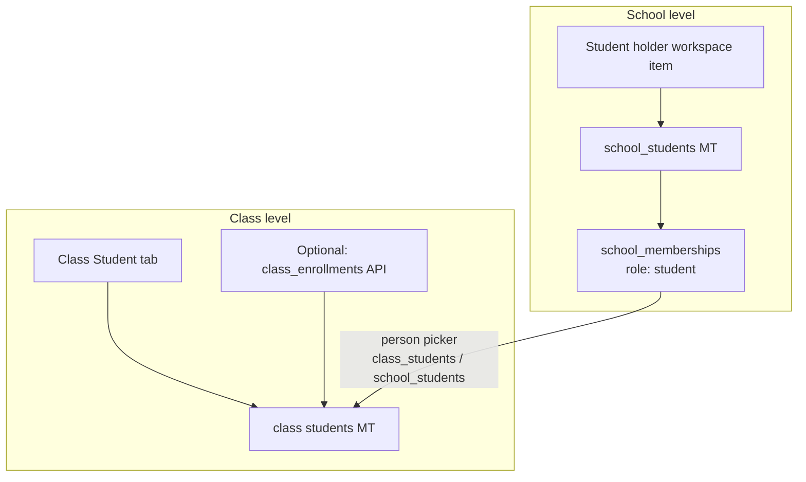

# Class — how it works (flows)

**Audience:** Feature developers  
**Related:** [class-rules-and-conventions.md](./class-rules-and-conventions.md) · [class-frontend-standards.md](./class-frontend-standards.md) · [class-backend-standards.md](./class-backend-standards.md)

---

## What a class is

A **class** is a school workspace item (`type: "class"`). It is the teaching unit under a school (often under a department). Opening a class loads one workspace page with tabs for sessions, students, parents, teachers, grades, schedules, assignments, attendance, and roadmap.

One class = one `school_workspace_items` row + optional linked tables, sessions, attendance, roadmap, enrollments.

---

## End-to-end: open a class



**IDs you always need:** `orgId`, `schoolId`, `classItemId` (workspace item `_id`).

---

## Tab flow (URL)

| User action | URL | What loads |
|-------------|-----|------------|
| Open class (default) | `…/class/{id}` or `?nav=class` | Sessions |
| Student tab | `?nav=students` | Class students management table |
| Parent | `?nav=parents` | Class parents MT |
| Teacher | `?nav=teacher` | Class teachers MT |
| Grade | `?nav=grade` | Grades MT |
| Schedules | `?nav=schedules` | Schedules MT |
| Assignment | `?nav=assignment` | Assignments MT |
| Attendance | `?nav=attendance` | Attendance (+ `attendanceView`) |
| Roadmap | `?nav=roadmap` | Class roadmap |

Navigation is **query-param based** — not separate Next.js routes (except live Meet: `/session/{sessionId}`).

---

## Management table bootstrap flow

Used by Student, Parent, Teacher, Grade, Schedules, Assignment, Leave requests.



**Rule:** Bootstrap is idempotent. Calling again returns `alreadyLinked: true` if metadata still points at a valid instance.

---

## Session flow



Sessions live in `school_class_sessions`, keyed by `class_workspace_item_id`.

---

## Student path: school register → class assign



1. **Register** at school (student holder) → membership.  
2. **Assign** in class Student tab → class table row (and/or enrollment API).

Class roster rows do **not** replace school registration.

---

## Attendance flow

1. Class must have sessions (from Class tab).  
2. Open Attendance → loads `GET …/attendance` (merged sessions + marks).  
3. Student rows come from the **class students management table**.  
4. Leave requests use leave-requests MT bootstrap under attendance.

---

## Roadmap flow

1. `GET …/roadmap` — one document per class (default empty section if none).  
2. `PUT …/roadmap` — replace full sections tree.  
3. `GET …/roadmap/resources` — aggregates sessions, courses, assignment rows, schedule rows for the sidebar.

See [class-roadmap-architecture.md](../school-page/class-roadmap-architecture.md).

---

## Permission flow (short)

| Action | Gate |
|--------|------|
| Open class, list sessions, read tables | Org membership |
| Create/edit sessions, bootstrap tables, edit rows, attendance marks | `school:manage` |
| Student submits leave request | Org membership + enrolled / on students table |

Frontend mirrors this with `userCanManageSchoolWorkspace` → `canMutate` passed into panels.

---

## Data that lives on the class item

Class workspace `metadata` stores pointers (not the row data itself):

| Metadata key (examples) | Points to |
|-------------------------|-----------|
| `studentsTableInstanceId` | Students MT instance |
| `parentsTableInstanceId` | Parents MT |
| `gradesTableInstanceId` | Grades MT |
| `schedulesTableInstanceId` | Schedules MT |
| `assignmentsTableInstanceId` | Assignments MT |
| `leaveRequestsTableInstanceId` | Leave requests MT |
| `studentCount` | Active enrollment count |

Row cells live in `school_management_table_rows`. Sessions / attendance / roadmap have their own collections.

---

## Quick mental model

```
User account
  → Org (API gate)
    → School
      → Workspace tree
        → Class item
            ├── sessions
            ├── attendance doc
            ├── roadmap doc
            ├── enrollments
            └── management tables (via metadata pointers)
```
