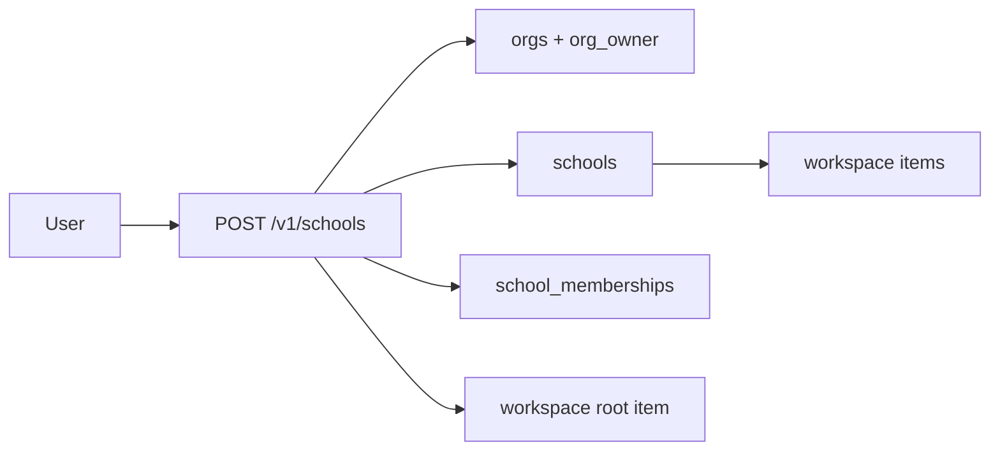
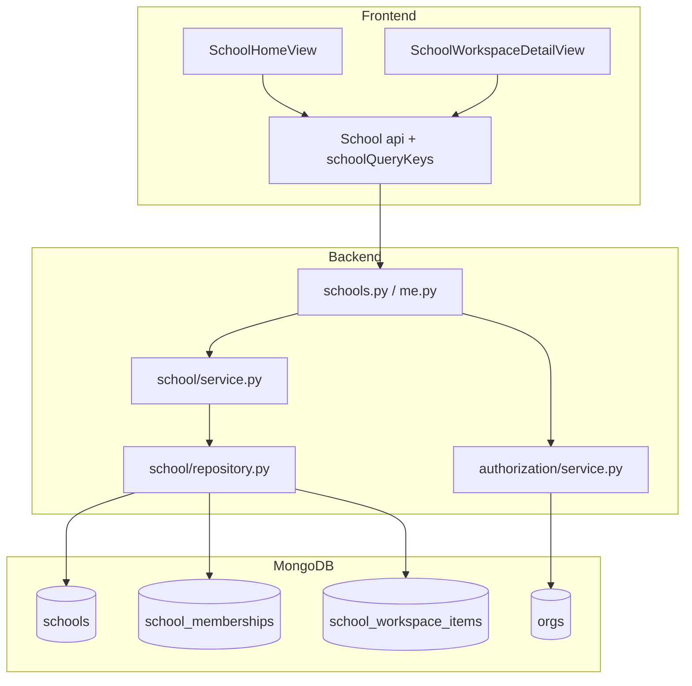

# 1 — School

**Status:** Implemented (web)  
**Parent:** Platform account → Org → **School**

---

## 1. Where to find it

### In the product (UI)

| Screen | URL |
|--------|-----|
| My School home | `/features/school` |
| Create school | `/features/school/create` |
| School workspace | `/features/school/[schoolId]` |
| Marketplace | `/features/school/marketplace` |
| Offers | `/features/school/offers` |
| Archive | `/features/school/archive` |
| Student registration | `/features/school/[schoolId]/student/[studentItemId]` |
| Parent registration | `/features/school/[schoolId]/parent/[parentItemId]` |

### In code — frontend

| What | Path |
|------|------|
| Routes | `deltalabs-frontend/src/app/(app)/features/school/**` |
| Module | `deltalabs-frontend/src/modules/School/` |
| Home view | `modules/School/views/SchoolHomeView.tsx` |
| Workspace | `modules/School/views/SchoolWorkspaceDetailView.tsx` |
| Create | `modules/School/views/SchoolCreatePageView.tsx` |
| API client | `modules/School/api/index.ts` |
| Query keys | `modules/School/hooks/schoolQueryKeys.ts` |

### In code — backend

| What | Path |
|------|------|
| Routes | `deltalabs-backend/app/api/v1/schools.py` (+ `me.py` for `/me/schools`) |
| Domain | `deltalabs-backend/app/domain/school/` |
| Org / RBAC | `deltalabs-backend/app/domain/authorization/` |
| Collections | `schools`, `school_memberships`, `school_workspace_items`, `school_offers`, `school_marketplace` |

---

## 2. How it works

1. User creates a school (`POST /v1/schools`) → backend reuses or creates an **org**, inserts `schools` row, writes `school_memberships` (`school_owner`), creates workspace **root**.
2. User opens My School → `GET /v1/me/schools` (from `school_memberships`).
3. User opens workspace → lists `school_workspace_items` under that school; can create folder / department / class / course / MT / student / parent holders.
4. Mutations on structure require org permission **`school:manage`**.

---

## 3. Standards

| Rule | Detail |
|------|--------|
| Always scope by `orgId` + `schoolId` | Every school API under `/v1/orgs/{orgId}/schools/{schoolId}/…` (except create-me / me list) |
| Thin routes | Next.js `page.tsx` → module view; FastAPI route → service |
| Two memberships | Org RBAC gates APIs; `school_memberships` drives My School + pickers |
| Workspace tree | One collection `school_workspace_items`; behavior by `type` |

---

## 4. Implementation decisions

| ID | Decision | Why |
|----|----------|-----|
| S-01 | Org is tenant; school is operational unit | Billing/permissions at org; day-to-day UX at school |
| S-02 | Auto-create workspace org on first school | Users don’t manage tenants manually |
| S-03 | Reuse first `org_owner` org for more schools | Keeps one admin tenant for a creator |
| S-04 | Roles in `school_memberships` for UX | Pickers / My School without overloading org RBAC |
| S-05 | Tree of typed workspace items | One pattern for department, class, tables, holders |

---

## 5. Architecture

---

## 6. Frontend notes

- Resolve `activeOrgId` via school memberships / org hooks before calling org-scoped APIs.
- Workspace view owns create-item flows and navigation to department / class / student / parent / MT.
- Shell (`SchoolManagementShell`) hides icon rail on deep school/class/student/parent routes.

## 7. Backend notes

- `create_school_me`: orchestrates org + school + membership + root.
- Workspace CRUD: membership for reads; `school:manage` for writes.
- Indexes: `schools` by org; unique membership `(user_id, school_id)`.
