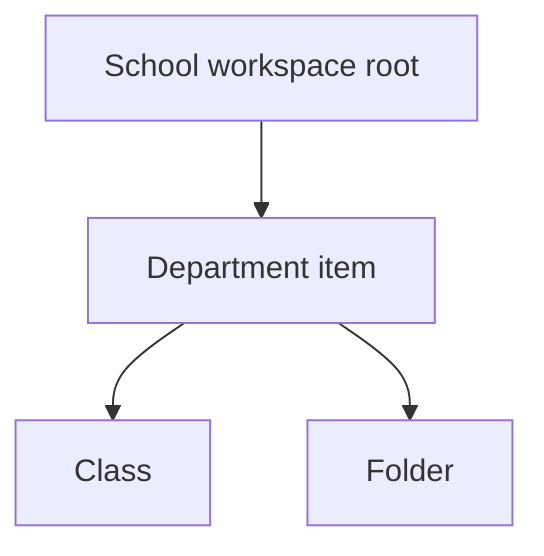
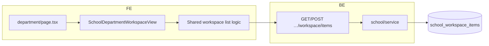

# 2 — Department

**Status:** Implemented (web)  
**Parent:** [School](./01-school.md) workspace item `type: "department"`

---

## 1. Where to find it

### UI

| Screen | URL |
|--------|-----|
| Department workspace | `/features/school/[schoolId]/department/[departmentItemId]` |

Created from school (or parent department) workspace “add item → Department”.

### Frontend code

| What | Path |
|------|------|
| Route | `app/(app)/features/school/[schoolId]/department/[departmentItemId]/page.tsx` |
| View | `modules/School/department/SchoolDepartmentWorkspaceView.tsx` |
| Layout helpers | `modules/School/department/*` |

### Backend code

| What | Path |
|------|------|
| Same workspace item APIs as school | `schools.py` → `…/workspace/items` |
| Domain | `domain/school/` — no separate “department” service |
| Storage | `school_workspace_items` with `type: "department"` |

---

## 2. How it works

A department is a **workspace item**, not a separate database entity.

1. Create item with `type: department` under school root (or another folder/department).
2. Opening it loads the same workspace browser **scoped** to that department as root (`departmentRootItemId`).
3. Classes, folders, tables created inside appear with `parent_id` under that department.

---

## 3. Standards

| Rule | Detail |
|------|--------|
| Reuse school workspace UI | Department view wraps/reuses workspace list patterns |
| Scope children by `parent_id` | List/filter under department |
| Same permissions as school workspace | Read: org member; write: `school:manage` |
| No parallel “departments” collection | Only `school_workspace_items` |

---

## 4. Implementation decisions

| ID | Decision | Why |
|----|----------|-----|
| D-01 | Department = workspace item type | Avoids second hierarchy system |
| D-02 | Dedicated URL for focus | Clear UX “inside this department” without new backend model |
| D-03 | Same CRUD APIs as any workspace item | One API surface |

---

## 5. Architecture

---

## 6. Frontend notes

- Pass `schoolId` + `departmentItemId`.
- Treat department as root for breadcrumbs / create-parent default.
- Opening a class from department uses the same class route as from school root.

## 7. Backend notes

- No department-specific endpoints.
- Validate item exists and `type == department` when opening department UX (frontend + optional service checks).
- Children queries: `parent_id = departmentItemId` (or path walk if nested folders).
