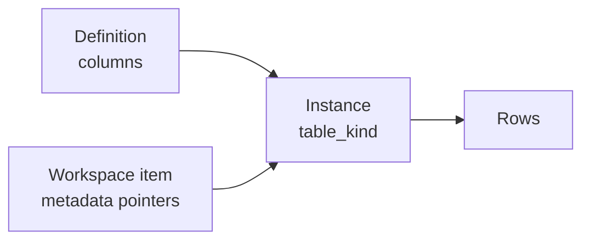
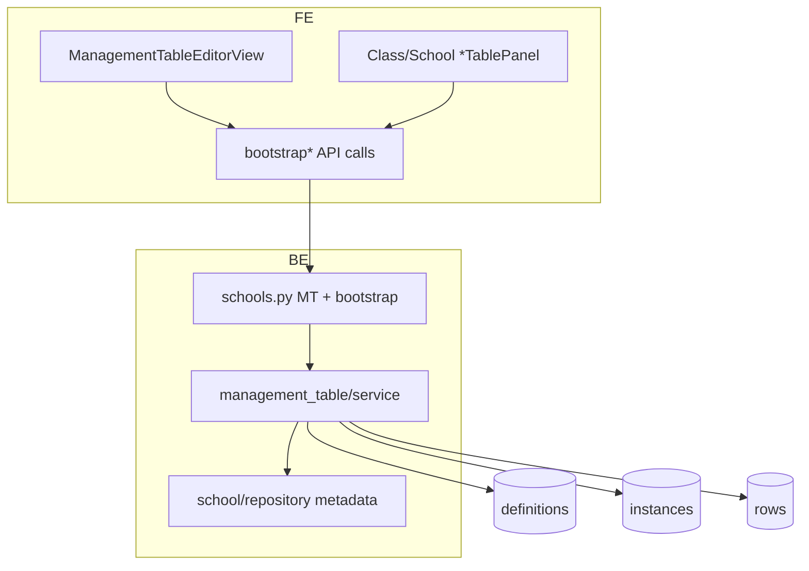

# 3 — Management table

**Status:** Implemented (web) — shared grid engine  
**Used by:** Standalone school tables, student/parent registration, class students/parents/teachers/grades/schedules/assignments/leave

---

## 1. Where to find it

### UI

| Screen | URL |
|--------|-----|
| Standalone editor | `/features/school/[schoolId]/management-tables/[instanceId]` |
| Inside registration / class tabs | Embedded panels (no separate URL) |

### Frontend code

| What | Path |
|------|------|
| Editor view | `modules/School/managementTable/ManagementTableEditorView.tsx` |
| Domain table panels | `modules/School/**/**TablePanel.tsx` (Students, Parents, Grades, …) |
| Column / row UI | `modules/School/managementTable/` (+ shared components) |
| API | `modules/School/api/` — bootstrap, instance bundle, rows, columns |

### Backend code

| What | Path |
|------|------|
| Routes | `app/api/v1/schools.py` — `…/management-tables/…` + bootstrap paths |
| Domain | `app/domain/management_table/` (`service.py`, `repository.py`, `schemas.py`) |
| Collections | `school_management_table_definitions`, `_instances`, `_rows` |

---

## 2. How it works

Three layers:

1. **Definition** — column schema (types, labels, person picker settings).  
2. **Instance** — one live table bound to a workspace item (`workspace_item_id`, `table_kind`).  
3. **Rows** — `cells` map `columnId → value` (person cells are `{ userId, fullName, … }`).

Bootstrap creates definition + instance and writes IDs onto the parent workspace item `metadata`.

---

## 3. Standards

| Rule | Detail |
|------|--------|
| Idempotent bootstrap | Safe to call twice; returns `alreadyLinked` if valid |
| Pointers in metadata | Never store all row data on the workspace item |
| `table_kind` isolation | e.g. `students` vs `parents` must be different instances |
| Mutate gate | `school:manage` |
| Allowed column types | Keep FE + BE allow-lists in sync |
| Person pickers | Scope: `platform` \| `school_students` \| `school_parents` \| `class_students` |

---

## 4. Implementation decisions

| ID | Decision | Why |
|----|----------|-----|
| MT-01 | One engine for all grids | Avoid per-feature table codebases |
| MT-02 | Metadata pointers on workspace items | Class/school holders can host many tables |
| MT-03 | Membership sync only on school student/parent/staff holders | Class rows assign; school rows register (R-07) |
| MT-04 | Template picker for standalone MTs | Reuse formats without copying rows |
| MT-05 | School-scoped `school:manage` on generic MT CRUD | Aligns permission check with school resource |

---

## 5. Architecture

---

## 6. Frontend notes

- Pattern: read metadata instance id → bootstrap if missing + `canMutate` → fetch bundle → edit rows.
- Invalidate `workspaceItem` + `managementTableInstance` / `managementTableRows` after bootstrap/mutations.
- Use `scope="class" | "school"` on shared roster panels for picker/copy.

## 7. Backend notes

- Bootstrap methods: `bootstrap_class_*_table`, school holder bootstraps, generic workspace MT bootstrap.
- `patch_row` may sync membership for school-level holders only.
- Indexes on `(org_id, school_id, instance_id)` for rows.
