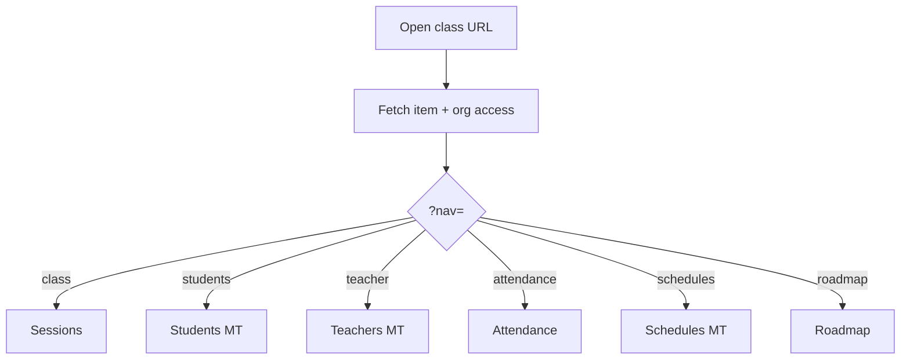
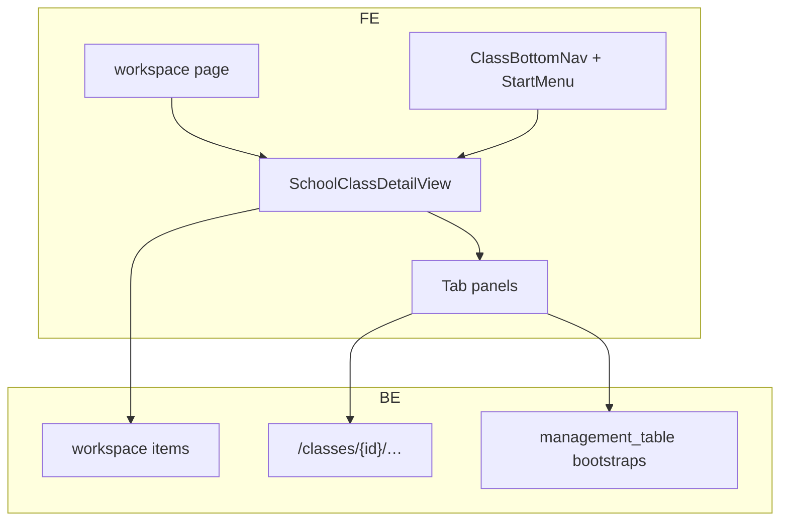

# 4 — Class (shell)

**Status:** Implemented (web)  
**Parent:** School / Department workspace item `type: "class"`  
**Children:** [Sessions](./05-class-sessions.md) · [Students](./06-class-students.md) · [Teachers](./07-class-teachers.md) · [Attendance](./08-class-attendance.md) · [Schedules](./09-class-schedules.md) · [Roadmap](./10-class-roadmap.md)

---

## 1. Where to find it

### UI

| Screen | URL |
|--------|-----|
| Class workspace | `/features/school/[schoolId]/class/[classItemId]` |
| Tabs | Same URL + `?nav=students|parents|teacher|…` |
| Live Meet | `…/class/[classItemId]/session/[sessionId]` |

### Frontend code

| What | Path |
|------|------|
| Route (workspace) | `…/class/[classItemId]/(workspace)/page.tsx` |
| Route (meet) | `…/class/[classItemId]/(meet)/session/[sessionId]/page.tsx` |
| Orchestrator | `modules/School/views/SchoolClassDetailView.tsx` |
| Chrome | `modules/School/class/` — bottom nav, start menu, layout, permissions |
| Nav config | `class/classBottomNavConfig.ts` |

### Backend code

| What | Path |
|------|------|
| Workspace item | Same as any item; class-specific under `…/classes/{class_workspace_item_id}/…` |
| Guard | `_require_class_workspace_item` in `school/service.py` |

---

## 2. How it works

1. Create `type: class` in school/department workspace.  
2. Navigate to class URL → `SchoolClassDetailView` loads org access + workspace item.  
3. Bottom nav / Start menu set `?nav=` to switch panels (no new route per tab).  
4. Each built panel may bootstrap its management table or load domain APIs.

---

## 3. Standards

| Rule | Detail |
|------|--------|
| `classItemId` = workspace item `_id` | Same id in all class APIs |
| Query-param tabs | Prefer `?nav=` over new App Router segments |
| `canMutate` from org RBAC | `userCanManageSchoolWorkspace` |
| Thin class table wrappers | `Class*TablePanel` → shared domain panels |
| Built vs coming soon | `isBuiltClassNavSection` is source of truth |

Coding standards detail: [class-frontend-standards.md](../school-class-page/class-frontend-standards.md) · [class-backend-standards.md](../school-class-page/class-backend-standards.md)

---

## 4. Implementation decisions

| ID | Decision | Why |
|----|----------|-----|
| C-01 | Class is a workspace item | Fits school tree |
| C-02 | Single page + `?nav=` | Fast tab switch; shared layout |
| C-03 | Metadata hosts all table pointers | One class, many grids |
| C-04 | Separate Meet route group | Full-screen without bottom nav |
| C-05 | Start menu filters bottom-nav duplicates | Cleaner overflow |

---

## 5. Architecture

---

## 6. Frontend notes

- Preserve `?returnTo=` for back navigation to school/department.
- Roadmap uses special overflow layout in `ClassWorkspaceRouteLayout`.
- Swappable 8th bottom-nav slot stored in `localStorage` per class.

## 7. Backend notes

- All class feature routes must call `_require_class_workspace_item`.
- Reads: `require_org_membership`; writes: `school:manage` (org scope on class routes).
