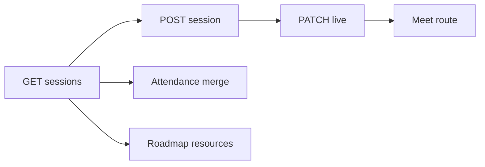
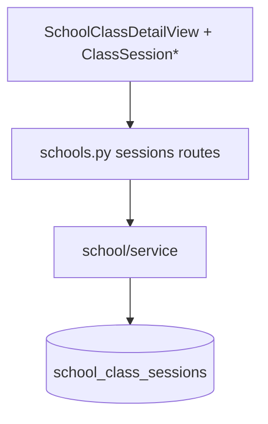

# 5 — Class sessions

**Status:** Implemented (web); Meet room **partial** (shell, not real A/V)  
**Parent:** [Class](./04-class.md) · default tab `?nav=class` or omitted

---

## 1. Where to find it

### UI

| Screen | URL |
|--------|-----|
| Session list | `/features/school/[schoolId]/class/[classItemId]` |
| Live Meet | `…/class/[classItemId]/session/[sessionId]` |

### Frontend

| What | Path |
|------|------|
| Section / cards / empty / new modal | `modules/School/class/ClassSession*.tsx`, `ClassNewSessionModals.tsx` |
| Meet view | `modules/School/class/ClassSessionMeetView.tsx` |
| Format helpers | `class/classSessionFormat.ts` |
| Wired in | `SchoolClassDetailView.tsx` |

### Backend

| What | Path |
|------|------|
| APIs | `GET/POST …/classes/{id}/sessions`, `PATCH/DELETE …/sessions/{session_id}` |
| Service / repo | `domain/school/service.py`, `repository.py` |
| Collection | `school_class_sessions` |

---

## 2. How it works

1. Class tab loads sessions for `class_workspace_item_id`.  
2. Manager creates session (title, type, schedule, weight, …).  
3. Start → PATCH status `live` → navigate to Meet route.  
4. Attendance and roadmap resources **read** sessions as source data.

---

## 3. Standards

| Rule | Detail |
|------|--------|
| Always pass `orgId`, `schoolId`, `classItemId` | — |
| Create/update/delete need `school:manage` | — |
| Status model | e.g. `draft` / `scheduled` / `live` (as implemented) |
| Do not invent a second session store on the client | Server is source of truth |

---

## 4. Implementation decisions

| ID | Decision | Why |
|----|----------|-----|
| CS-01 | Dedicated `school_class_sessions` collection | Not MT rows — sessions are first-class |
| CS-02 | Meet is a separate route | Full-screen UX |
| CS-03 | Meet A/V deferred | Ship navigation + metadata first |
| CS-04 | Attendance merges class sessions | One schedule of truth |

---

## 5. Architecture

---

## 6. Frontend notes

- Enable sessions query when nav is class (default).
- After create/start, invalidate `schoolQueryKeys.classSessions`.
- Meet may show mock participants — do not document as production video.

## 7. Backend notes

- Guard with `_require_class_workspace_item`.
- Index by org/school/class + `scheduled_at`.
- Session ids used as keys in attendance `session_settings` / marks.
