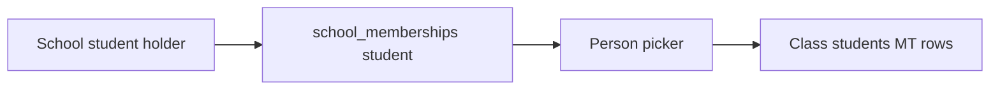
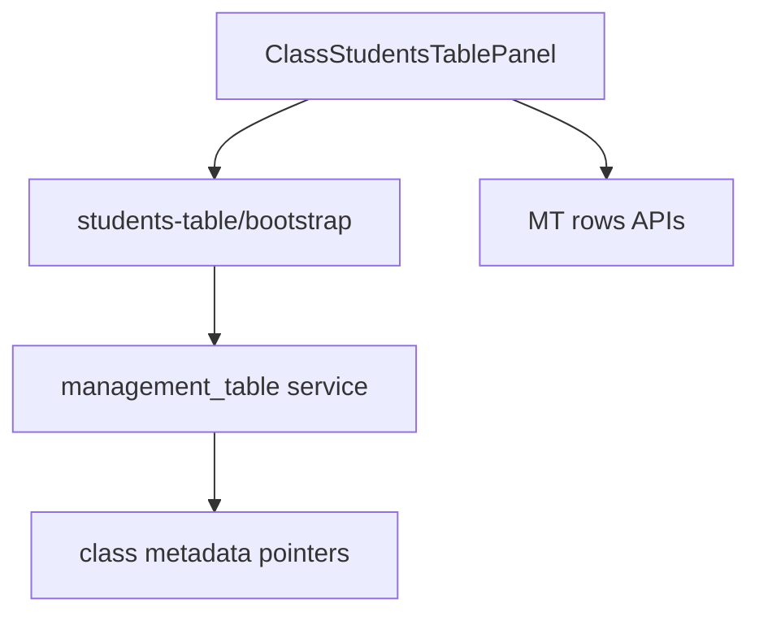

# 6 — Class students

**Status:** Implemented (web + mobile)  
**Parent:** [Class](./04-class.md) · `?nav=students`  
**Related engine:** [Management table](./03-management-table.md) · Roster ADRs in `school-roster-page/`

---

## 1. Where to find it

### UI

| Screen | URL |
|--------|-----|
| Class Student tab | `…/class/[classItemId]?nav=students` |
| School registration (prerequisite) | `…/student/[studentItemId]` |

### Frontend

| What | Path |
|------|------|
| Wrapper | `modules/School/class/ClassStudentsTablePanel.tsx` |
| Shared panel | Students table panel (`scope="class"`) |
| Meta helpers | `class/classStudentsTableMeta.ts` / students table meta |

### Backend

| What | Path |
|------|------|
| Bootstrap | `POST …/classes/{id}/students-table/bootstrap` |
| Rows | Management table instance/rows APIs |
| Enrollments (secondary) | `…/classes/{id}/enrollments` |
| Search | `GET …/members/search?picker=school_students` or `class_students` |

---

## 2. How it works

**Product flow:** Register at school → assign on class Student tab.

1. Open Student tab → bootstrap students MT if needed.  
2. Metadata stores `studentsTableInstanceId` (+ definition/column ids).  
3. Person column picks from **school-registered students**.  
4. Optional enrollment API also upserts membership + can sync a students-table row.

---

## 3. Standards

| Rule | Detail |
|------|--------|
| Separate instance from parents table | Never share `parentsTableInstanceId` |
| School register first | Empty-state copy should guide admins |
| Class row edits do not sync school membership | By design |
| `table_kind`: `students` | — |

---

## 4. Implementation decisions

| ID | Decision | Why |
|----|----------|-----|
| R-01 | Two-layer register → assign | Clear admin mental model |
| R-02 | MT primary UX over enrollment forms | Consistent grids |
| R-03 | Separate MT instances per roster type | Fixed parent/student mix-up |
| R-07 | Membership sync on school holders only | Class is assignment layer |

---

## 5. Architecture

---

## 6. Frontend notes

- Auto-bootstrap when `canMutate` and no instance id.
- Invalidate workspace item after bootstrap.
- Prefer `school_students` picker on class student person columns.

## 7. Backend notes

- Bootstrap idempotent; starter column **Student** (person).
- Enrollment path updates `studentCount` and may `sync_class_enrollment_row`.
- Withdraw enrollment does not delete MT row.
