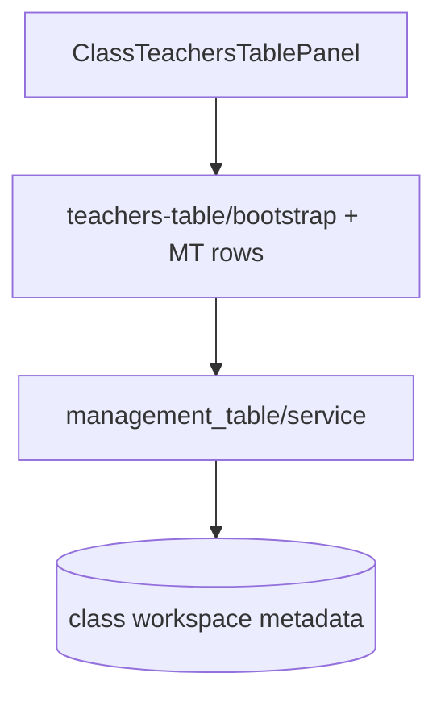

# 7 — Class teachers

**Status:** Implemented (web; mobile largely available)  
**Parent:** [Class](./04-class.md) · `?nav=teacher`  
**Related engine:** [Management table](./03-management-table.md)

---

## 1. Where to find it

### UI

| Screen | URL |
|--------|-----|
| Teacher tab | `…/class/[classItemId]?nav=teacher` |

### Frontend

| What | Path |
|------|------|
| Wrapper | `modules/School/class/ClassTeachersTablePanel.tsx` |
| Shared panel | Teachers table panel |

### Backend

| What | Path |
|------|------|
| Bootstrap | `POST …/classes/{id}/teachers-table/bootstrap` |
| Rows | Management table CRUD |
| Metadata | `teachersTableInstanceId`, definition/column ids |
| `table_kind` | `teachers` |

---

## 2. How it works

1. Open Teacher tab → bootstrap teachers MT if missing.  
2. Edit rows (Teacher person column, Role, Subject starters).  
3. School-level **staff** holder can sync `teacher` membership when used; class teachers table is class-scoped staffing grid.

---

## 3. Standards

| Rule | Detail |
|------|--------|
| Same MT panel pattern as students/grades | Thin `Class*` wrapper |
| Bootstrap idempotent | — |
| Mutate requires `school:manage` | — |
| Pointers only in class metadata | — |

---

## 4. Implementation decisions

| ID | Decision | Why |
|----|----------|-----|
| CT-01 | Teachers as MT, not separate collection | Reuse grid engine |
| CT-02 | Own `table_kind` + metadata keys | Isolated from students/parents |
| CT-03 | Starter Role/Subject columns | Common school staffing fields |

---

## 5. Architecture

---

## 6. Frontend notes

- Follow students bootstrap/invalidate pattern.
- Nav id is `teacher` (singular) in `classBottomNavConfig`.

## 7. Backend notes

- Validate class type on bootstrap.
- Starter columns: Teacher (person), Role, Subject (as implemented).
- Optional: school `staff` holder membership sync is separate from this class table.
