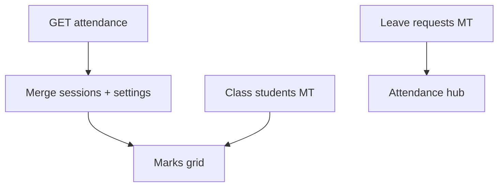
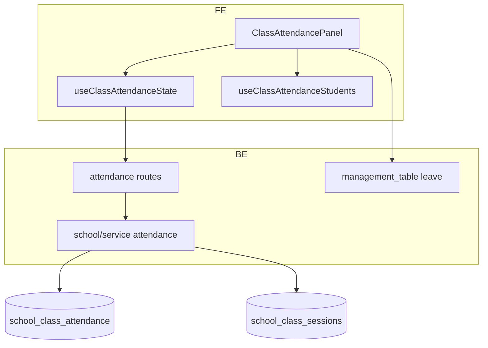

# 8 — Class attendance

**Status:** Implemented (web; mobile available)  
**Parent:** [Class](./04-class.md) · `?nav=attendance`  
**Depends on:** [Sessions](./05-class-sessions.md), [Students](./06-class-students.md)

---

## 1. Where to find it

### UI

| Screen | URL |
|--------|-----|
| Attendance hub | `…/class/[classItemId]?nav=attendance` |
| Sub-views | `?attendanceView=sessions\|leave\|devices` |

### Frontend

| What | Path |
|------|------|
| Panel | `modules/School/class/ClassAttendancePanel.tsx` |
| Domain | `modules/School/attendance/` — state hooks, side rail, leave panel |
| Leave MT | Leave requests table panel (bootstrapped) |

### Backend

| What | Path |
|------|------|
| State | `GET …/classes/{id}/attendance` |
| Marks / devices / formula / realtime | POST/PATCH/PUT under `…/attendance/…` |
| Leave submit | `POST …/leave-requests/submit` |
| Leave bootstrap | `…/leave-requests-table/bootstrap` |
| Collection | `school_class_attendance` (+ leave MT rows) |

---

## 2. How it works

1. One attendance document per class (get-or-create on read).  
2. Sessions list **merged** from `school_class_sessions` + per-session settings.  
3. Student columns/rows come from class students MT.  
4. Marks keyed by student + session.  
5. Leave requests use a bootstrapped MT; students may submit without full `school:manage`.

---

## 3. Standards

| Rule | Detail |
|------|--------|
| Empty sessions → CTA to Class tab | Don’t invent fake sessions |
| Mutations (marks, devices, config) need `school:manage` | Except leave submit |
| Leave submit checks student of class | Enrollment or students table |
| Sub-nav via `attendanceView` query | Keep one attendance panel |

---

## 4. Implementation decisions

| ID | Decision | Why |
|----|----------|-----|
| CA-01 | Single attendance doc per class | Simple overlay model |
| CA-02 | Merge live session list on read | Sessions remain source of truth |
| CA-03 | Leave as MT | Flexible columns/status workflow |
| CA-04 | Student leave submit lighter auth | Students can’t get `school:manage` |

---

## 5. Architecture

---

## 6. Frontend notes

- Load students via students MT instance from class metadata.
- Side rail switches sessions / leave / devices without leaving attendance nav.
- Some secondary controls may still show “Coming soon”.

## 7. Backend notes

- Get-or-create attendance document.
- Mark patch updates nested `marks` map.
- Formula/realtime configs stored on same document.
- Index unique on `(org_id, school_id, class_workspace_item_id)`.
