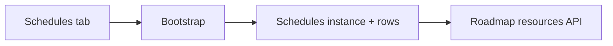
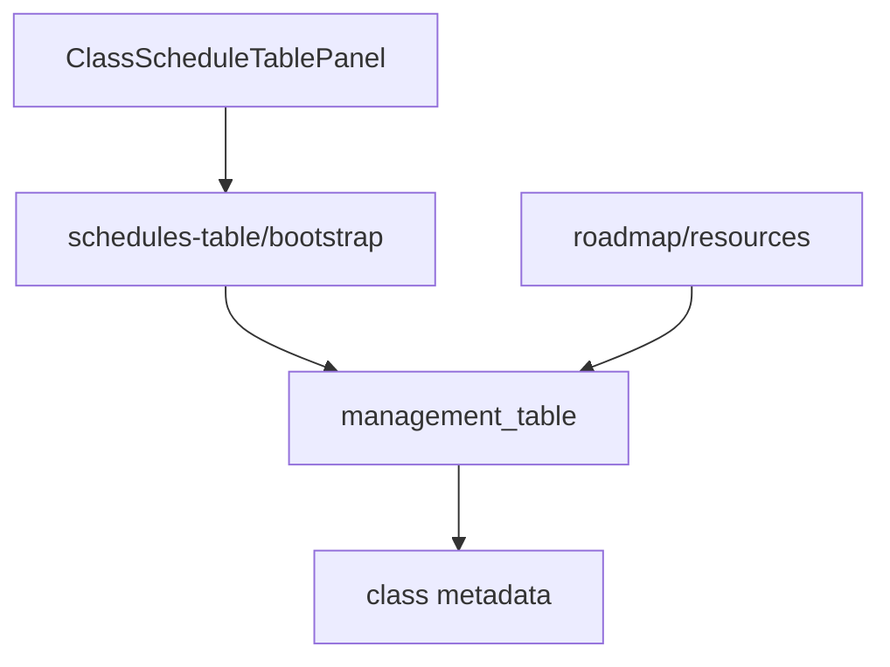

# 9 — Class schedules

**Status:** Implemented (web); **not yet** on mobile  
**Parent:** [Class](./04-class.md) · `?nav=schedules`  
**Related engine:** [Management table](./03-management-table.md) · feeds [Roadmap](./10-class-roadmap.md) resources

---

## 1. Where to find it

### UI

| Screen | URL |
|--------|-----|
| Schedules tab | `…/class/[classItemId]?nav=schedules` |

### Frontend

| What | Path |
|------|------|
| Wrapper | `modules/School/class/ClassScheduleTablePanel.tsx` |
| Shared panel | Schedule table panel (table + calendar UX as implemented) |

### Backend

| What | Path |
|------|------|
| Bootstrap | `POST …/classes/{id}/schedules-table/bootstrap` |
| Rows | Management table APIs |
| Metadata | `schedulesTableInstanceId`, session column id, … |
| `table_kind` | `schedules` |

---

## 2. How it works

1. Open Schedules tab → bootstrap schedules MT if needed.  
2. Starter column may use `cellEditor: class_session` to link class sessions.  
3. Roadmap `GET …/roadmap/resources` can surface schedule rows (e.g. as exams).

---

## 3. Standards

| Rule | Detail |
|------|--------|
| Same bootstrap / invalidate pattern as other class tables | — |
| Do not duplicate session list as the only schedule store | Sessions collection remains for class meetings; schedules MT is the planning grid |
| Mutate with `school:manage` | — |

---

## 4. Implementation decisions

| ID | Decision | Why |
|----|----------|-----|
| CSch-01 | Schedules as MT | Flexible columns without new schema per school |
| CSch-02 | Session cell editor | Tie rows to real class sessions |
| CSch-03 | Expose to roadmap resources | One place to drag schedule items onto roadmap |

---

## 5. Architecture

---

## 6. Frontend notes

- Auto-bootstrap when manager opens tab.
- Roadmap resources hook may also trigger schedules bootstrap if missing.
- Mobile: still coming soon / resources stub.

## 7. Backend notes

- Idempotent bootstrap with `table_kind: schedules`.
- Resources aggregation reads rows when metadata pointers present.
