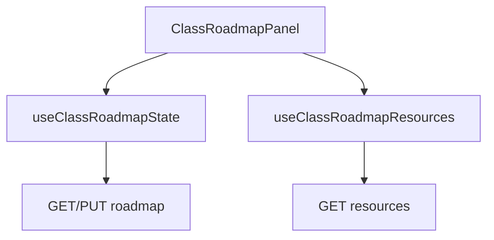
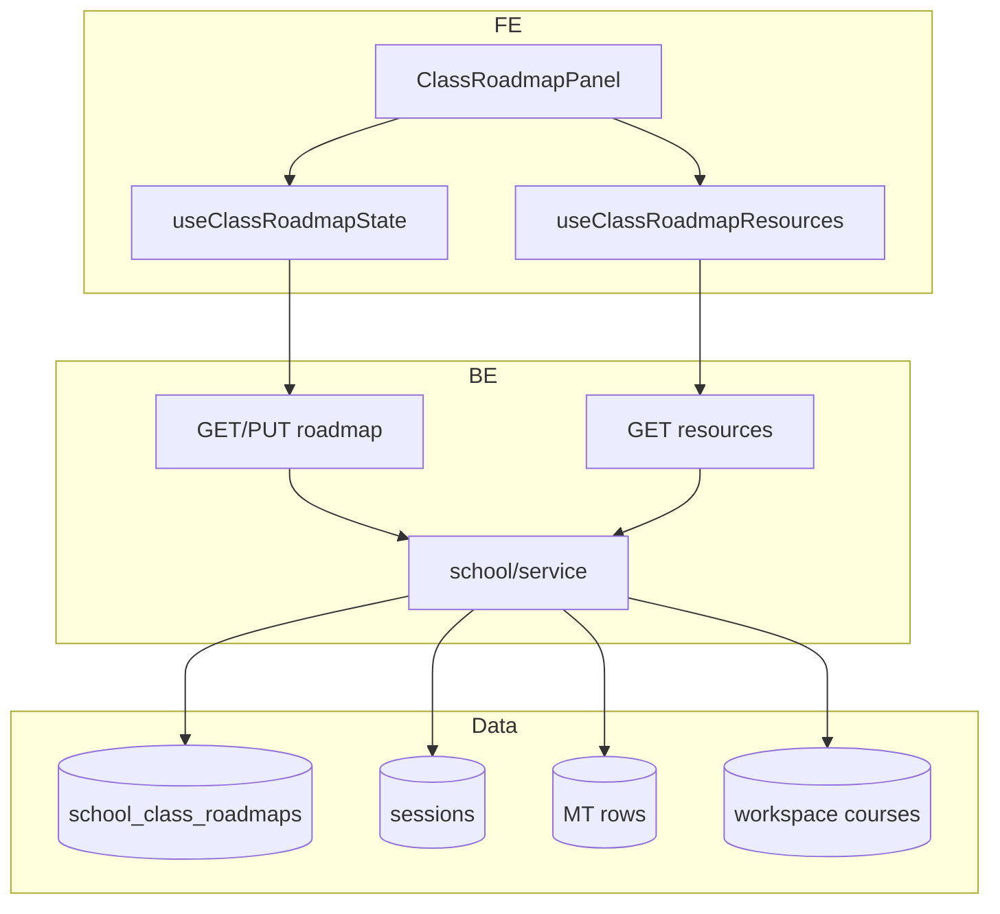

# 10 — Class roadmap

**Status:** Implemented (web); **not yet** on mobile  
**Parent:** [Class](./04-class.md) · `?nav=roadmap` (via Start menu)  
**Deep dive:** [class-roadmap-architecture.md](../school-page/class-roadmap-architecture.md)

---

## 1. Where to find it

### UI

| Screen | URL |
|--------|-----|
| Roadmap | `…/class/[classItemId]?nav=roadmap` |

### Frontend

| What | Path |
|------|------|
| Panel | `modules/School/roadmap/ClassRoadmapPanel.tsx` |
| State hook | `roadmap/hooks/useClassRoadmapState.ts` |
| Resources hook | `roadmap/hooks/useClassRoadmapResources.ts` |
| Timeline / sidebar UI | `modules/School/roadmap/` |

### Backend

| What | Path |
|------|------|
| Get / put | `GET/PUT …/classes/{id}/roadmap` |
| Resources | `GET …/classes/{id}/roadmap/resources` |
| Collection | `school_class_roadmaps` |
| Aggregates | sessions, course workspace items, assignment rows, schedule rows |

---

## 2. How it works

1. One roadmap document per class (default empty section if none).  
2. Teachers edit sections/contents; `PUT` replaces the full tree (MVP).  
3. Sidebar loads **real** resources via resources API (may bootstrap assignments/schedules tables if needed).  
4. Progress via `currentSectionId` / `currentContentId`.

---

## 3. Standards

| Rule | Detail |
|------|--------|
| Server is source of truth | localStorage only for migration leftovers |
| PUT replaces full document | Keep payload consistent |
| Resources must be real aggregations | No fake session/course lists |
| Mutate roadmap needs `school:manage` | Read needs org membership |
| Special layout for roadmap nav | Full-height overflow in class shell |

---

## 4. Implementation decisions

| ID | Decision | Why |
|----|----------|-----|
| CR-01 | One Mongo doc per class | Simple read/write |
| CR-02 | Full PUT replace (MVP) | Avoid complex patch merge early |
| CR-03 | Resources API aggregates live data | Drag real sessions/assignments onto timeline |
| CR-04 | Reusable panel per classItemId | Same UI everywhere |
| CR-05 | Optimistic TanStack updates | Snappy editing |

---

## 5. Architecture

---

## 6. Frontend notes

- Query keys: `classRoadmap`, `classRoadmapResources`.
- Resources hook may call assignment/schedule bootstrap then invalidate.
- Content types: session, course, assignment, exam, video (as modeled).

## 7. Backend notes

- Unique index `(org_id, school_id, class_workspace_item_id)`.
- Default section on empty GET.
- Resources builder must tolerate missing table metadata (return what exists).
