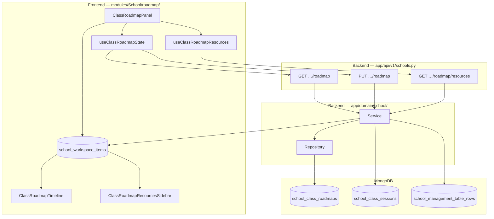

# Class roadmap architecture

This document describes how the **school class roadmap** is designed, how data flows between frontend and backend, and why the structure is reusable across every class in a school.

**Related docs:** [school-organization-and-workspace-concepts.md](./school-organization-and-workspace-concepts.md) · [school-page/README.md](./README.md)

---

## What the roadmap is

Each **class** (workspace item `type: "class"`) has its own roadmap:

- **Sections** — milestones on a vertical timeline (title, description, tags, collapsed state).
- **Contents** — ordered steps under a section (session, course, assignment, exam, video).
- **Progress** — `currentSectionId` / `currentContentId` mark where the class is now; each content has `pending` or `completed`.

Teachers drag resources from the sidebar onto a section to build the class path. Students and staff see progress on the same spine UI.

**One roadmap per class** — stored in MongoDB keyed by `org_id`, `school_id`, `class_workspace_item_id`.

---

## High-level architecture



### Design principles

| Principle | How we apply it |
|-----------|-----------------|
| **Reusable UI** | Same `ClassRoadmapPanel` for any class; only `classItemId` + org/school change. |
| **Thin routes** | FastAPI handlers delegate to `Service`; no business logic in routers. |
| **Document-shaped roadmap** | One Mongo document per class; `PUT` replaces the full tree (simple, consistent with MVP). |
| **Real sidebar data** | `GET …/roadmap/resources` aggregates sessions, courses, assignments, schedules — no placeholders. |
| **Optimistic UX** | TanStack Query cache updates immediately; `PUT` persists in background. |
| **Legacy migration** | Browser `localStorage` is migrated once to the API when the server has no saved roadmap yet. |

---

## Backend

### Storage

| Collection | ID prefix | Scope | Purpose |
|------------|-----------|--------|---------|
| `school_class_roadmaps` | `scr_` | One doc per class | Sections, contents, current pointers |

**Unique index:** `(org_id, school_id, class_workspace_item_id)`

Document shape (snake_case in Mongo):

```json
{
  "_id": "scr_…",
  "org_id": "org_…",
  "school_id": "school_…",
  "class_workspace_item_id": "wsi_…",
  "sections": [
    {
      "id": "section_…",
      "title": "Phase 1",
      "description": "",
      "tags": ["milestone"],
      "collapsed": false,
      "contents": [
        {
          "id": "content_…",
          "kind": "session",
          "content_type": "video",
          "title": "Intro lesson",
          "subtitle": null,
          "source_key": "scs_…",
          "tags": ["video"],
          "status": "pending"
        }
      ]
    }
  ],
  "current_section_id": "section_…",
  "current_content_id": null,
  "created_at": "…",
  "updated_at": "…"
}
```

### API endpoints

Base path: `/v1/orgs/{org_id}/schools/{school_id}/classes/{class_workspace_item_id}`

| Method | Path | Auth | Description |
|--------|------|------|-------------|
| `GET` | `/roadmap` | org membership | Load roadmap; returns default structure if never saved (`updatedAt` null). |
| `PUT` | `/roadmap` | `school:manage` | Replace full roadmap document. |
| `GET` | `/roadmap/resources` | org membership | Sidebar drag sources for this class. |

### Resources aggregation (`GET …/roadmap/resources`)

| Sidebar group | Source | Mapping |
|---------------|--------|---------|
| **Sessions** | `school_class_sessions` | All sessions for the class; virtual → `contentType: video` in session row. |
| **Courses** | `school_workspace_items` where `type: course` | School-wide course workspace items. |
| **Class materials — assignments** | Assignments management table rows | Class metadata `assignmentsTableInstanceId`; title from assignment column. |
| **Class materials — exams** | Schedules management table rows | Class metadata `schedulesTableInstanceId`; scheduled session cell → exam step. |
| **Class materials — videos** | Virtual sessions | Same sessions with `session_type: virtual` as `kind: video`. |

When a manager opens the roadmap, the frontend may **auto-bootstrap** assignments and schedules tables (same as Assignments / Schedule tabs) so material rows exist.

### Code map (backend)

| File | Responsibility |
|------|----------------|
| `app/domain/school/schemas.py` | `ClassRoadmapPublic`, `ClassRoadmapPutInput`, `ClassRoadmapResourcesResponse` |
| `app/domain/school/repository.py` | `find_class_roadmap`, `upsert_class_roadmap`, index |
| `app/domain/school/service.py` | `get_class_roadmap`, `put_class_roadmap`, `list_class_roadmap_resources` |
| `app/api/v1/schools.py` | Route wiring |

---

## Frontend

### Module layout

```
deltalabs-frontend/src/modules/School/roadmap/
├── ClassRoadmapPanel.tsx          # Entry: wires hooks + workspace
├── types.ts                       # Domain types (sections, contents, sidebar resource)
├── classRoadmapMappers.ts         # API DTO ↔ domain
├── classRoadmapStorage.ts         # localStorage (migration only)
├── roadmapLayout.ts               # Spine / connector Tailwind constants
├── roadmapProgress.ts             # Milestone + spine progress helpers
├── contentTypeMeta.ts             # Icons / labels per content type
├── hooks/
│   ├── useClassRoadmapState.ts    # Load/save roadmap via API
│   └── useClassRoadmapResources.ts# Sidebar data + table bootstrap
└── components/
    ├── molecules/                 # Cards, sortable rows, resource rows
    └── organisms/                 # Timeline, section block, sidebar, workspace
```

### Component hierarchy

```
ClassRoadmapPanel
└── ClassRoadmapWorkspace
    ├── ClassRoadmapTimeline
    │   └── ClassRoadmapSectionBlock (× N sections)
    │       ├── ClassRoadmapSectionCard
    │       └── ClassRoadmapSectionContentList
    │           └── SortableClassRoadmapContentCard
    │               └── ClassRoadmapContentCard
    └── ClassRoadmapResourcesSidebar
        └── ClassRoadmapResourceRow (draggable)
```

### State management

**`useClassRoadmapState(orgId, schoolId, classItemId, canMutate)`**

- `useQuery` → `GET …/roadmap`
- `useMutation` → `PUT …/roadmap` on every edit (add section, reorder, complete, etc.)
- Optimistic update via `queryClient.setQueryData`
- One-time migration from `localStorage` when `updatedAt` is missing on server

**`useClassRoadmapResources(…)`**

- `useQuery` → `GET …/roadmap/resources`
- Auto-bootstrap assignments + schedules tables when `canMutate` and metadata lacks instance IDs

### API client

`modules/School/api/index.ts`:

- `fetchClassRoadmap`
- `putClassRoadmap`
- `fetchClassRoadmapResources`

Query keys: `schoolQueryKeys.classRoadmap`, `schoolQueryKeys.classRoadmapResources`

### Wiring in the app

- **Nav:** `classBottomNavConfig.ts` → `?nav=roadmap`
- **View:** `SchoolClassDetailView.tsx` renders `ClassRoadmapPanel` with `classMetadata` from the class workspace item

---

## User flows

### Build a class path

1. Open class → **Roadmap** tab.
2. Expand a section; drag a **session**, **assignment**, or **course** from the sidebar onto the section.
3. Reorder contents with the grip handle.
4. Set **Class is here** / **Done** to track progress.

### Persistence

- Every change triggers `PUT …/roadmap`.
- Data is shared for all users in the org with access to that class (no per-browser isolation after migration).

---

## Extending the roadmap

| Change | Where to work |
|--------|----------------|
| New content type | `types.ts`, `contentTypeMeta.ts`, backend `ClassRoadmapContentType` literal, resources mapper |
| New sidebar source | `list_class_roadmap_resources` in `service.py` |
| Partial updates (PATCH) | New service method + route; optional if documents grow large |
| Ghost / shared resources | `ClassRoadmapResourcesSidebar` “Ghost Res.” tab (placeholder for cross-class linking) |
| Desktop app | Mirror API functions in `deltalabs-desktop/src/modules/School/api` |

---

## Testing checklist

- [ ] `GET /roadmap` returns default for new class; `PUT` then `GET` returns saved data.
- [ ] Two classes have independent roadmaps.
- [ ] Sidebar shows real sessions, courses, assignment rows, schedule rows (after tables bootstrapped).
- [ ] Drag-drop add + reorder persists after refresh.
- [ ] User without `school:manage` can view but not mutate.
- [ ] localStorage roadmap migrates once when server doc is new.

---

## Summary

The class roadmap is a **class-scoped, document-based** feature with a **reusable React module** and **Mongo-backed API** patterned after class sessions. Sidebar resources are **aggregated from existing school data** (sessions, workspace courses, management tables), and the timeline UI stays decoupled from storage via hooks and mappers — making it fast to iterate, easy to reuse per class, and straightforward to extend.
