# Delta Labs School — Architecture, decisions, and how everything connects

## Purpose

This is the **single narrative** for understanding how the School product fits together:

- Why we have **organization**, **school**, **department**, **class**, **course**, and **management tables**
- How data and user flows connect between them
- Which architecture decisions explain today’s design

**Audience:** Product, school admins, new developers, and architects.

**Go deeper after this doc:**

| Topic | Document |
|-------|----------|
| Plain-language overview | [school-overview-user-brief.md](./school-overview-user-brief.md) |
| Workspace item reference | [school-organization-and-workspace-concepts.md](./school-organization-and-workspace-concepts.md) |
| Roster decisions (ADRs) | [school-roster-design-decisions.md](../school-roster-page/school-roster-design-decisions.md) |
| Admin step-by-step flows | [school-roster-user-flows.md](../school-roster-page/school-roster-user-flows.md) |
| Technical checklist / APIs | [school-system-architecture-decision-guide.md](../school-roster-page/school-system-architecture-decision-guide.md) |
| Class feature (flows, FE/BE standards) | [school-class-page/README.md](../school-class-page/README.md) |
| Class roadmap | [class-roadmap-architecture.md](./class-roadmap-architecture.md) |
| Permissions | [school-access-and-permissions.md](./school-access-and-permissions.md) |
| What works today | [school-capabilities-and-limitations.md](./school-capabilities-and-limitations.md) |

---

## 1. User → Org → School — main architecture (for feature developers)

**Read this first.** School features sit on top of three stacked layers. Each layer answers a different question.

| Layer | Mongo collections | Question it answers |
|-------|-------------------|---------------------|
| **User** | `users`, `user_sessions` | Who is logged in? |
| **Org (tenant)** | `orgs`, `org_memberships`, `role_bindings`, `role_definitions` | Can this user call APIs in this tenant? What can they change? |
| **School** | `schools`, `school_memberships`, `school_workspace_items`, … | Which school are we in? What is inside it? |

### 1.1 The stack (ownership chain)

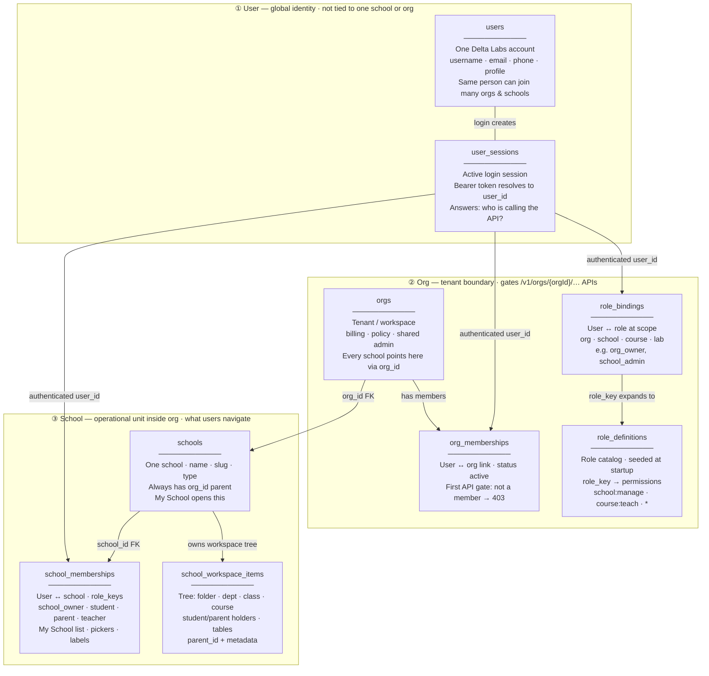

**Ownership rule:** `Org` owns `School`. `School` owns the workspace tree. `User` is global and links in through **two different membership tables** (see §1.2).

### 1.2 Two memberships — do not confuse them

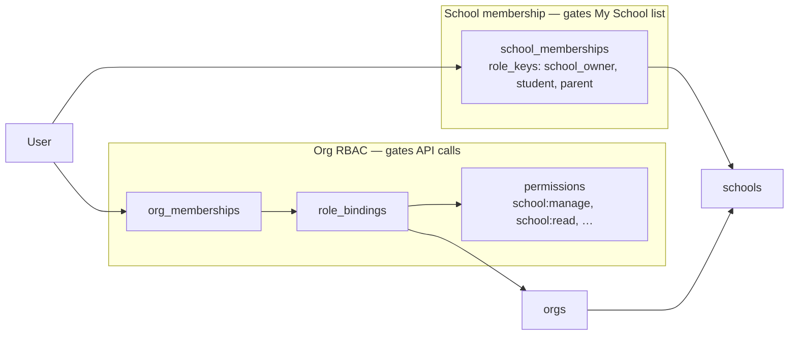

| | `org_memberships` + `role_bindings` | `school_memberships` |
|---|-------------------------------------|----------------------|
| **Purpose** | Permission checks on `/v1/orgs/{orgId}/…` | “My schools” list, person pickers, role labels |
| **Checked by** | `require_org_membership`, `require_org_permission` | `GET /v1/me/schools`, roster search |
| **Typical admin** | `org_owner` → `*` or `school:manage` | `school_owner` |
| **Typical student** | Often **not** in org yet (gap today) | `student` after registration row saved |
| **Code** | `app/domain/authorization/` | `app/domain/school/repository.py` |

**Rule of thumb for new features:**

- **Mutating** school structure, rosters, tables, sessions → need `school:manage` via org RBAC.
- **Listing** which schools a user belongs to → `GET /v1/me/schools` (reads `school_memberships`).
- **Never** assume `school_memberships` alone grants API access.

### 1.3 Request flow (every school API call)

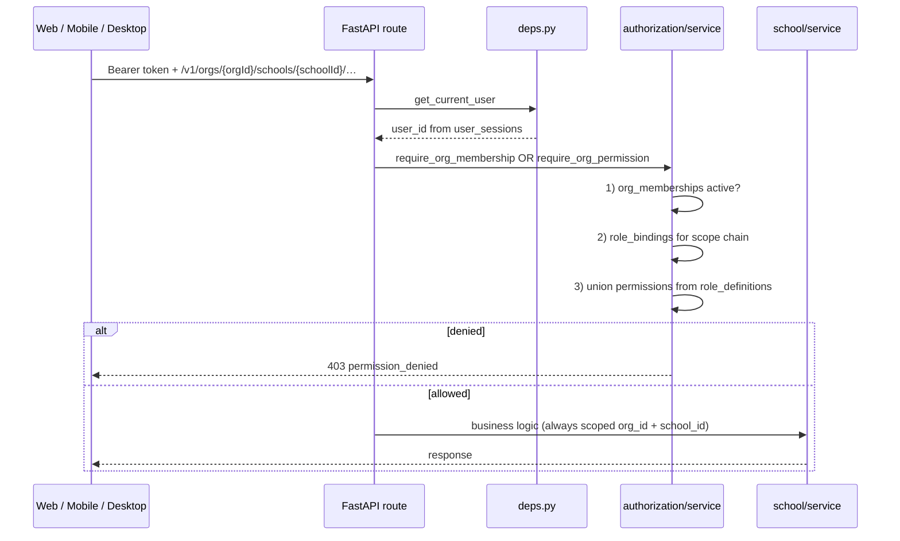

**Scope chain detail:** when checking `scope_type=school`, the engine also checks org-wide bindings (`scope_type=org`). So `org_owner` at org scope still passes `school:manage` on a specific school.

### 1.4 Create-school flow (how User, Org, School get linked)

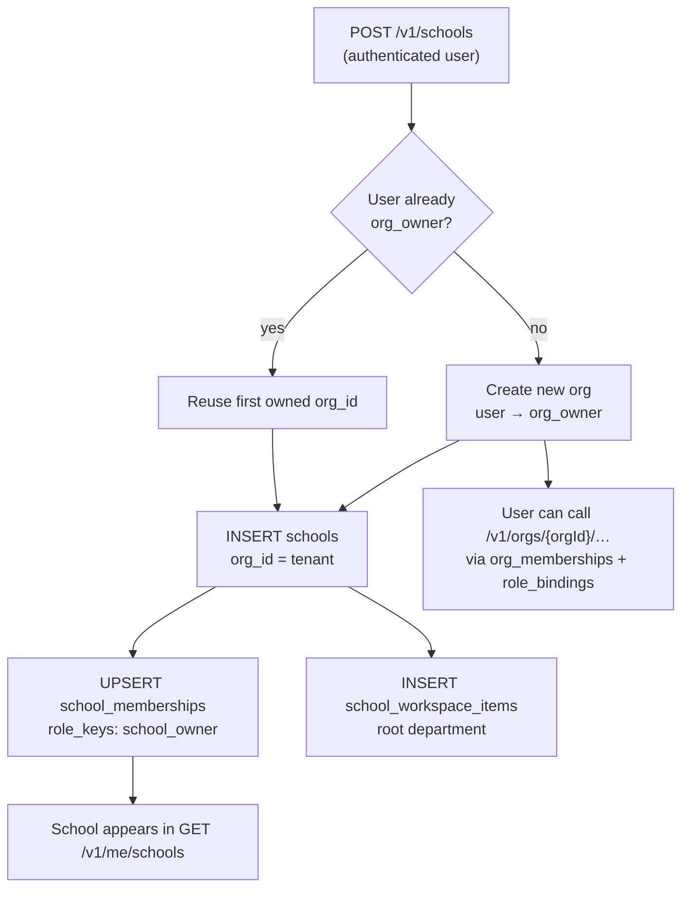

**Code entry points:**

- `app/api/v1/schools.py` → `create_school_me`
- `app/domain/authorization/service.py` → `create_workspace_org_for_school_owner`
- `app/domain/school/service.py` → `create_school`

### 1.5 IDs a feature developer needs

| When building… | You need | Where it comes from |
|----------------|----------|---------------------|
| Any org-scoped API | `orgId` | `school.org_id`, or `GET /v1/me/schools` |
| School workspace / class / MT | `schoolId` | Route param, workspace item’s `school_id` |
| Class tab features | `classItemId` | `school_workspace_items._id` where `type=class` |
| Management table data | `instanceId` | Class metadata or bootstrap response |
| Permission-gated UI | `permissions[]` | `GET /v1/orgs/{orgId}/access` |

**API prefix pattern:**

```
/v1/orgs/{orgId}/schools/{schoolId}/workspace/items/...
/v1/orgs/{orgId}/schools/{schoolId}/management-tables/...
/v1/orgs/{orgId}/schools/{schoolId}/classes/{classItemId}/...
```

User-centric shortcuts (no `orgId` in path):

```
GET  /v1/me/schools          → list from school_memberships
POST /v1/schools             → create school (+ org if needed)
```

### 1.6 Register student flow (school layer → membership sync)

Roster features follow this pattern:

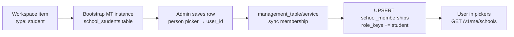

Class assignment is a **second step**: link the registered student in the class Student tab (management table row on the class). That does **not** create a new school registration.

### 1.7 Collection reference

| Collection | FK / keys | Owned by |
|------------|-----------|----------|
| `users` | `_id` | global |
| `orgs` | `_id` | platform |
| `org_memberships` | `org_id`, `user_id` | org |
| `role_bindings` | `org_id`, `subject_user_id`, `scope_type`, `scope_id`, `role_key` | org |
| `schools` | `_id`, **`org_id`** | org |
| `school_memberships` | `user_id`, `school_id`, `org_id`, `role_keys[]` | school |
| `school_workspace_items` | `org_id`, `school_id`, `parent_id`, `type` | school |
| `class_enrollments` | `org_id`, `school_id`, `class_workspace_item_id`, `user_id` | class |

**Key decision:** Org is the **tenant and API gate**. School is the **product unit** users navigate. `school_memberships` labels who belongs to a school; **org RBAC** decides who can edit it.

**Go deeper on permissions:** [school-access-and-permissions.md](./school-access-and-permissions.md) · [authz-org-rbac-design.md](../au-page/authz-org-rbac-design.md)

---

## 2. The workspace tree — one place for school structure

Instead of separate apps for “departments”, “classes”, and “tables”, Delta Labs uses **one workspace tree** per school.

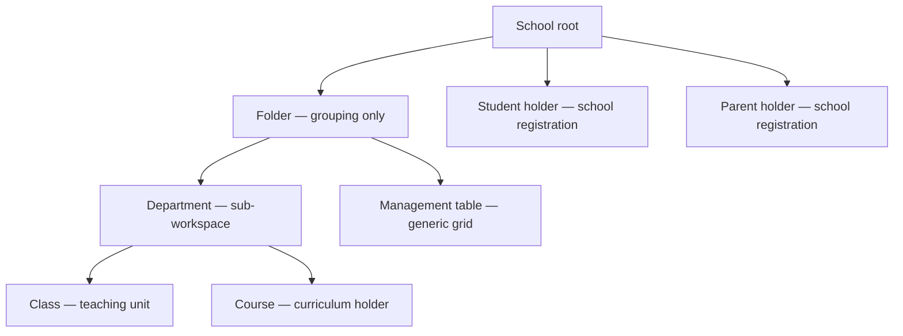

Each item has:

- `type` — what it opens (class, course, parent, …)
- `title` / `description`
- `parent_id` — where it lives in the tree
- `metadata` — type-specific links (e.g. management table instance ids on a class)

**Why a tree?**

- Schools organize differently (faculties, years, campuses). Folders and departments mirror real structure without hard-coding one hierarchy.
- The same **create → open → manage** pattern works for every item type.
- **Metadata** attaches behavior (roster tables, roadmap, assignments) without new top-level entities for every feature.

**Web routes (examples):**

| Opens | Route |
|-------|-------|
| School browse | `/features/school/[schoolId]` |
| Department | `/features/school/[schoolId]/department/[id]` |
| Class | `/features/school/[schoolId]/class/[id]` |
| Student registration | `/features/school/[schoolId]/student/[id]` |
| Parent registration | `/features/school/[schoolId]/parent/[id]` |
| Management table editor | `/features/school/[schoolId]/management-tables/...` |

---

## 3. Department vs class vs course — three different jobs

These names overlap in everyday language. In Delta Labs they are **different workspace types**:

| Type | Answers the question | Typical examples | Connected to |
|------|----------------------|------------------|--------------|
| **Department** | “Which part of the school is this?” | Primary, STEM, Secondary | Contains classes, courses, folders, tables |
| **Class** | “Which group of learners meets together?” | Grade 10 Section A | Sessions, rosters, roadmap, attendance (planned) |
| **Course** | “What curriculum / subject is this?” | Introduction to Physics | Content and school-wide course items; **not** the class roster |

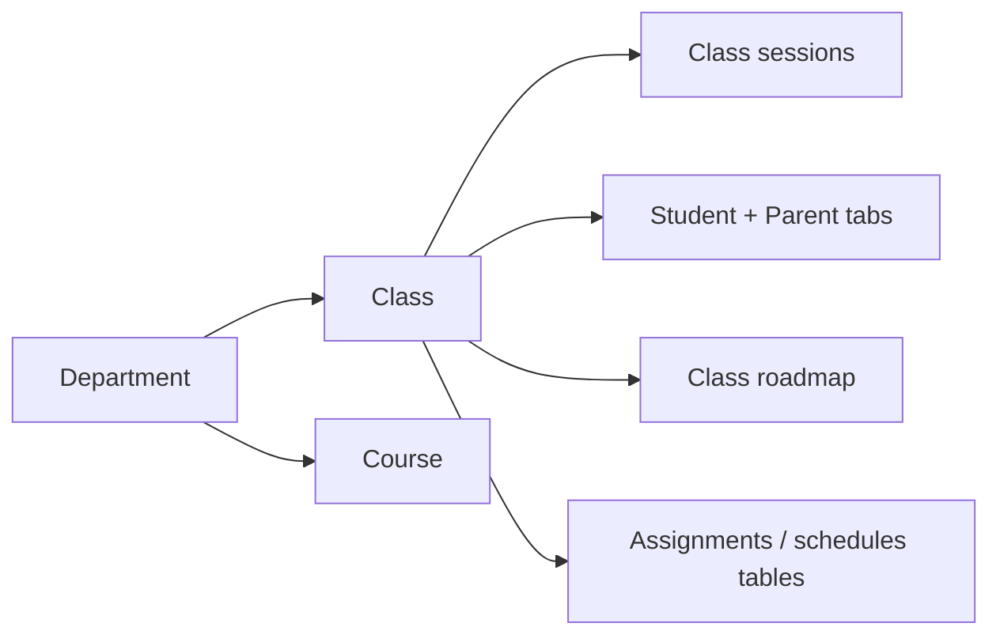

**Decision:** **Rosters live on the class**, not on the course. A course is curriculum structure; a class is the operational teaching group.

**Decision:** A department is a **workspace slice** (own URL and browse view), not a separate database “school”. It still belongs to one school and shares org permissions.

---

## 4. Management table — the engine that connects rosters and school data

A **management table (MT)** is a spreadsheet-like grid:

- **Definition** — column schema (types: person, text, date, …)
- **Instance** — one table linked to a workspace item
- **Rows** — data in a `cells` map keyed by column id

### Two ways MT appears in School

| Flavor | How it is created | Used for |
|--------|-------------------|----------|
| **Standalone MT item** | User creates `management-table` workspace item, picks a template | Inventory, custom school lists, arbitrary data |
| **Bootstrapped MT** | System auto-creates on first open of class/student/parent surfaces | Class rosters, school student/parent registration |

**Why one engine for everything?**

| Benefit | Explanation |
|---------|-------------|
| **Extensibility** | Schools add columns without new product screens |
| **Consistency** | Same “add row → edit cells → save” UX everywhere |
| **One backend** | `management_table` domain handles CRUD, columns, person cells |
| **Feature reuse** | Roadmap sidebar pulls assignment/schedule **rows** from class-linked MT instances |

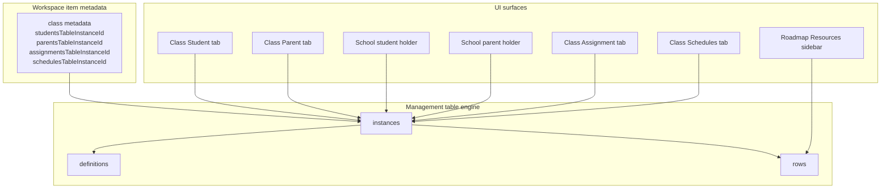

---

## 5. Students and parents — why two layers (school + class)

This is the most important **flow decision** in School.

| Layer | Question | Where | Membership sync? |
|-------|----------|-------|------------------|
| **School registration** | Is this person a student/parent **of our school**? | Student / Parent **holders** in workspace | **Yes** — updates `school_memberships` |
| **Class assignment** | Who is **in this class**? Who is this parent linked to **here**? | Class → **Student** / **Parent** tabs | **No** — references existing members |

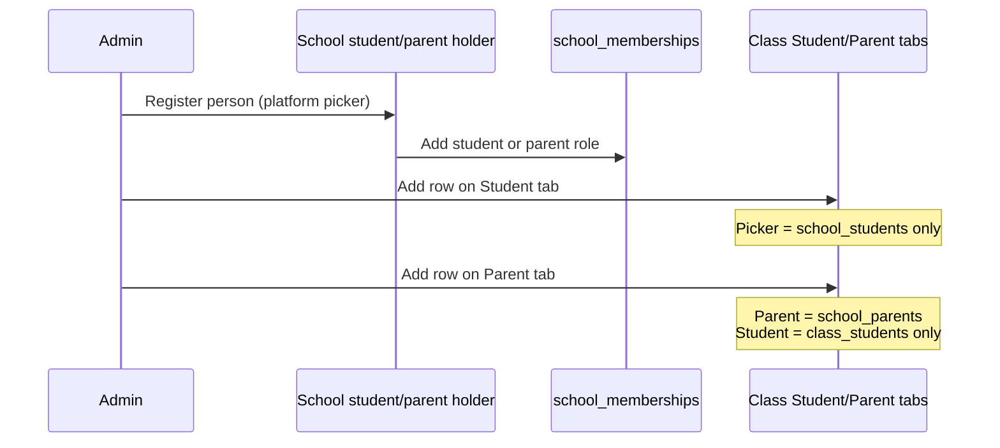

**Why connected this way:**

1. **Search stays correct** — you cannot pick a parent who was never registered, or a student not in this class’s roster.
2. **Scale** — school may have hundreds of students; each class only sees its subset.
3. **One registration, many classes** — register parent once; link per class where their children are.
4. **Authority** — school registration is the source of truth for “who belongs to our school.”

**Canonical admin order:**

1. Create **Student** holder → register students at school  
2. Create **Parent** holder → register parents at school  
3. Open **Class → Student** → assign school students to the class  
4. Open **Class → Parent** → link school parent + student from this class  

Detail: [school-roster-user-flows.md](../school-roster-page/school-roster-user-flows.md)

---

## 6. Person pickers — how context enforces the flow

Person columns do not always search “everyone.” The backend `picker` scope depends on **where** you edit:

| Where | Column | Picker scope | Who appears |
|-------|--------|--------------|-------------|
| School student registration | Student | `platform` | Any Delta Labs user |
| School parent registration | Parent | `platform` | Any Delta Labs user |
| Class Student tab | Student | `school_students` | Registered school students |
| Class Parent tab | Parent | `school_parents` | Registered school parents |
| Class Parent tab | Student | `class_students` | Students on **this class’s** Student tab only |

**Decision:** Empty pickers show **actionable** messages (“Register in school parent workspace first”), not silent failure.

Detail: [school-roster-person-picker-design.md](../school-roster-page/school-roster-person-picker-design.md)

---

## 7. Class workspace — how features connect inside one class

Opening a **class** loads a dedicated workspace with bottom navigation (`?nav=`).

| Tab / `nav` | Purpose | Data source |
|-------------|---------|-------------|
| **Class** (default) | Live / scheduled sessions | `school_class_sessions` |
| **Student** | Class roster | Bootstrapped students MT |
| **Parent** | Parent ↔ student links | Bootstrapped parents MT (separate instance) |
| **Attendance** | Register devices / attendance | Class attendance API |
| **Teacher** | Teachers for class | Teachers MT / panel |
| **Schedules** | Exam / session schedule rows | Schedules MT on class metadata |
| **Grade** | Grades | Grades MT |
| **Assignment** | Assignment rows | Assignments MT on class metadata |
| **Roadmap** | Class path timeline | `school_class_roadmaps` + resources API |

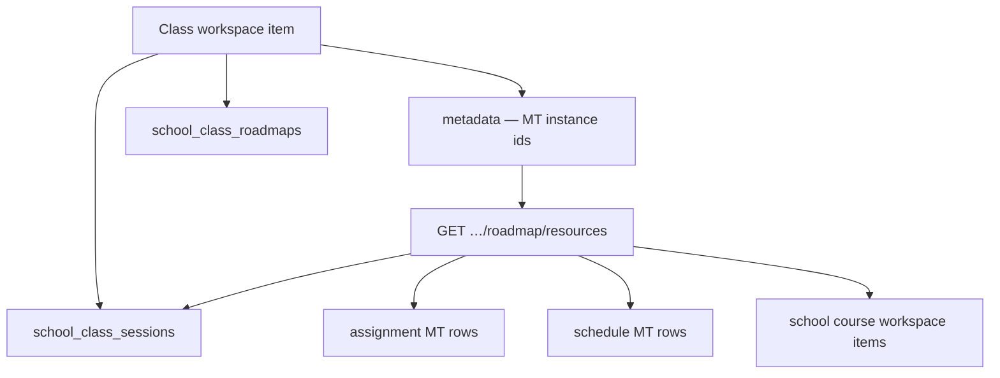

**Roadmap connection:** The roadmap does not duplicate sessions or assignments. `GET …/roadmap/resources` **aggregates** existing class sessions, school courses, assignment rows, and schedule rows so teachers drag real items onto the timeline.

Detail: [class-roadmap-architecture.md](./class-roadmap-architecture.md)

---

## 8. Architecture decisions summary

| ID | Decision | Why |
|----|----------|-----|
| **A-01** | Org-scoped API `/v1/orgs/{orgId}/schools/{schoolId}/…` | Multi-tenant safety; one school id in UX paths |
| **A-02** | Workspace tree with typed items | Flexible school structure without custom DB per school |
| **A-03** | Metadata links features to workspace items | Class “knows” its MT instances without scattered lookups |
| **A-04** | Management tables as shared grid engine | Extensible columns; one CRUD path for rosters and custom tables |
| **A-05** | Bootstrap MT for rosters (no template picker) | Managers get correct columns immediately |
| **A-06** | Separate MT instance per roster type on class | Prevents Parent tab showing wrong columns |
| **A-07** | School register → class assign (two layers) | Correct pickers, membership authority, multi-class parents |
| **A-08** | Membership sync on **school** holder patch only | Class rosters reference members; they do not re-register |
| **A-09** | `school:manage` for structure + roster mutate | Consistent gate until teacher-scoped roles exist |
| **A-10** | Class roadmap as one Mongo doc per class | Simple MVP; PUT replaces full section tree |
| **A-11** | Deep routes hide school icon rail | Class/student/parent/department views are focus modes, not “My School home” |

Roster ADRs R-01 … R-10: [school-roster-design-decisions.md](../school-roster-page/school-roster-design-decisions.md)

---

## 9. End-to-end flow — new school to class parent link

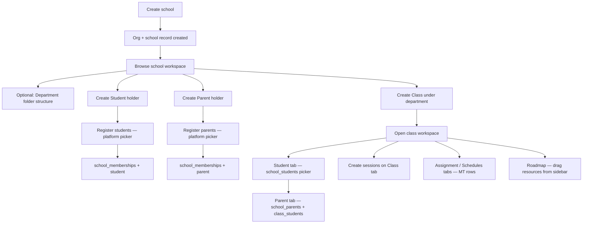

---

## 10. Data model — what points to what

| From | To | Link |
|------|-----|------|
| `school_workspace_items` | Parent item in tree | `parent_id` |
| Class `metadata` | Students roster | `studentsTableInstanceId`, column ids |
| Class `metadata` | Parents roster | `parentsTableInstanceId` (≠ students id) |
| Class `metadata` | Assignments / schedules | `assignmentsTableInstanceId`, `schedulesTableInstanceId` |
| MT instance | Workspace item | `workspace_item_id` |
| MT row person cell | Delta Labs user | `cells[colId].userId` |
| School student/parent patch | Membership | `school_memberships.role_keys` |
| Class roadmap doc | Class | `class_workspace_item_id` |
| Roadmap resources API | Sessions, MT rows, courses | Aggregated read — no duplicate store |

ER diagrams: [school-roster-backend-data-model-and-diagrams.md](../school-roster-page/school-roster-backend-data-model-and-diagrams.md)

---

## 11. UI shell — navigation vs focus modes

| Surface | School icon rail (Home, Offers, Marketplace)? | Why |
|---------|-----------------------------------------------|-----|
| My School home, offers, marketplace | **Yes** | Top-level school product areas |
| School workspace browse (`/school/[id]`) | **No** | Full-width workspace; tabs for All, Class, Parents, … |
| Department / class / student / parent deep links | **No** | Focus mode — back button returns to workspace |
| Management table editor | **No** | Same as class — immersive table UX |

---

## 12. What is intentionally not connected (yet)

| Area | Status | Notes |
|------|--------|-------|
| Course item ↔ class roster | Not automatic | Course is structure; class owns roster |
| Legacy enrollments API | Exists | Web UI uses MT rosters instead |
| Parent portal | Not built | Parents cannot browse class rosters in app yet |
| Ghost resources (roadmap) | Placeholder tab | No cross-class resource sharing yet |
| Full Grade / Attendance product | Partial UI | Tabs exist; depth varies |

Matrix: [school-capabilities-and-limitations.md](./school-capabilities-and-limitations.md)

---

## 13. Code map (source of truth)

| Area | Path |
|------|------|
| School API | `deltalabs-backend/app/api/v1/schools.py` |
| School domain | `deltalabs-backend/app/domain/school/*` |
| Management tables | `deltalabs-backend/app/domain/management_table/*` |
| Web school module | `deltalabs-frontend/src/modules/School/*` |
| Class bottom nav | `deltalabs-frontend/src/modules/School/class/ClassBottomNav.tsx` |
| School workspace browse | `deltalabs-frontend/src/modules/School/views/SchoolWorkspaceDetailView.tsx` |
| School shell / icon rail | `deltalabs-frontend/src/components/features/school/layout/SchoolManagementShell.tsx` |
| Class roadmap | `deltalabs-frontend/src/modules/School/roadmap/*` |

---

## 14. Reading order by role

### Product / school admin

1. This document (sections 1–5, 9)  
2. [school-overview-user-brief.md](./school-overview-user-brief.md)  
3. [school-roster-changes-brief.md](./school-roster-changes-brief.md)  

### Developer onboarding

1. This document (full)  
2. [school-system-architecture-decision-guide.md](../school-roster-page/school-system-architecture-decision-guide.md)  
3. [school-organization-and-workspace-concepts.md](./school-organization-and-workspace-concepts.md)  
4. [school-roster-backend-design.md](../school-roster-page/school-roster-backend-design.md)  

### Architect / performance / change impact

1. [school-system-architecture-decision-guide.md](../school-roster-page/school-system-architecture-decision-guide.md)  
2. [database-schema.md](../database-schema.md)  

---

*Last updated: 2026-07-03*
