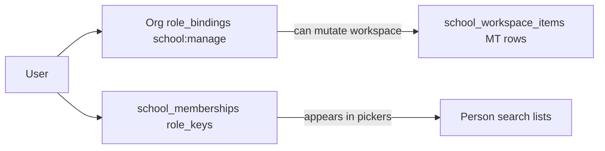

# School access and permissions

## Purpose

Who can **see** and **change** school structure, rosters, classes, and management tables — and **why** changes in one place affect another.

**Audience:** Admins, product, developers.

**Related:** [school-tenant-architecture.md](../../deltalabs-frontend/docs/school-tenant-architecture.md), [authz-org-rbac-design.md](../au-page/authz-org-rbac-design.md)

---

## 1. Two permission layers

| Layer | Collection / mechanism | What it controls |
|-------|------------------------|------------------|
| **Organization RBAC** | `role_bindings` + permissions on org | Create school, `school:manage`, org admin actions |
| **School membership** | `school_memberships` | Per-school roles: `school_owner`, `student`, `parent`, … |

Most **structure and roster editing** today is gated by **org permission** `school:manage` (or wildcard `*`), not by “teacher” vs “student” school role alone.

---

## 2. Who can do what (today)

| Action | Typical requirement | Notes |
|--------|---------------------|-------|
| Create a school | Authenticated user (`POST /v1/schools`) | Creates org if needed; creator gets `school_owner` membership |
| Open school workspace | Member of school / org with access | Read paths vary by feature |
| Create folder, department, class, course, MT item | **`school:manage`** on org | Shown in UI if missing |
| Edit / delete workspace items | **`school:manage`** | Same gate |
| Bootstrap class student/parent table | **`school:manage`** | Auto on first open by manager |
| Add/edit roster rows | **`school:manage`** | Class tabs + school registration holders |
| Register student at school (membership sync) | **`school:manage`** + save on student holder | Writes `student` to `school_memberships` |
| Register parent at school | **`school:manage`** + save on parent holder | Writes `parent` to `school_memberships` |
| Create / edit class sessions | **`school:manage`** (class workspace) | `SchoolClassDetailView` |
| Link standalone management table template | **`school:manage`** | Management table hub |
| View marketplace / offers | School membership + feature flags | Separate from roster |
| Student/parent self-serve edit own class roster | **Not supported** | No parent/student mutate on class MT |

Frontend check (class): `userCanManageSchoolClassWorkspace()` in `schoolClassPermissions.ts` — true if org permissions include `school:manage` or `*`, or relevant owner role keys.

---

## 3. How access affects data

### Creating a class

- Creates `school_workspace_items` with `type: class`.
- Does **not** auto-create roster rows or memberships.
- Manager must open **Student** / **Parent** tabs to bootstrap tables.

### Registering a student at school

- Patches a row on the **student holder** MT.
- Backend `_maybe_sync_school_student_membership_from_row` upserts `school_memberships` with `student`.
- **Effect:** User appears in **`school_students`** picker on class Student tabs.

### Registering a parent at school

- Same on **parent holder** → `parent` membership.
- **Effect:** User appears in **`school_parents`** picker on class Parent tab.

### Adding student to class

- Patches class students MT only.
- **Effect:** User appears in **`class_students`** picker on that class’s Parent tab.
- **Does not** grant org-level or new school role.

### Linking parent to student in class

- Patches class parents MT only.
- **Effect:** Relationship stored in MT row cells for that class.
- **Does not** create platform-wide parent–child record outside the class MT.

---

## 4. School membership roles (Phase B)

| `role_keys` value | Meaning today |
|-------------------|---------------|
| `school_owner` | Creator of school; listed in `GET /v1/me/schools` |
| `student` | Synced from school student registration MT |
| `parent` | Synced from school parent registration MT |
| (future) `teacher`, … | Invites / join flows not fully productized |

**Important:** Class roster membership **does not** add `student` — only school registration does. A user could theoretically be on a class Student tab without `student` membership if data were edited out of band; pickers assume school registration was done first.

---

## 5. Organization vs school (why it matters for access)

| Concern | Org | School |
|---------|-----|--------|
| Billing / tenant boundary | Yes | Indirect |
| `school:manage` permission | Yes | Checked via org |
| “Is this person a student here?” | No | `school_memberships` |
| Workspace tree | Stored with `org_id` + `school_id` | User navigates by `schoolId` in URL |

Users often **never see “org”** in UI; URLs use `/features/school/[schoolId]/…`. The frontend resolves `orgId` from `GET /v1/me/schools` (`useSchoolActiveOrgId`).

---

## 6. Security rules (engineering)

- Every API must scope by **org_id** + **school_id** from authenticated context — not trust client ids alone.
- Person pickers never return users outside the declared **picker** scope.
- Bootstrap and row patch require **`school:manage`** same as workspace create.

---

## 7. Future access model (not implemented)

Target direction (see school-tenant-architecture § Phase B–D):

- School-scoped **teacher** role with mutate on assigned classes only.
- **Parent** read-only view of linked students’ class activity.
- Invite / join-by-code instead of platform search only.

Today, roster mutation is **manager-centric**.

---

*Last updated: 2026-06-03*
