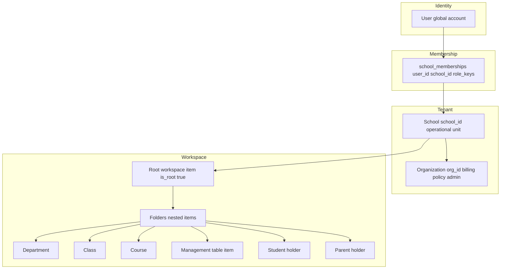
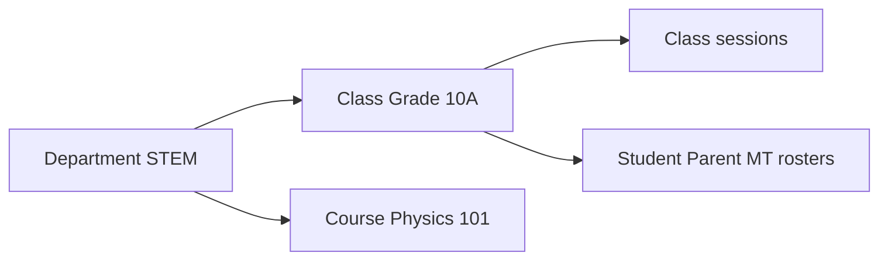
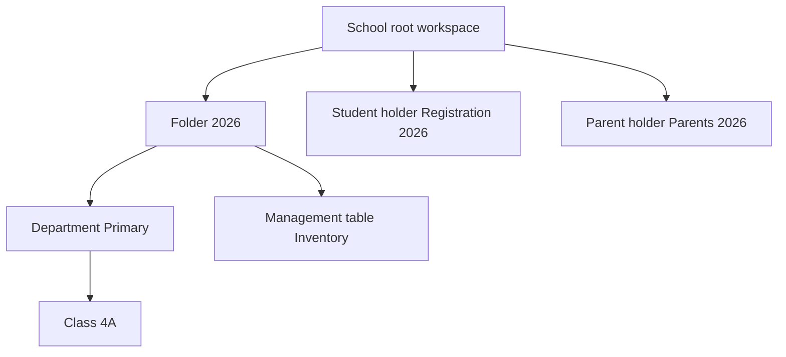

# School organization and workspace concepts

## Purpose

Explain **how a school is structured in Delta Labs**: organization vs school, workspace tree, each **workspace item type**, and how **class**, **course**, **management table**, and **roster tables** relate.

**Audience:** Product, school admins, and developers onboarding to the School module.

**Related:** [school-tenant-architecture.md](../../deltalabs-frontend/docs/school-tenant-architecture.md), [database-schema.md](../database-schema.md) § `school_workspace_items`

---

## 1. Hierarchy: user → org → school → workspace



| Level | Stored in | User-facing name |
|-------|-----------|------------------|
| **User** | `users` | Delta Labs account |
| **Organization** | `orgs` | Usually hidden; created when you create your first school |
| **School** | `schools` | “My school” in the app |
| **Workspace item** | `school_workspace_items` | Cards/folders in the school workspace |
| **School membership** | `school_memberships` | “This user is student/parent/owner at this school” |

Each workspace item has: `type`, `title`, optional `parent_id` (tree), and `metadata` (type-specific keys — e.g. class roster table ids).

---

## 2. Workspace item types

Backend enum: `SchoolWorkspaceItemType` in `app/domain/school/schemas.py`

| Type | API value | Opens as | Primary purpose |
|------|-----------|----------|-----------------|
| Folder | `folder` | Navigate into folder | Organization only |
| Department | `department` | Department workspace URL | Sub-school structure (e.g. faculties) |
| Class | `class` | Class detail + bottom nav | Teaching unit: sessions, rosters, future grade/attendance |
| Course | `course` | Course detail (evolving) | Curriculum / course content holder |
| Management table | `management-table` | MT editor hub | Generic configurable table linked to a template |
| Student | `student` | Student registration page | **School-wide** student registration MT |
| Parent | `parent` | Parent registration page | **School-wide** parent registration MT |
| Resource | `resource` | Resource view | Documents / assets |
| Service | `service` | Service view | School services |
| Staff | `staff` | Staff view | Staff records |

**Web route patterns (examples):**

| Type | Route pattern |
|------|---------------|
| School workspace | `/features/school/[schoolId]` |
| Department | `/features/school/[schoolId]/department/[departmentItemId]` |
| Class | `/features/school/[schoolId]/class/[classItemId]` |
| Student registration | `/features/school/[schoolId]/student/[studentItemId]` |
| Parent registration | `/features/school/[schoolId]/parent/[parentItemId]` |
| Management tables hub | `/features/school/[schoolId]/management-tables/...` |

---

## 3. Department vs class vs course

These names are easy to confuse. In Delta Labs they are **different workspace item types**:

| Concept | Meaning | Typical use |
|---------|---------|-------------|
| **Department** | Structural division of the school workspace | “Secondary school”, “STEM department” — contains folders, classes, etc. |
| **Class** | A **group of learners** with sessions and rosters | “Grade 10 Section A” — has Student/Parent tabs, live sessions |
| **Course** | A **curriculum unit** or course offering | “Introduction to Physics” — may relate to content/materials; not the roster itself |



**Important:** Student and parent **rosters live on the class**, not on the course item. Courses do not replace class rosters.

---

## 4. Management table — two flavors

### 4.1 Standalone management table workspace item

- User creates type **`management-table`** in the workspace.
- Manager links it to a **template** (definition) via the management-table hub.
- Used for arbitrary school data (inventory, custom lists, etc.).
- Route: `/features/school/.../management-tables/...`

### 4.2 Bootstrapped roster tables (metadata on class / student / parent items)

These are **management tables under the hood**, but users never pick a template manually:

| Attached to | Metadata keys | Default columns | Purpose |
|-------------|---------------|-----------------|---------|
| Class (Student tab) | `studentsTableInstanceId`, `studentsTableStudentColumnId`, … | **Student** | Class roster |
| Class (Parent tab) | `parentsTableInstanceId`, `parentsTableParentColumnId`, `parentsTableStudentColumnId`, … | **Parent**, **Student** | Parent ↔ student links |
| School student holder | `studentsTableInstanceId`, … | **Student** | Register school students + sync membership |
| School parent holder | `parentsTableInstanceId`, … | **Parent** | Register school parents + sync membership |

**Storage (Mongo):**

- `school_management_table_definitions` — column schema
- `school_management_table_instances` — instance linked to workspace item
- `school_management_table_rows` — row data in `cells` map

**Why separate instances for class students vs class parents:**

Early bugs reused one instance id for both tabs, so the Parent tab showed a Student column. We now **require separate instance ids** and repair bad metadata on bootstrap.

Deep dive: [school-roster-page/school-roster-backend-data-model-and-diagrams.md](../school-roster-page/school-roster-backend-data-model-and-diagrams.md)

---

## 5. How roster tables affect membership

| Where you edit | What happens to `school_memberships` |
|----------------|--------------------------------------|
| School **student** holder — save Student cell | User gets **`student`** role at school (if not already) |
| School **parent** holder — save Parent cell | User gets **`parent`** role at school |
| Class **Student** tab — save row | **No** membership change — only references existing school student |
| Class **Parent** tab — save row | **No** membership change — links registered parent to class student |

**Design reason:** Registration is authoritative at **school** level. Class is assignment and relationships for **that class only**.

---

## 6. Person picker scope (by context)

When you edit a **person** cell, search is filtered:

| Where | Column | Who you can pick |
|-------|--------|------------------|
| School student registration | Student | Any Delta Labs user (`platform`) |
| School parent registration | Parent | Any Delta Labs user (`platform`) |
| Class Student tab | Student | Users with **school student** membership |
| Class Parent tab | Parent | Users with **school parent** membership |
| Class Parent tab | Student | Users on **this class’s Student tab** only |

Detail: [school-roster-page/school-roster-person-picker-design.md](../school-roster-page/school-roster-person-picker-design.md)

---

## 7. Class workspace internals

Opening a **class** loads `SchoolClassDetailView`. Bottom nav (`?nav=`) switches sections:

| `nav` value | Panel | Data |
|-------------|-------|------|
| (default) / `class` | Sessions list | `class_sessions` API |
| `students` | `ClassStudentsTablePanel` → `StudentsTablePanel` | Class students MT |
| `parents` | `ClassParentsTablePanel` → `ParentsTablePanel` | Class parents MT |
| `attendance`, `teacher`, … | Placeholder / future | Not roster scope |

Class metadata example keys:

```json
{
  "studentsTableInstanceId": "mti_…",
  "studentsTableDefinitionId": "mtd_…",
  "studentsTableStudentColumnId": "col_…",
  "parentsTableInstanceId": "mti_…",
  "parentsTableDefinitionId": "mtd_…",
  "parentsTableParentColumnId": "col_…",
  "parentsTableStudentColumnId": "col_…"
}
```

---

## 8. How items nest in the tree



- **`parent_id`** on each `school_workspace_items` doc defines nesting.
- Omitting `parent_id` on create attaches under the **school root department** (API default).
- Departments can have their own URL segment; nested navigation uses breadcrumbs / path stack.

---

## 9. Mobile parity

Mobile (`deltalabs-mobile`) uses the same workspace item types and API. Class **Student** and **Parent** tabs and bootstrap endpoints are wired; school **parent registration** page may lag web in some builds. API contracts are shared.

---

*Last updated: 2026-06-03*
