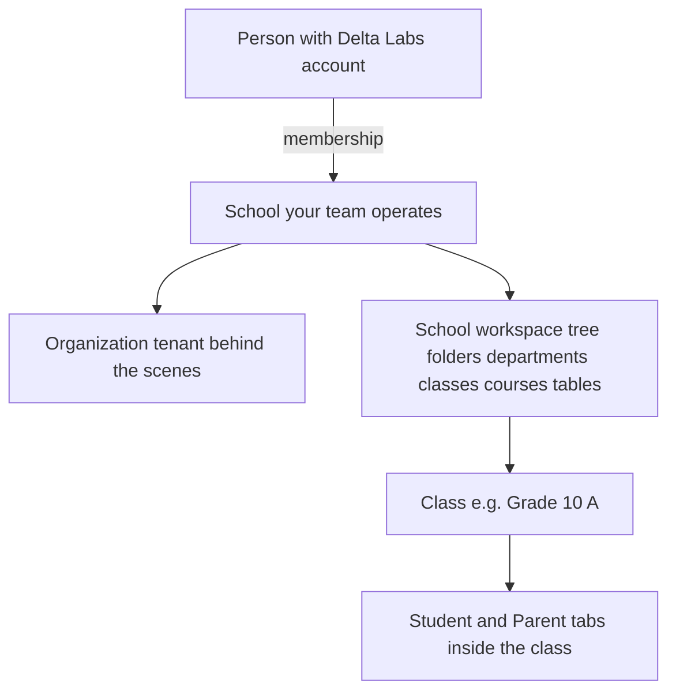

# School product — overview (plain language)

This page explains **how schools work in Delta Labs** for people who do not need file paths or API names. For technical detail, see [README.md](./README.md) → developer path, or [school-roster-page](../school-roster-page/README.md).

---

## What problem we are solving

Schools need one place to:

1. **Organize** their structure (departments, classes, courses, documents, tables).
2. **Register** who belongs to the school (students, parents, staff).
3. **Assign** students to classes and **link parents** to students within a class.
4. **Run day-to-day work** inside a class (sessions, and eventually attendance, grades, assignments).

Delta Labs treats a **school** as the main working unit. Behind the scenes there is also an **organization** (tenant) for billing and admin — most users never think about it when they “create a school.”

---

## The big picture

**Key idea:** The same person can be a **student** at one school and a **teacher** at another. Roles are **per school**, not one global label.

---

## Two layers for students and parents

We deliberately split **school registration** from **class assignment**.

| Layer | Question it answers | Where in the app |
|-------|---------------------|------------------|
| **School** | “Is this person a student or parent **of our school**?” | School workspace → **Student** or **Parent** registration areas |
| **Class** | “Who is **in this class**?” and “Which **parent** is linked to which **student** here?” | Open a **Class** → bottom tabs **Student** and **Parent** |

**Why two layers?**

- A school may have hundreds of students; a class only needs its own subset.
- Parents are registered once at school level, then **linked per class** (a parent might have children in different classes).
- Search lists stay small and correct — you cannot accidentally pick someone who is not registered, or a student who is not in that class.

**Correct order for admins:**

1. Register students at **school** level.
2. Register parents at **school** level.
3. On the **class → Student** tab, add the students who belong to that class.
4. On the **class → Parent** tab, pick a registered parent and the student **from that class’s student list**.

---

## What is a “management table”?

Instead of a fixed form with only “name” and “email,” many school areas use a **management table** — a spreadsheet-like grid:

- **Rows** = people or records (one row per student, parent link, etc.).
- **Columns** = fields you can extend (person picker, text, dates, etc.).
- **Person columns** search Delta Labs users with rules that depend on context (whole platform vs school-only vs this class only).

**Why we chose this:**

- Schools can add custom columns without waiting for new product features.
- The same table technology is reused for generic school tables, class rosters, and registration holders.
- One consistent UX for “add row → fill cells → save.”

---

## Workspace items you will see

When you browse a school’s workspace, you can create different **item types**. Each opens a different experience:

| Item type | What it is for |
|-----------|----------------|
| **Folder** | Grouping only — navigate inside like a directory |
| **Department** | A major slice of the school (e.g. “Primary”, “Science”) with its own workspace view |
| **Class** | A teaching group — sessions, **Student** tab, **Parent** tab, and more tabs planned |
| **Course** | Curriculum / course material holder (structure item; not the same as “class roster”) |
| **Management table** | Standalone configurable table (template-based), separate from auto-bootstrapped class rosters |
| **Student** (holder) | School-wide **student registration** table |
| **Parent** (holder) | School-wide **parent registration** table |
| **Resource, Service, Staff** | Other school content types (placeholders / partial UX depending on area) |

See [school-organization-and-workspace-concepts.md](./school-organization-and-workspace-concepts.md) for how these nest and connect.

---

## Class bottom navigation

Inside a class, the bottom bar has several sections. **Today:**

| Tab | Status | Purpose |
|-----|--------|---------|
| **Class** | Implemented | Live / scheduled **sessions** (virtual, in-person, hybrid) |
| **Student** | Implemented | Class roster — school students assigned to this class |
| **Parent** | Implemented | Parent ↔ student links **for this class only** |
| **Attendance, Teacher, Schedules, Grade, Assignment** | UI present | Navigation exists; full product flows not complete |

---

## What changed recently (students & parents)

Before the latest work:

- The **Parent** tab could look like the **Student** tab (wrong default column).
- Person search could show **any user** or **all school students**, which was confusing.
- There was no clear **school-first** flow.

**After:**

- Separate tables and metadata for class **students** vs class **parents**.
- Parent tab defaults to a **Parent** column; also has a **Student** column scoped to **students already on that class’s Student tab**.
- School **Student** and **Parent** holders register people and grant `student` / `parent` **school membership**.
- Class tabs **reference** those members; they do not re-register them.

Full narrative: [school-roster-changes-brief.md](./school-roster-changes-brief.md).

---

## Who can do what (short version)

- **Creating** workspace structure (folders, departments, classes, registration holders) and **editing rosters** generally requires **school manager** access (`school:manage` on the organization).
- **Viewing** school workspace content depends on org/school membership (see [school-access-and-permissions.md](./school-access-and-permissions.md)).
- **Parents and students** do not yet have a dedicated “parent portal” to view class rosters — that is future work.

---

## Related docs

- Workspace concepts (detailed): [school-organization-and-workspace-concepts.md](./school-organization-and-workspace-concepts.md)
- Can / cannot do: [school-capabilities-and-limitations.md](./school-capabilities-and-limitations.md)
- Developer roster detail: [school-roster-page](../school-roster-page/README.md)

---

*Last updated: 2026-06-03*
