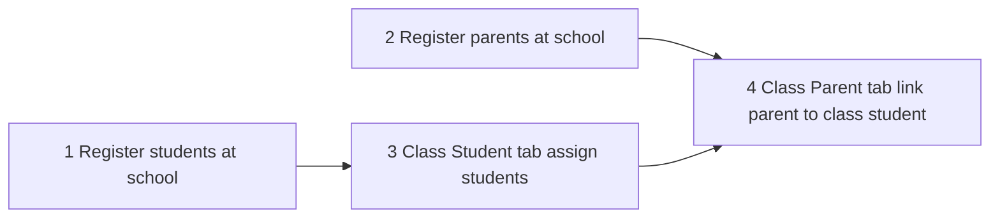

# Students & parents — what we changed and why (brief)

Plain-language summary of the **recent roster work** for stakeholders and new team members. Technical ADRs live in [school-roster-page/school-roster-design-decisions.md](../school-roster-page/school-roster-design-decisions.md).

---

## Problems we heard

| Problem | Impact |
|---------|--------|
| Parent tab looked like Student tab | Admins did not know they were linking parents, not enrolling students |
| Person search showed “everyone” | Easy to pick users who were not registered at the school |
| Parent row “Student” column showed all school students | Could link a parent to a student **not in that class** |
| No clear order of operations | Teams tried to add parents to a class before registering anyone at school level |

---

## Direction we chose

**School first, class second** — always register people at the **school**, then assign or link them inside a **class**.

We did **not** build separate hard-coded enrollment forms. We extended the existing **management table** pattern so schools can still add custom columns later.

---

## What we built (by surface)

### School workspace — Student holder

- Admin creates a **Student** workspace item (e.g. “Students 2026”).
- Opening it shows a table with a default **Student** column.
- Searching picks any **Delta Labs account** (platform-wide search).
- Saving a row adds that person as a **school student** (`student` on school membership).

### School workspace — Parent holder

- Same pattern with type **Parent** and a default **Parent** column.
- Saving adds **`parent`** school membership.

### Class — Student tab

- Table with **Student** column.
- Search only shows people already registered as **school students**.
- Does **not** change school membership — only records “this student is in this class.”

### Class — Parent tab

- Table with **Parent** column and **Student** column.
- **Parent** search: registered **school parents** only.
- **Student** search: students on **this class’s Student tab** only — not the whole school.
- Does **not** change school membership — only records the link for this class.

---

## Design decisions (in plain language)

| Decision | Why |
|----------|-----|
| Two separate tables on a class (students vs parents) | Different jobs: roster vs parent–child links; avoids one table doing both badly |
| Separate table **instances** in the database | A bug had reused the same instance id; Parent tab inherited Student columns |
| Parent tab defaults to **Parent** column first | Matches Student tab pattern (“primary column = what this tab is about”) |
| Membership sync only on **school** registration tables | Class is assignment; school registration is the source of truth for “who belongs here” |
| Card-style search results | Easier to scan than a plain divided list |
| Managers need **school:manage** to bootstrap and edit | Same rule as creating classes and other workspace items |

---

## What admins should do in practice

1. **Create** Student and Parent holders under the school workspace (once per cohort/year if you like).
2. **Register** all students and parents there first.
3. For each **class**, open **Student** tab and add rows for that class.
4. Then open **Parent** tab and, per row, pick parent + student (student list comes from step 3).
5. Optional: add custom columns (phone, notes) on any of these tables — same as other management tables.

---

## What we explicitly did **not** build yet

| Not built | What happens instead |
|-----------|----------------------|
| Parent portal / parent login to see class | Parents use normal accounts; no parent-facing roster view |
| Email invite for parents | Must find existing Delta Labs account in search |
| Server blocking invalid parent–student pairs | UI picker limits choices; backend does not re-validate on save |
| Auto-add parents when student joins class | Manual rows on Parent tab |
| School-wide parent–child graph outside class | Links only on class Parent tab today |

Full matrix: [school-capabilities-and-limitations.md](./school-capabilities-and-limitations.md)

---

## For developers

| Topic | Document |
|-------|----------|
| API routes & bootstrap | [school-roster-backend-design.md](../school-roster-page/school-roster-backend-design.md) |
| Picker algorithms | [school-roster-person-picker-design.md](../school-roster-page/school-roster-person-picker-design.md) |
| Frontend components | [school-roster-frontend-component-hierarchy.md](../school-roster-page/school-roster-frontend-component-hierarchy.md) |
| Step-by-step admin flows | [school-roster-user-flows.md](../school-roster-page/school-roster-user-flows.md) |

---

*Last updated: 2026-06-03*
