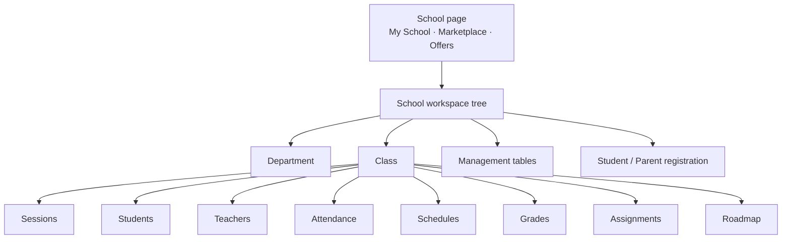

# School product — what we have implemented

**Purpose:** Handoff document for what exists today in the School product (web + backend).  
**Audience:** Product, partners, school admins, developers sharing status.  
**Platform:** Delta Labs web app (primary). Mobile notes called out where different.  
**Date:** 2026-07-16

**Related deep docs:** [school-page README](../school-page/README.md) · [class docs](../school-class-page/README.md) · [architecture hub](../school-page/delta-labs-school-architecture-how-it-connects.md)

---

## Legend

| Status | Meaning |
|--------|---------|
| **Done** | Usable end-to-end on web |
| **Partial** | Works in part, or UI shell only |
| **Not yet** | Do not promise to users |

---

## 1. School page (My School home)

| Feature | Status | What you get |
|---------|--------|--------------|
| Create a school | **Done** | Self-serve create; org/tenant created in the background if needed |
| My School list | **Done** | See schools you belong to |
| Open school workspace | **Done** | Browse folders, departments, classes, tables |
| Marketplace | **Done** | List / browse / buy / bid (web) |
| Offers | **Done** | Ownership and marketplace offers |
| Archive school | **Done** | Archive from home |
| Invite by email / join by code | **Not yet** | Users must already exist on the platform for roster pickers |

---

## 2. School workspace

| Feature | Status | What you get |
|---------|--------|--------------|
| Folder nesting | **Done** | Organize the tree |
| Create department | **Done** | Opens department workspace |
| Create class | **Done** | Opens class workspace with bottom nav |
| Create course item | **Partial** | Can create and list; **no dedicated course workspace yet** |
| Create management table | **Done** | Standalone table + template link |
| Student registration holder | **Done** | School-wide student register |
| Parent registration holder | **Done** | School-wide parent register |
| Resource / service / staff items | **Partial** | Types exist; depth varies |

**Flow:** School → workspace tree → open item (department / class / student / parent / management table).

---

## 3. Department

| Feature | Status | What you get |
|---------|--------|--------------|
| Department workspace page | **Done** | Own URL; scoped tree under that department |
| Create classes / folders under department | **Done** | Same workspace patterns as school root |

---

## 4. Management table (shared engine)

Used for school registration, class rosters, grades, schedules, assignments, and standalone school tables.

| Feature | Status | What you get |
|---------|--------|--------------|
| Create / edit definitions (columns) | **Done** | Text, number, date, person, dropdown, status, … |
| Instances bound to workspace items | **Done** | One instance per use (e.g. class students) |
| Add / edit / delete rows | **Done** | Requires `school:manage` |
| Person picker (scoped search) | **Done** | Platform / school students / school parents / class students |
| Template picker (standalone MT) | **Done** | Pick format when creating a school table |
| Auto-bootstrap on open | **Done** | Class and registration holders bootstrap tables when needed |
| CSV import / export | **Not yet** | — |
| Row-level permissions | **Not yet** | Whole-table manager gate only |

---

## 5. School registration (students & parents)

| Feature | Status | What you get |
|---------|--------|--------------|
| Register students at school | **Done** | Student holder → management table → membership `student` |
| Register parents at school | **Done** | Parent holder → management table → membership `parent` |
| Search existing platform users | **Done** | Person column search |
| Bulk import | **Not yet** | Manual rows |
| Invite someone who has no account | **Not yet** | Account must exist first |

**Rule:** Register at **school** first, then assign people into a **class**.

---

## 6. Class workspace (shell)

| Feature | Status | What you get |
|---------|--------|--------------|
| Class page + bottom navigation | **Done** | Tabs for teaching tools |
| Start menu (overflow) | **Done** | Extra destinations; hides items already on the bar |
| Open from school / department tree | **Done** | Click class item |

### Class tabs — status

| Tab | Status | What you get |
|-----|--------|--------------|
| **Class (sessions)** | **Done** | Create / list sessions; start live |
| **Student** | **Done** | Class roster table; pick school-registered students |
| **Parent** | **Done** | Class parents table; link to class students |
| **Teacher** | **Done** | Teachers table (bootstrap + edit) |
| **Attendance** | **Done** | Session marks, devices, leave requests |
| **Schedules** | **Done** | Class schedules management table |
| **Grade** | **Done** | Grades management table |
| **Assignment** | **Done** | Assignments management table |
| **Roadmap** | **Done** | Sections + contents; sidebar from real sessions/courses/assignments/schedules |
| **Live Meet room** | **Partial** | Route + session metadata; **not real video** (placeholder UI) |
| Assets / Plans / Labs / R&D / Transport / Materials | **Not yet** | “Coming soon” placeholders |

---

## 7. Class features in detail

### Sessions
- Create scheduled / draft sessions (virtual, in-person, hybrid).
- List on the Class tab.
- Start → opens Meet route (shell only for A/V).

### Student
- Auto-bootstrap students table on the class.
- Person picker limited to school-registered students (typical flow).
- Custom columns supported via management table editor.

### Teacher
- Auto-bootstrap teachers table.
- Person / role / subject style starter columns.

### Attendance
- Attendance state per class (marks, session settings).
- Devices registration.
- Leave requests table (students can submit leave where allowed).
- Student rows driven by class students table + sessions.

### Schedule
- Schedules management table on the class (session-aware columns).

### Roadmap
- One roadmap document per class.
- Drag resources from sidebar (sessions, courses, assignments, schedules).
- Progress pointers (`currentSectionId` / `currentContentId`).
- Full detail: [class-roadmap-architecture.md](../school-page/class-roadmap-architecture.md)

### Grades & Assignments
- Dedicated management tables with bootstrap on first open.

---

## 8. Permissions (short)

| Who | Can do |
|-----|--------|
| Org member | Open school / class, read most data |
| User with `school:manage` (or org owner/admin) | Create structure, edit tables, sessions, attendance config, roadmap |
| Student / parent roles in `school_memberships` | Appear in My School / pickers; **not** full admin edit by themselves |

---

## 9. Mobile (quick status)

| Area | Status |
|------|--------|
| Class sessions, students, parents, teachers, attendance, grades | **Done** / largely available |
| Schedules, assignments, roadmap | **Done** |
| School student registration | **Done** |
| School parent registration | **Not yet** (lags web) |
| Marketplace buy/bid | **Partial** |

Same backend APIs as web.

---

## 10. One-page architecture picture

---

## 11. Do not promise (yet)

- Live video Meet product  
- Course teaching workspace (items only)  
- Email invites / join-by-code  
- Parent self-serve portal  
- CSV roster import/export  
- Full mobile parity for roadmap / schedules / assignments / parent registration  

---

## 12. Where to go next (for builders)

| Need | Doc |
|------|-----|
| How org / school / class connect | [delta-labs-school-architecture-how-it-connects.md](../school-page/delta-labs-school-architecture-how-it-connects.md) |
| Class flows + FE/BE standards | [school-class-page/](../school-class-page/README.md) |
| Roster design | [school-roster-page/](../school-roster-page/README.md) |

---

*This is the stakeholder-facing status of the School product as of 2026-07-16.*
