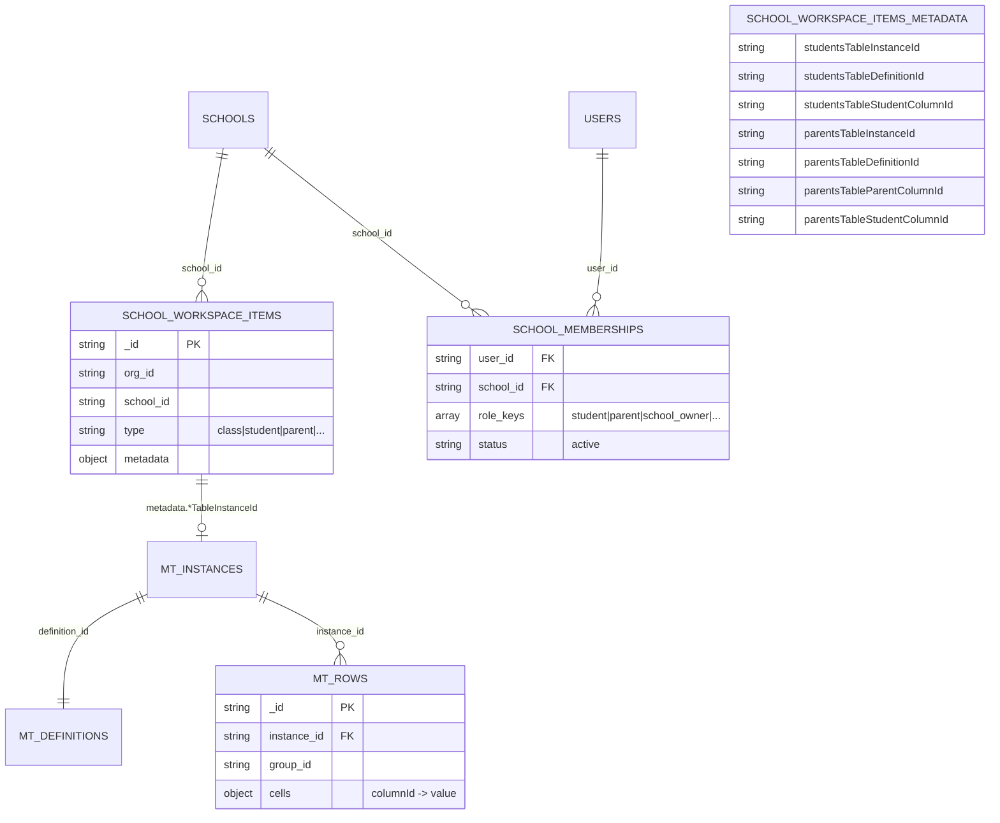
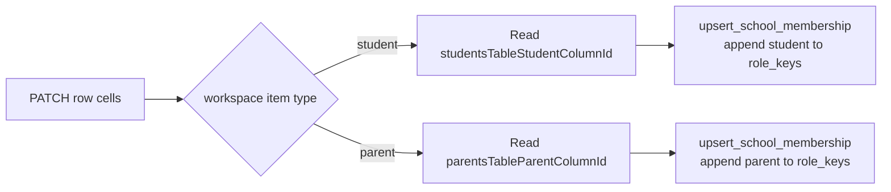
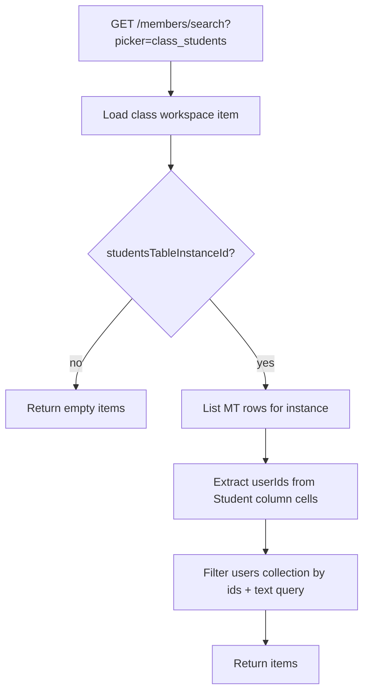

# School roster — Backend data model and diagrams

## Overview

Roster features persist through:

1. **`school_workspace_items`** — holder nodes + **metadata** pointing at MT instances
2. **Management table collections** — definitions, instances, rows
3. **`school_memberships`** — `role_keys` includes `student` / `parent` after school registration patch
4. **`users`** — person picker search target

No separate `class_parents` or `class_enrollments` collection is required for the MT-based UI (legacy enrollment may still exist).

---

## Entity relationship (logical)



---

## Workspace metadata keys

Stored on `school_workspace_items.metadata`:

### Students table

| Key | Type | Purpose |
|-----|------|---------|
| `studentsTableInstanceId` | string | MT instance id |
| `studentsTableDefinitionId` | string | MT definition id |
| `studentsTableStudentColumnId` | string | Person column id; membership sync |

### Parents table

| Key | Type | Purpose |
|-----|------|---------|
| `parentsTableInstanceId` | string | MT instance id |
| `parentsTableDefinitionId` | string | MT definition id |
| `parentsTableParentColumnId` | string | Person column id; membership sync on school `parent` workspace |
| `parentsTableStudentColumnId` | string | Student link column (class parents table only) |

### Example (class item)

```json
{
  "studentsTableInstanceId": "mti_abc…",
  "studentsTableDefinitionId": "mtd_def…",
  "studentsTableStudentColumnId": "mtc_col_student",
  "parentsTableInstanceId": "mti_xyz…",
  "parentsTableDefinitionId": "mtd_parent…",
  "parentsTableParentColumnId": "mtc_col_parent",
  "parentsTableStudentColumnId": "mtc_col_student_link"
}
```

---

## Person cell value shape (in `cells`)

```json
{
  "userId": "usr_…",
  "fullName": "Jane Doe",
  "username": "jane",
  "email": "jane@example.com"
}
```

Backend sync reads `userId` / `user_id`. Display uses `fullName`, `username`, `email`.

---

## Management table collections

| Collection | Roster usage |
|------------|--------------|
| `school_management_table_definitions` | Column schema (Student, Parent, custom fields) |
| `school_management_table_instances` | Linked to workspace via `workspace_item_id` + metadata mirror |
| `school_management_table_rows` | Roster rows; person values in `cells` map |

Default group id: `mtg_main` (`MANAGEMENT_TABLE_DEFAULT_GROUP_ID`).

---

## `school_memberships` role sync

After patch on **school** registration workspace:



Class workspace patches **do not** write memberships.

---

## `class_students` data read path



---

## Workspace item types (roster-related)

| type | Purpose |
|------|---------|
| `student` | School student registration holder |
| `parent` | School parent registration holder |
| `class` | Hosts class student + class parent MT metadata |

---

## Indexes (inherited)

Roster code relies on existing school + MT indexes from repository bootstrap (`ensure_indexes`). No roster-specific index additions documented separately.

---

*Last updated: 2026-06-03*
