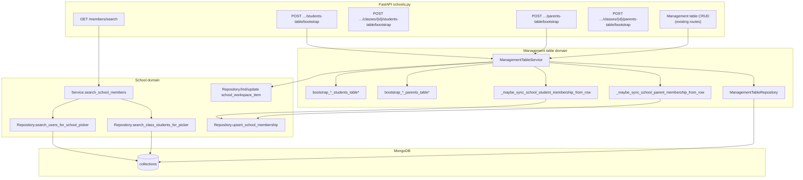

# School roster — Backend design (API, services, bootstrap)

## What this document covers

- FastAPI **route boundary** for roster bootstrap and member search
- **Domain services** (school search, management table bootstrap, membership sync)
- Bootstrap and repair rules
- Service architecture diagram

**Evidence (code):**

- `deltalabs-backend/app/api/v1/schools.py`
- `deltalabs-backend/app/domain/school/service.py`
- `deltalabs-backend/app/domain/school/repository.py`
- `deltalabs-backend/app/domain/management_table/service.py`
- `deltalabs-backend/app/domain/school/schemas.py`

**Companion:** [school-roster-person-picker-design.md](./school-roster-person-picker-design.md), [school-roster-backend-data-model-and-diagrams.md](./school-roster-backend-data-model-and-diagrams.md)

---

## Service architecture diagram



---

## API routes

Base: `/v1/orgs/{org_id}/schools/{school_id}`

### Member search (person picker)

```
GET /members/search
```

| Query | Type | Default | Notes |
|-------|------|---------|-------|
| `q` | string | `""` | Search text; ≥2 chars used client-side before call |
| `limit` | int | 20 | Max 50 |
| `picker` | enum | `school_students` | See person-picker doc |
| `classWorkspaceItemId` | string | optional | **Required** when `picker=class_students` |

**Auth:** org membership (`require_org_membership`)

**Response:** `{ items: [{ userId, username, email, fullName }] }`

### Students table bootstrap

```
POST /workspace/items/{workspace_item_id}/students-table/bootstrap
POST /classes/{class_workspace_item_id}/students-table/bootstrap  # alias
```

**Allowed workspace types:**

| `workspace_item_id` host type | Handler |
|------------------------------|---------|
| `class` | `bootstrap_class_students_table` |
| `student` | `bootstrap_school_students_table` |

**Auth:** `school:manage`

**Response:** `{ instance, definition, alreadyLinked }`

**Starter columns:** **Student** (person cell editor)

**Metadata written:** `studentsTableInstanceId`, `studentsTableDefinitionId`, `studentsTableStudentColumnId`

### Parents table bootstrap

```
POST /workspace/items/{workspace_item_id}/parents-table/bootstrap
POST /classes/{class_workspace_item_id}/parents-table/bootstrap  # alias
```

**Allowed workspace types:**

| Host type | Handler |
|-----------|---------|
| `class` | `bootstrap_class_parents_table` |
| `parent` | `bootstrap_school_parents_table` |

**Starter columns:**

| Host | Columns |
|------|---------|
| `class` | **Parent**, **Student** (both person) |
| `parent` | **Parent** only |

**Metadata written:** `parentsTableInstanceId`, `parentsTableDefinitionId`, `parentsTableParentColumnId`, optionally `parentsTableStudentColumnId` (class)

### Management table CRUD

Row patch, column append, etc. use existing MT routes under the same org/school prefix. Roster features do not add separate enrollment write endpoints for the web UI.

---

## Bootstrap idempotency

### Students table

If `studentsTableInstanceId` exists and instance is found → return `alreadyLinked: true`.

### Parents table (with repair)

Reuse existing instance only when:

1. `parentsTableInstanceId` is set and ≠ `studentsTableInstanceId`
2. Linked definition has a **Parent** column (by title or `parentsTableParentColumnId`)

Otherwise create new instance and overwrite metadata keys.

---

## Membership sync (patch row)

Triggered from `ManagementTableService.patch_row` after cell update:

| Workspace item type | Column metadata key | Role added |
|--------------------|---------------------|------------|
| `student` | `studentsTableStudentColumnId` | `student` |
| `parent` | `parentsTableParentColumnId` | `parent` |

**Conditions:** Person cell must be object with non-empty `userId`. Class-hosted instances skip sync (workspace type ≠ student/parent).

---

## Schemas (`school/schemas.py`)

```python
SchoolMemberSearchPicker = Literal[
    "school_students", "school_parents", "class_students", "platform"
]

SchoolWorkspaceItemType = Literal[
    "folder", "department", "class", "course", "management-table",
    "resource", "student", "parent", "service", "staff",
]
```

---

## Error codes (search / bootstrap)

| Code | When |
|------|------|
| `class_students_picker_missing_class` | `picker=class_students` without `classWorkspaceItemId` |
| `class_students_table_workspace_type_invalid` | Students bootstrap on wrong workspace type |
| `class_parents_table_workspace_type_invalid` | Parents bootstrap on wrong workspace type |
| `school_students_table_workspace_type_invalid` | Students bootstrap on non-student/non-class item |
| `school_parents_table_workspace_type_invalid` | Parents bootstrap on non-parent item |
| `parents_table_workspace_type_invalid` | Generic parents bootstrap type mismatch |

---

*Last updated: 2026-06-03*
