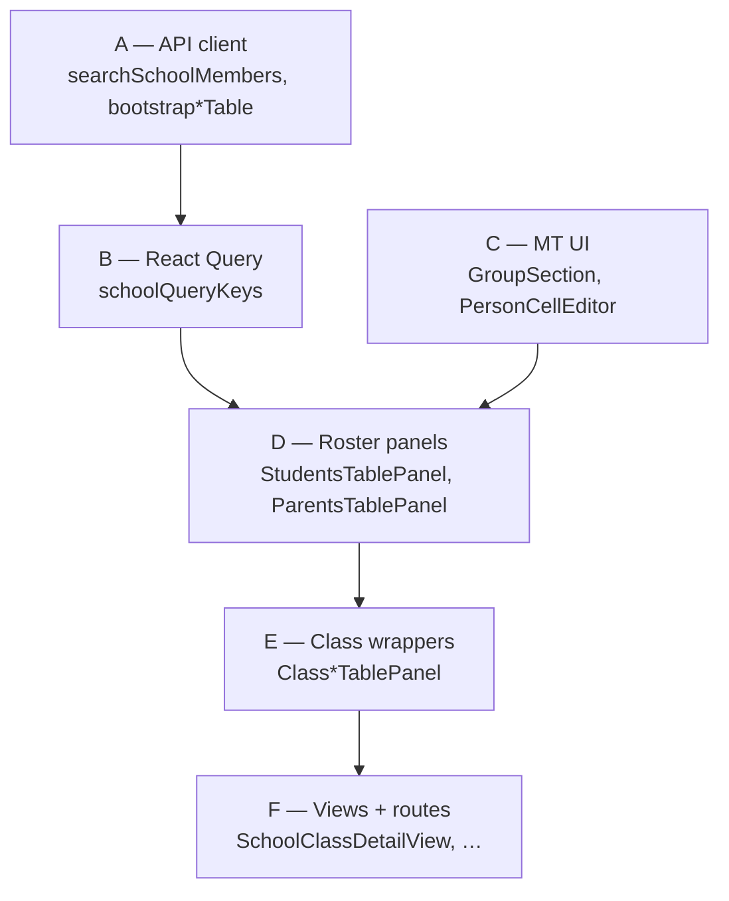

# School roster — Frontend component hierarchy (simple)

## Purpose

One-page **layered map** (A → F) of school roster web UI. Full tree: [school-roster-frontend-component-hierarchy.md](./school-roster-frontend-component-hierarchy.md).

---

## Layers

| Layer | What lives here | Key paths |
|-------|-----------------|-----------|
| **A — API** | HTTP client, types, bootstrap | `modules/School/api/index.ts` |
| **B — Query** | Cache keys, React Query | `hooks/schoolQueryKeys.ts` |
| **C — MT core** | Person cell utils, column meta, editors | `managementTable/*` |
| **D — Roster panels** | Student/parent table shells | `students/StudentsTablePanel`, `parents/ParentsTablePanel` |
| **E — Class wrappers** | Thin class adapters | `class/ClassStudentsTablePanel`, `ClassParentsTablePanel` |
| **F — Views & routes** | Pages users open | `views/School*DetailView`, `app/…/features/school/**` |

---

## Layer diagram



---

## Surface → layer stack

| User opens | F | E | D | Picker |
|------------|---|---|---|--------|
| School student registration | `SchoolStudentDetailView` | — | `StudentsTablePanel` | `platform` |
| School parent registration | `SchoolParentDetailView` | — | `ParentsTablePanel` | `platform` |
| Class Student tab | `SchoolClassDetailView` | `ClassStudentsTablePanel` | `StudentsTablePanel` | `school_students` |
| Class Parent tab | `SchoolClassDetailView` | `ClassParentsTablePanel` | `ParentsTablePanel` | `school_parents` + `class_students` |

---

## File checklist (roster-only)

```
modules/School/
├── api/index.ts
├── students/
│   ├── StudentsTablePanel.tsx
│   └── studentsTableMeta.ts
├── parents/
│   ├── ParentsTablePanel.tsx
│   └── parentsTableMeta.ts
├── class/
│   ├── ClassStudentsTablePanel.tsx
│   ├── ClassParentsTablePanel.tsx
│   └── ClassBottomNav.tsx
├── managementTable/
│   ├── ManagementTableGroupSection.tsx
│   ├── ManagementTablePersonCellEditor.tsx
│   └── managementTablePersonCell.ts
└── views/
    ├── SchoolClassDetailView.tsx
    ├── SchoolStudentDetailView.tsx
    ├── SchoolParentDetailView.tsx
    └── SchoolWorkspaceDetailView.tsx
```

---

*Last updated: 2026-06-03*
