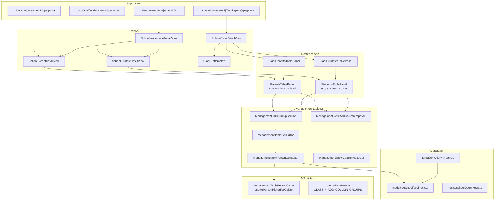

# School roster — Frontend component hierarchy (Web)

## Purpose

Tree diagram of **school roster UI** from API client → management table primitives → roster panels → school/class views → App Router pages.

**Quick layered diagram:** [school-roster-frontend-component-hierarchy-simple.md](./school-roster-frontend-component-hierarchy-simple.md)

**Scope:** `deltalabs-frontend` — School module roster surfaces only.

**Source of truth (code):**

- API: `src/modules/School/api/index.ts`
- Roster panels: `src/modules/School/students/*`, `src/modules/School/parents/*`, `src/modules/School/class/*`
- MT UI: `src/modules/School/managementTable/*`
- Views: `src/modules/School/views/*`
- Routes: `src/app/(app)/features/school/**`

---

## Big-picture UI architecture (bottom → top)

1. **API client** — `searchSchoolMembers`, bootstrap helpers, MT CRUD
2. **MT utilities** — `managementTablePersonCell.ts`, `columnTypeMeta.ts`
3. **MT building blocks** — cell editor, person picker, group section, column head
4. **Roster panels** — `StudentsTablePanel`, `ParentsTablePanel`
5. **Class wrappers** — `ClassStudentsTablePanel`, `ClassParentsTablePanel`
6. **Views** — `SchoolClassDetailView`, `SchoolStudentDetailView`, `SchoolParentDetailView`, `SchoolWorkspaceDetailView`
7. **App routes** — `page.tsx` under `features/school/…`

---

## Tree diagram

---

## Component responsibility matrix

| Component | Props (roster-relevant) | Picker default |
|-----------|-------------------------|----------------|
| `StudentsTablePanel` | `scope`, `workspaceItemId`, `itemMetadata` | `school_students` / `platform` |
| `ParentsTablePanel` | `scope`, `workspaceItemId`, `classWorkspaceItemId` when class | `school_parents` / `platform` |
| `ManagementTableGroupSection` | `personPicker`, `classWorkspaceItemId?` | per-column resolve |
| `ManagementTablePersonCellEditor` | `personPicker`, `classWorkspaceItemId?` | calls `searchSchoolMembers` |

---

## Metadata helpers

| File | Functions |
|------|-----------|
| `students/studentsTableMeta.ts` | `readStudentsTableInstanceId`, `readStudentsTableDefinitionId` |
| `parents/parentsTableMeta.ts` | `readParentsTableInstanceId`, `readParentsTableDefinitionId` |
| `class/classStudentsTableMeta.ts` | Re-exports student meta for class |

---

## Route → view → panel map

| URL pattern | View | Panel |
|-------------|------|-------|
| `…/class/[id]?nav=students` | `SchoolClassDetailView` | `ClassStudentsTablePanel` |
| `…/class/[id]?nav=parents` | `SchoolClassDetailView` | `ClassParentsTablePanel` |
| `…/student/[id]` | `SchoolStudentDetailView` | `StudentsTablePanel` (`scope=school`) |
| `…/parent/[id]` | `SchoolParentDetailView` | `ParentsTablePanel` (`scope=school`) |

---

## Bootstrap UX (panels)

Both `StudentsTablePanel` and `ParentsTablePanel`:

1. Read instance id from metadata on mount.
2. If manager + no id → auto `bootstrapMutation`.
3. Parents: if bundle loads without Parent column → re-bootstrap.
4. On success → invalidate workspace item + MT instance queries.

---

## Shared MT components (non-roster-specific)

Roster tabs reuse the same MT stack as school management tables elsewhere:

- `ManagementTableEditorView` — full-page MT editor (different entry)
- `ManagementTableTemplatePickerModal` — template linking for generic MT workspace items

Roster tables are **pre-seeded** via bootstrap (not template picker).

---

*Last updated: 2026-06-03*
