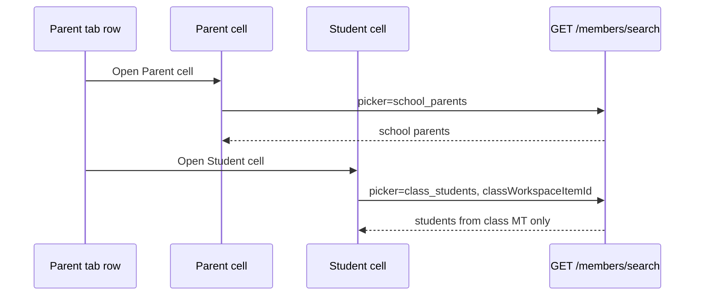

# School roster — Person picker design

## Purpose

Specification for **`GET /members/search`** picker scopes: when each is used, what data is queried, and what the UI should communicate.

**Scope:** Backend search + web `ManagementTablePersonCellEditor`.

---

## Picker enum

```typescript
type SchoolMemberSearchPicker =
  | "platform"
  | "school_students"
  | "school_parents"
  | "class_students";
```

Backend: `SchoolMemberSearchPicker` in `app/domain/school/schemas.py`

---

## Summary table

| Picker | Where used | Data source | Requires `classWorkspaceItemId` |
|--------|------------|-------------|----------------------------------|
| `platform` | School student/parent registration → primary person column | `users` collection, partial text match | No |
| `school_students` | Class Student tab → Student column | `school_memberships` where `role_keys` contains `student`, then `users` | No |
| `school_parents` | Class Parent tab → Parent column | `school_memberships` where `role_keys` contains `parent`, then `users` | No |
| `class_students` | Class Parent tab → Student column | User ids from **this class’s** students MT rows | **Yes** |

---

## Frontend resolution

Table-level default is resolved **per column** via `resolvePersonPickerForColumn()`:

| Column title | Table context (`tableDefault`) | Resolved picker |
|--------------|-------------------------------|-----------------|
| Parent | `platform` (school reg) | `platform` |
| Parent | `school_parents` (class parent tab) | `school_parents` |
| Student | `platform` (school student reg) | `platform` |
| Student | `school_students` (class student tab) | `school_students` |
| Student | `school_parents` (class parent tab) | **`class_students`** |

**File:** `deltalabs-frontend/src/modules/School/managementTable/managementTablePersonCell.ts`

When resolved picker is `class_students`, frontend passes `classWorkspaceItemId` (= class workspace item id) on the search request.

---

## Search algorithm: `platform`

**Repository:** `search_users_for_school_picker` when `picker == "platform"`

1. Build case-insensitive regex query on `full_name`, `username`, `email`, `email_normalized`.
2. Multi-word queries use `$and` of per-term clauses.
3. Fetch up to `min(limit * 3, 150)`, return first `limit` sorted by name.

---

## Search algorithm: `school_students` / `school_parents`

1. Load active memberships for `school_id` with `role_keys` = `student` or `parent`.
2. Collect `user_id` list.
3. Intersect with text query on `users`.
4. Return up to `limit` results.

**Empty membership set → `[]`**

---

## Search algorithm: `class_students`

**Repository:** `search_class_students_for_picker`

1. Load class `school_workspace_items` doc by `class_workspace_item_id`.
2. Read `metadata.studentsTableInstanceId`, `metadata.studentsTableStudentColumnId`.
3. If either missing → `[]`.
4. `list_rows` on MT instance (`mtg_main`, up to 2000 rows).
5. For each row, read Student column cell; collect distinct `userId`.
6. Query `users` with `_id ∈ ids` AND text query.
7. Return up to `limit`.

**Note:** Only cells with `userId` participate; name-only cells without id are not searchable.

---

## API contract

```
GET /v1/orgs/{org_id}/schools/{school_id}/members/search
  ?q={text}
  &limit={1..50}
  &picker={picker}
  &classWorkspaceItemId={id}   // required for class_students
```

**Error:** `400` / validation `class_students_picker_missing_class` if `class_students` without class id.

---

## UI copy matrix (web)

| Picker | Placeholder | Empty result |
|--------|-------------|--------------|
| `platform` | Search name, username, or email | No matching Delta Labs accounts |
| `school_students` | Search registered school students | Register in school student workspace first |
| `school_parents` | Search registered school parents | Register in school parent workspace first |
| `class_students` | Search students on this class | Add students on the Student tab first |

---

## Person column detection

Column uses person picker when:

- `settings.cellEditor === "person"`, OR
- title is **Student** or **Parent** (case-insensitive)

---

## Sequence: class parent row (two pickers)



---

*Last updated: 2026-06-03*
