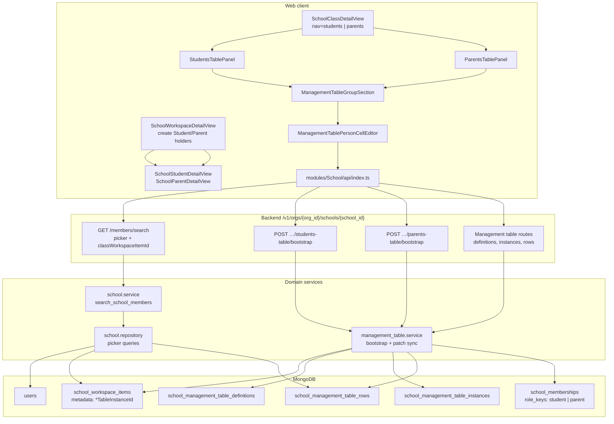
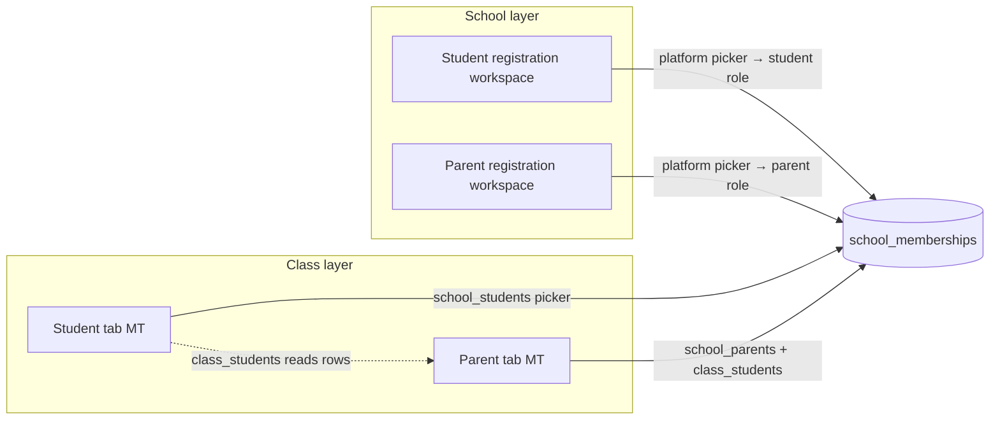
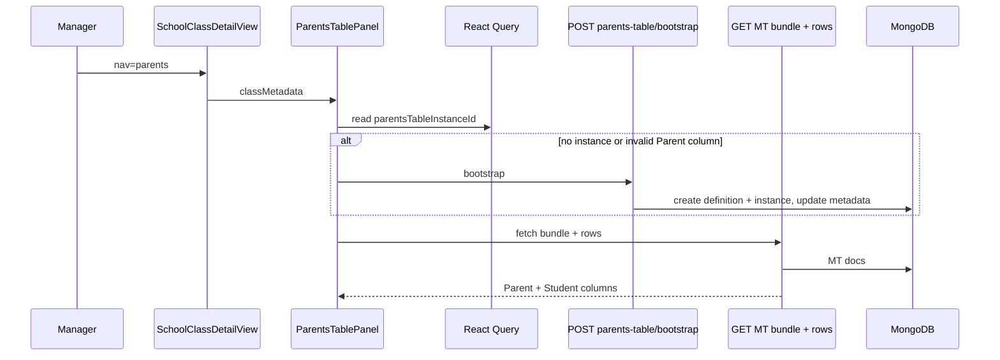
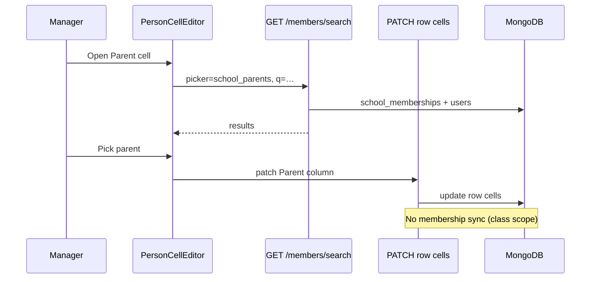

# School roster — System architecture (Web + Backend)

## Purpose

System-level architecture for **school-level registration** and **class-level student/parent rosters** using **management tables** (MT), person pickers, and `school_memberships` role sync.

**Scope:** `deltalabs-frontend` + `deltalabs-backend` only.

**Plain-language context:** [school-page/school-overview-user-brief.md](../school-page/school-overview-user-brief.md), [school-page/school-roster-changes-brief.md](../school-page/school-roster-changes-brief.md)

**Related (classified docs in this folder):**

| Doc | Topic |
|-----|--------|
| [school-roster-design-decisions.md](./school-roster-design-decisions.md) | ADRs and product rules |
| [school-roster-user-flows.md](./school-roster-user-flows.md) | Step-by-step user flows |
| [school-roster-backend-design.md](./school-roster-backend-design.md) | API + services |
| [school-roster-backend-data-model-and-diagrams.md](./school-roster-backend-data-model-and-diagrams.md) | Mongo metadata + ER |
| [school-roster-person-picker-design.md](./school-roster-person-picker-design.md) | Picker scopes + search |
| [school-roster-frontend-component-hierarchy.md](./school-roster-frontend-component-hierarchy.md) | Full UI tree |
| [school-roster-frontend-component-hierarchy-simple.md](./school-roster-frontend-component-hierarchy-simple.md) | Layered A–Z summary |

---

## Architecture style

| Layer | Choice | Rationale |
|-------|--------|-----------|
| **Roster UI** | Management table (grid + person cells) | Same extensibility as other school MT features; custom columns without new APIs |
| **School registration** | Workspace items `type: student` / `type: parent` | Mirrors folder/class pattern; one holder per registration area |
| **Class assignment** | Class bottom nav → Student / Parent tabs | Separate MT instances per roster type on class metadata |
| **Person search** | Scoped `picker` query param | Prevents admins/teachers from picking wrong population (platform vs school vs class) |
| **Membership** | Sync on **school** MT patch only | Class rosters reference members; they do not create roles |
| **Auth** | `school:manage` for bootstrap + mutate | Same gate as other school workspace mutations |
| **Frontend state** | TanStack Query + metadata on workspace item | Instance ids live on `school_workspace_items.metadata` |

---

## High-level system diagram

---

## Two-layer model

---

## Read path: open class Parent tab

---

## Write path: assign parent in class row

---

## Implemented vs not implemented

| Area | Status |
|------|--------|
| Class students MT + `school_students` picker | **Implemented** |
| School student registration + membership sync | **Implemented** |
| Class parents MT (Parent + Student columns) | **Implemented** |
| School parent registration + membership sync | **Implemented** |
| `class_students` picker (Student column on parent tab) | **Implemented** |
| Parents table bootstrap repair | **Implemented** |
| Legacy class enrollment API as primary UI | **Not used** (MT is primary) |
| Server-side validation parent row student ∈ class | **Not implemented** (picker scope only) |
| Parent portal / parent-facing app | **Not implemented** |
| School-level parent–child link (outside class) | **Not implemented** |

---

*Last updated: 2026-06-03*
