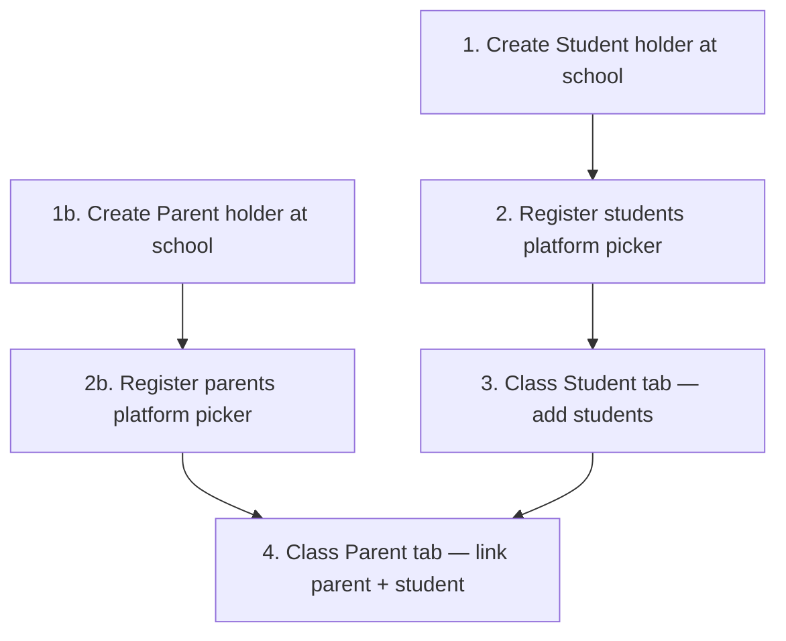
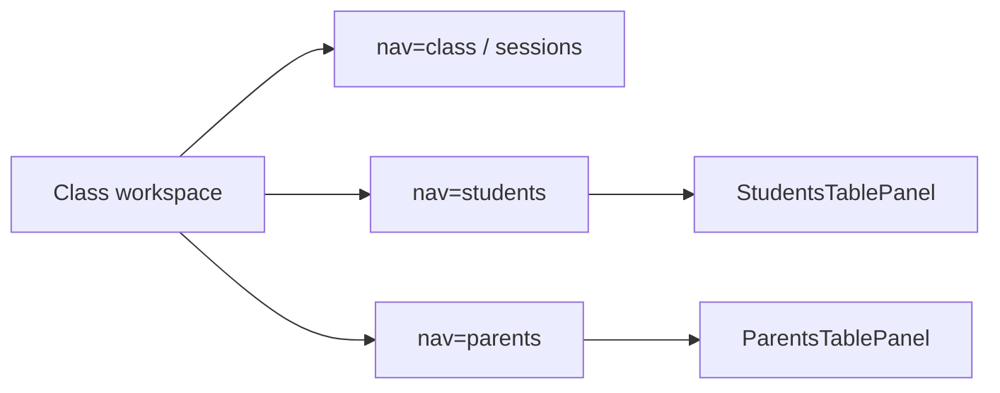

# School roster — User flows (what admins can do)

## Scope

Admin/manager flows on **school workspace** and **class workspace** for registering students/parents and building class rosters.

**Evidence:** `deltalabs-frontend/src/modules/School/views/*`, `class/ClassBottomNav.tsx`

**Fully wired** vs **not implemented** are labeled explicitly.

---

## Feature inventory

### Routes and surfaces

| Route / surface | Purpose | Bootstrap | Person picker |
|-----------------|---------|-----------|---------------|
| School workspace → **Students** section | List `student` holders | — | — |
| School workspace → **Parents** section | List `parent` holders | — | — |
| `/features/school/[schoolId]/student/[id]` | School student registration | Auto `students-table/bootstrap` | `platform` |
| `/features/school/[schoolId]/parent/[id]` | School parent registration | Auto `parents-table/bootstrap` | `platform` |
| Class → **Student** tab (`?nav=students`) | Class student roster | Auto bootstrap | `school_students` |
| Class → **Parent** tab (`?nav=parents`) | Class parent links | Auto bootstrap | `school_parents` + `class_students` |

### Actions by surface

| Action | School student reg | School parent reg | Class Student tab | Class Parent tab |
|--------|-------------------|-------------------|-------------------|------------------|
| Auto-create MT on first open (manager) | Yes | Yes | Yes | Yes |
| Add row | Yes | Yes | Yes | Yes |
| Add custom column | Yes | Yes | Yes | Yes |
| Pick person in primary column | `platform` | `platform` | `school_students` | `school_parents` |
| Pick person in Student column | — | — | — | `class_students` |
| Sync `school_memberships` on save | `student` role | `parent` role | No | No |
| Requires `school:manage` | Yes | Yes | Yes | Yes |

---

## Canonical order of operations

**Rule:** Steps 1–2 (school registration) should happen before steps 3–4 (class assignment). The UI enforces population via picker scope, not hard blocks.

---

## Flow 1 — Register student at school

### User intent

“Add this Delta Labs user as a student of our school.”

### Steps

| Step | Actor | Action |
|------|-------|--------|
| **1** | Manager | School workspace → **New** → **Student** → create holder (e.g. “Students 2026”). |
| **2** | Manager | Open holder → `SchoolStudentDetailView`. |
| **3** | System | If no `studentsTableInstanceId`, `POST …/students-table/bootstrap` (Student column). |
| **4** | Manager | **Add row** → open **Student** cell → search (`platform`, ≥2 chars). |
| **5** | Manager | Pick user. |
| **6** | System | `PATCH` row → `_maybe_sync_school_student_membership_from_row` adds `student` to `school_memberships`. |

### Empty / error states

| Condition | Message direction |
|-----------|-------------------|
| No search results | “No matching Delta Labs accounts.” |
| Not manager | “Students table not set up” / need manager to open once |

---

## Flow 2 — Register parent at school

Same as Flow 1 with:

- Holder type **`parent`**
- Route `/features/school/…/parent/…`
- Bootstrap **parents-table** with **Parent** column only
- Picker `platform` → sync **`parent`** role

---

## Flow 3 — Add students to a class

### User intent

“These school students are in this class.”

### Steps

| Step | Actor | Action |
|------|-------|--------|
| **1** | Manager | Open class → bottom nav **Student**. |
| **2** | System | Bootstrap class students MT if needed (**Student** column). |
| **3** | Manager | **Add row** → **Student** cell → `school_students` search. |
| **4** | Manager | Pick registered school student. |
| **5** | System | Patch row (no membership change). |

### Empty states

| Condition | Message |
|-----------|---------|
| No school students | Register in school student workspace first |

---

## Flow 4 — Link parents to students in a class

### User intent

“For this class, this parent is linked to this student.”

### Steps

| Step | Actor | Action |
|------|-------|--------|
| **1** | Manager | Ensure Flow 3 completed (students on class Student tab). |
| **2** | Manager | Open class → bottom nav **Parent**. |
| **3** | System | Bootstrap class parents MT (**Parent** + **Student** columns) if needed. |
| **4** | Manager | **Add row** → **Parent** cell → `school_parents` search. |
| **5** | Manager | **Student** cell → `class_students` search (same class id). |
| **6** | System | Patch row cells. |

### Empty states

| Column | Condition | Message |
|--------|-----------|---------|
| Parent | No school parents | Register in school parent workspace first |
| Student | No rows on class Student tab | Add students on Student tab first |

---

## Flow 5 — First manager opens Parent tab (bootstrap + repair)

| Step | System behavior |
|------|-----------------|
| 1 | Read `parentsTableInstanceId` from class metadata |
| 2 | If missing → bootstrap new table (Parent + Student columns) |
| 3 | If id equals `studentsTableInstanceId` → bootstrap new parents table |
| 4 | If loaded bundle has no Parent column → re-bootstrap |
| 5 | Render grid |

---

## Navigation map (class)

`ClassBottomNav`: tabs include **Class**, **Student**, **Parent**, …

---

## Not implemented (user-visible gaps)

| Feature | Current behavior |
|---------|------------------|
| Parent login / view class as parent | No dedicated surface |
| Invite parent by email | Platform search only |
| Block saving parent row if student not on class | Picker limits choices; no patch validation |
| Auto-suggest parents when student added to class | Manual rows only |

---

*Last updated: 2026-06-03*
