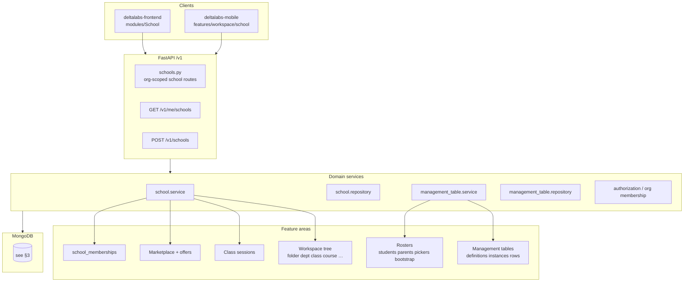

# School — System architecture decision guide (complete reference)

## Purpose

**Single entry point for technical leads and architects** evaluating the School module: performance, scaling, refactors, new features, or “why is it slow?”

Use this document as a **checklist** — every subsystem, store, coupling point, and classified doc is indexed here so nothing is missed before you change the system.

**Scope:** `deltalabs-frontend` + `deltalabs-backend` (+ mobile API parity notes).  
**Plain-language context:** [school-page/README.md](../school-page/README.md)  
**Roster-only deep dives:** other files in this folder (`school-roster-page/`)

---

## How to use this guide

| Your question | Go to section |
|---------------|---------------|
| What are all the moving parts? | [§1 Subsystem inventory](#1-subsystem-inventory) |
| What stack choices did we make? | [§2 Architecture style](#2-architecture-style) |
| Where is data stored? | [§3 Data stores](#3-data-stores) |
| What APIs exist? | [§4 API surface map](#4-api-surface-map) |
| How does a request flow? | [§5 Read/write paths](#5-readwrite-paths) |
| Who can call what? | [§6 Auth & permissions](#6-auth--permissions) |
| What breaks if I change X? | [§7 Change impact matrix](#7-change-impact-matrix) |
| Why might it be slow? | [§8 Performance & scaling](#8-performance--scaling) |
| What is not built yet? | [§9 Implemented vs not](#9-implemented-vs-not) |
| All ADRs / decisions | [§10 Decision index](#10-decision-index) |
| Every doc in the repo | [§11 Complete documentation map](#11-complete-documentation-map) |

---

## 1. Subsystem inventory



| Subsystem | Responsibility | Primary code | Doc |
|-----------|----------------|--------------|-----|
| **Tenant / org** | Billing boundary, `school:manage` | `authorization/*`, `orgs` | [school-tenant-architecture.md](../../deltalabs-frontend/docs/school-tenant-architecture.md) |
| **School record** | `schools` CRUD, archive | `school/repository.py` | [school-organization-and-workspace-concepts.md](../school-page/school-organization-and-workspace-concepts.md) |
| **School membership** | Per-school roles (`school_owner`, `student`, `parent`) | `school_memberships` | [school-access-and-permissions.md](../school-page/school-access-and-permissions.md) |
| **Workspace tree** | Nested items (`school_workspace_items`) | `school.service` workspace CRUD | [school-organization-and-workspace-concepts.md](../school-page/school-organization-and-workspace-concepts.md) |
| **Management table engine** | Definitions, instances, rows, columns | `management_table/*` | [school-roster-backend-design.md](./school-roster-backend-design.md) |
| **Roster bootstrap** | Auto MT for class/school student/parent | `management_table/service.py` bootstrap_* | [school-roster-system-architecture.md](./school-roster-system-architecture.md) |
| **Person pickers** | Scoped member search | `search_school_members`, repository pickers | [school-roster-person-picker-design.md](./school-roster-person-picker-design.md) |
| **Class sessions** | Schedule / live sessions per class | `school_class_sessions` | §5.4 below |
| **Legacy enrollments** | REST enrollments API | `class enrollments` routes | **Not primary UI** — MT rosters used |
| **Marketplace / offers** | School trading, bids | `school_marketplace`, `school_offers` | [school-marketplace-offers-implementation-details.md](../school-marketplace-offers-implementation-details.md) |

---

## 2. Architecture style

| Layer | Choice | Rationale | Change risk |
|-------|--------|-----------|-------------|
| **API** | REST under `/v1/orgs/{org_id}/schools/{school_id}/…` | Org-scoped multi-tenant; school id in path for UX | High — all clients pass `orgId` from `GET /v1/me/schools` |
| **Backend** | FastAPI + domain services (`school`, `management_table`) | School routes delegate to MT service for rosters | Bootstrap logic lives in MT service, not school-only |
| **Primary store** | MongoDB | Workspace tree, MT rows, memberships, sessions | No Redis cache layer for school reads today |
| **Frontend** | Next.js App Router + TanStack Query | `schoolQueryKeys`, invalidate on bootstrap/patch | Query key shape is coupling point |
| **Roster UX** | Management table grid (not custom forms) | Extensible columns; one engine for all tables | Changing MT schema affects all roster surfaces |
| **Registration → membership** | Sync on **school** MT row patch only | Class rosters reference members | Removing sync breaks pickers |
| **Person search** | Query param `picker` + optional `classWorkspaceItemId` | Enforces population rules server-side | New picker = backend + frontend + docs |
| **Auth gate for mutate** | `school:manage` on org | Same as workspace create | Teacher-scoped roles need new ADR |
| **Mobile** | Same API contracts | Partial UI parity | Check mobile before API breaking changes |

---

## 3. Data stores

### MongoDB collections (school-relevant)

| Collection | Written by | Read by | Notes |
|------------|------------|---------|-------|
| `schools` | Create/update school | Workspace shell, marketplace | `org_id` link |
| `school_workspace_items` | Workspace CRUD, bootstrap metadata | All navigation, pickers (`class_students`) | **`metadata` holds MT instance ids** |
| `school_memberships` | Create school, roster sync on school MT patch | `school_students` / `school_parents` pickers | Unique `(user_id, school_id)` |
| `school_management_table_definitions` | Bootstrap, add column | MT editor, roster panels | Column ids stored on workspace metadata |
| `school_management_table_instances` | Bootstrap, link | Row queries | `workspace_item_id` FK |
| `school_management_table_rows` | Patch row, add row | Grids, `class_students` picker | Person values in `cells` map |
| `school_class_sessions` | Session CRUD | Class default tab | Separate from rosters |
| `school_marketplace` | Listing CRUD | Marketplace views | Separate domain |
| `school_offers` | Offer workflow | Offers views | Separate domain |
| `users` | Identity (global) | All person pickers | Text search with regex |
| `orgs`, `role_bindings`, `org_memberships` | Auth provisioning | `school:manage` checks | Org tenant layer |

**ER detail:** [school-roster-backend-data-model-and-diagrams.md](./school-roster-backend-data-model-and-diagrams.md), [database-schema.md](../database-schema.md)

### Redis / cache

| Area | Today |
|------|--------|
| School workspace reads | **No dedicated cache** — direct Mongo |
| Person search | **No cache** — query per keystroke (debounced client-side) |
| MT row lists | **No cache** — paginated fetch per group |

**Architect note:** Slowness is likely Mongo query patterns (see §8), not missing Redis for school module specifically.

---

## 4. API surface map

Base prefix: `/v1/orgs/{org_id}/schools/{school_id}`  
Evidence: `deltalabs-backend/app/api/v1/schools.py`

### 4.1 Workspace

| Method | Path | Auth | Purpose |
|--------|------|------|---------|
| GET | `/workspace/items` | org membership | List tree |
| GET | `/workspace/items/{id}` | org membership | Single item + metadata |
| POST | `/workspace/items` | `school:manage` | Create folder/dept/class/course/MT/student/parent/… |
| PATCH | `/workspace/items/{id}` | `school:manage` | Update title, metadata |
| DELETE | `/workspace/items/{id}` | `school:manage` | Remove item |

### 4.2 Rosters (bootstrap + search)

| Method | Path | Auth | Purpose |
|--------|------|------|---------|
| GET | `/members/search` | org membership | Person picker (`picker`, `classWorkspaceItemId`) |
| POST | `/workspace/items/{id}/students-table/bootstrap` | `school:manage` | School student holder or class |
| POST | `/classes/{id}/students-table/bootstrap` | `school:manage` | Class alias |
| POST | `/workspace/items/{id}/parents-table/bootstrap` | `school:manage` | School parent holder or class |
| POST | `/classes/{id}/parents-table/bootstrap` | `school:manage` | Class alias |

### 4.3 Management tables (full CRUD)

Prefix: `/management-tables/…` — definitions, instances, rows, columns, inherit.

Used by: standalone MT workspace items **and** roster tables (same engine).

### 4.4 Class sessions

| Method | Path | Auth | Purpose |
|--------|------|------|---------|
| GET | `/classes/{class_id}/sessions` | org membership | List |
| POST | `/classes/{class_id}/sessions` | `school:manage` | Create |
| PATCH | `/classes/{class_id}/sessions/{session_id}` | `school:manage` | Update |
| DELETE | `/classes/{class_id}/sessions/{session_id}` | `school:manage` | Delete |

### 4.5 Legacy class enrollments

| Method | Path | Status |
|--------|------|--------|
| GET/POST/DELETE | `/classes/{id}/enrollments` | API exists; **web UI uses MT rosters** |

### 4.6 School lifecycle & marketplace

| Area | Paths | Doc |
|------|-------|-----|
| Create school | `POST /v1/schools`, `POST /v1/orgs/{org_id}/schools` | school-tenant-architecture |
| My schools | `GET /v1/me/schools` | school-tenant-architecture |
| Marketplace / offers | Many under `schools.py` | marketplace implementation doc |

---

## 5. Read/write paths

### 5.1 Open school workspace (read)

```
Browser → SchoolWorkspaceDetailView
       → fetchSchoolWorkspaceItems(orgId, schoolId)
       → GET …/workspace/items
       → Mongo school_workspace_items (by school_id, parent_id)
```

### 5.2 Register student at school (write + side effect)

```
Manager → SchoolStudentDetailView → StudentsTablePanel
       → bootstrap if no studentsTableInstanceId
       → PersonCellEditor (picker=platform)
       → PATCH MT row
       → ManagementTableService.patch_row
       → _maybe_sync_school_student_membership_from_row
       → upsert school_memberships (role student)
```

**Sequence diagram:** [school-roster-system-architecture.md](./school-roster-system-architecture.md)

### 5.3 Add student to class (write, no membership)

```
Manager → Class nav=students → ClassStudentsTablePanel
       → bootstrap class students MT
       → PersonCellEditor (picker=school_students)
       → PATCH row only (no membership sync)
```

### 5.4 Link parent in class (write, two pickers)

```
Manager → Class nav=parents
       → Parent cell: picker=school_parents
       → Student cell: picker=class_students + classWorkspaceItemId
       → PATCH row (no membership sync)
```

**Picker detail:** [school-roster-person-picker-design.md](./school-roster-person-picker-design.md)

### 5.5 `class_students` search (read, potentially heavy)

```
GET /members/search?picker=class_students&classWorkspaceItemId=…
  → load class metadata (studentsTableInstanceId, studentsTableStudentColumnId)
  → list_rows(limit=2000) on students MT instance
  → extract userIds from Student column cells
  → query users with text filter ∩ userIds
```

**Scaling hotspot:** Large classes → up to 2000 rows scanned per search.

### 5.6 Class session create (write)

```
SchoolClassDetailView → POST …/classes/{id}/sessions
  → school.repository.create_class_session
  → insert school_class_sessions
```

Independent of roster MT.

---

## 6. Auth & permissions

| Operation | Requirement | Checked where |
|-----------|-------------|---------------|
| Read workspace / sessions / search | Org membership | `require_org_membership` |
| Create workspace / bootstrap / patch MT / sessions | `school:manage` | `require_org_permission` |
| Appear in picker | `school_memberships.role_keys` | Repository membership filters |
| Class UI mutate button | `userCanManageSchoolClassWorkspace()` | Frontend + same backend gate |

**Full matrix:** [school-access-and-permissions.md](../school-page/school-access-and-permissions.md)

**Future:** Teacher-scoped mutate on assigned classes only — **not implemented**; would touch authz, frontend gates, and possibly row-level ACL.

---

## 7. Change impact matrix

Use before refactors. “**High**” = multiple subsystems + clients + docs.

| If you change… | Also update / risk | Impact |
|----------------|-------------------|--------|
| `school_workspace_items.metadata` keys | Bootstrap, frontend meta readers, mobile models, repair logic | **High** |
| Person `picker` enum | `schemas.py`, repository search, `managementTablePersonCell.ts`, mobile picker, docs | **High** |
| MT row `cells` shape | Person editor, sync hooks, `class_students` extraction | **High** |
| Membership sync rules | Pickers, school registration UX, ADR R-07 | **High** |
| Bootstrap column defaults | Frontend “re-bootstrap if no Parent column”, existing class metadata | **Medium** |
| `schoolQueryKeys` shape | All School module queries, invalidation after bootstrap | **Medium** |
| Separate students/parents instance ids | Classes with legacy shared id need repair path | **Medium** |
| `list_rows` limit (2000) | `class_students` picker completeness | **Medium** |
| Org resolution (`useSchoolActiveOrgId`) | Every school route, marketplace | **High** |
| Management table pagination | Roster panels load pattern | **Medium** |
| Remove legacy enrollments API | External integrations only (UI uses MT) | **Low** today |
| Add Redis cache for workspace list | Invalidation on CRUD, bootstrap | New design needed |

---

## 8. Performance & scaling

### Likely bottlenecks (today)

| Hotspot | Cause | Mitigation ideas (not implemented) |
|---------|-------|-----------------------------------|
| **`class_students` search** | Loads up to **2000 MT rows** per search, scans cells | Denormalize class roster user ids on class metadata; cache membership set |
| **`platform` picker** | Regex on `users` (multi-term `$and`) | Atlas search / dedicated index strategy |
| **`school_students` / `school_parents`** | Load all memberships then filter users | Index `school_memberships` by `(school_id, role_keys)` — verify indexes |
| **MT bundle + rows on open** | Multiple round trips per tab | Batch endpoint; server-side bundle cache |
| **Workspace item list** | Full tree fetch for large schools | Pagination / lazy load by folder |
| **No query caching** | TanStack Query only (client) | CDN not applicable; server cache optional |

### Frontend patterns

| Pattern | Location | Note |
|---------|----------|------|
| Debounced search | `ManagementTablePersonCellEditor` | ≥2 chars before API |
| Stale times | `schoolQueryKeys` queries | 15–30s typical |
| Bootstrap on mount | `StudentsTablePanel`, `ParentsTablePanel` | Extra POST if metadata missing |
| Re-bootstrap repair | Parents tab if no Parent column | Extra POST + metadata write |

### What to measure before changing architecture

1. P95 latency: `GET /members/search` per picker type.
2. P95 latency: `GET …/management-tables/instances/{id}` + rows for typical roster size.
3. Document count: `school_workspace_items` per school, MT rows per class.
4. Index usage on `school_memberships`, `users` text queries.

---

## 9. Implemented vs not

| Area | Status | Doc |
|------|--------|-----|
| Workspace tree (folder, dept, class, course, MT item) | **Implemented** | school-organization-and-workspace-concepts |
| School student/parent holders + membership sync | **Implemented** | school-roster-user-flows |
| Class Student / Parent MT tabs | **Implemented** | school-roster-user-flows |
| Four picker scopes + `classWorkspaceItemId` | **Implemented** | school-roster-person-picker-design |
| Parents table bootstrap repair | **Implemented** | school-roster-design-decisions R-10 |
| Class sessions CRUD | **Implemented** | §5.6 |
| Standalone MT hub + editor | **Implemented** | frontend hierarchy doc |
| Class bottom nav (attendance, grade, …) | **Partial** — UI only | school-capabilities-and-limitations |
| Legacy enrollments as primary UI | **Not used** | — |
| Server validate parent student ∈ class on patch | **Not implemented** | R-09 open |
| Parent portal | **Not implemented** | — |
| Teacher role scoped to class | **Not implemented** | school-access-and-permissions §7 |
| Invite / join by code | **Not implemented** | school-tenant-architecture |
| Bulk import rosters | **Not implemented** | — |
| Mobile school parent registration page | **Partial** | school-capabilities-and-limitations |

**Full matrix:** [school-capabilities-and-limitations.md](../school-page/school-capabilities-and-limitations.md)

---

## 10. Decision index

| ID | Decision | Doc |
|----|----------|-----|
| R-01 | School register → class assign (two layers) | [school-roster-design-decisions.md](./school-roster-design-decisions.md) |
| R-02 | Management tables over enrollment forms | R-02 |
| R-03 | Separate MT instance per roster type on class | R-03 |
| R-04 | Four person picker scopes | R-04 |
| R-05 | Default bootstrap columns by context | R-05 |
| R-06 | Per-column picker resolution (frontend) | R-06 |
| R-07 | Membership sync on school patch only | R-07 |
| R-08 | `school:manage` for bootstrap/mutate | R-08 |
| R-09 | Class parent Student column = `class_students` | R-09 |
| R-10 | Parents bootstrap repair / anti-aliasing | R-10 |

**Product narrative (non-technical):** [school-roster-changes-brief.md](../school-page/school-roster-changes-brief.md)

---

## 11. Complete documentation map

Check every box before signing off an architecture change.

### 11.1 School product (`docs/school-page/`)

- [ ] [README.md](../school-page/README.md) — audience routing
- [ ] [school-overview-user-brief.md](../school-page/school-overview-user-brief.md) — plain language
- [ ] [school-organization-and-workspace-concepts.md](../school-page/school-organization-and-workspace-concepts.md) — dept / class / course / MT
- [ ] [school-roster-changes-brief.md](../school-page/school-roster-changes-brief.md) — what changed & why
- [ ] [school-access-and-permissions.md](../school-page/school-access-and-permissions.md) — who can do what
- [ ] [school-capabilities-and-limitations.md](../school-page/school-capabilities-and-limitations.md) — can / cannot

### 11.2 Roster & school technical (`docs/school-roster-page/`)

- [ ] **This file** — architecture decision guide
- [ ] [school-roster-system-architecture.md](./school-roster-system-architecture.md) — end-to-end roster architecture
- [ ] [school-roster-design-decisions.md](./school-roster-design-decisions.md) — ADRs
- [ ] [school-roster-user-flows.md](./school-roster-user-flows.md) — admin step flows
- [ ] [school-roster-backend-design.md](./school-roster-backend-design.md) — API + services
- [ ] [school-roster-backend-data-model-and-diagrams.md](./school-roster-backend-data-model-and-diagrams.md) — Mongo + ER
- [ ] [school-roster-person-picker-design.md](./school-roster-person-picker-design.md) — search algorithms
- [ ] [school-roster-frontend-component-hierarchy.md](./school-roster-frontend-component-hierarchy.md) — UI tree
- [ ] [school-roster-frontend-component-hierarchy-simple.md](./school-roster-frontend-component-hierarchy-simple.md) — layered map

### 11.3 Related repo docs

- [ ] [school-tenant-architecture.md](../../deltalabs-frontend/docs/school-tenant-architecture.md) — org / school / membership phases
- [ ] [database-schema.md](../database-schema.md) — all collections
- [ ] [school-marketplace-offers-implementation-details.md](../school-marketplace-offers-implementation-details.md) — marketplace (separate subsystem)
- [ ] [authz-org-rbac-design.md](../au-page/authz-org-rbac-design.md) — org RBAC model

### 11.4 Source code (verify if docs drift)

| Area | Path |
|------|------|
| School API routes | `deltalabs-backend/app/api/v1/schools.py` |
| School domain | `deltalabs-backend/app/domain/school/` |
| MT domain | `deltalabs-backend/app/domain/management_table/` |
| Web School module | `deltalabs-frontend/src/modules/School/` |
| Web routes | `deltalabs-frontend/src/app/(app)/features/school/` |
| Mobile school | `deltalabs-mobile/lib/features/workspace/school/` |

---

## 12. Architecture review checklist (before you ship a change)

Copy into PR / design doc:

1. **Subsystem** — Which row in §1 is affected?
2. **Data** — Collections in §3: new fields? Migration? Index?
3. **API** — New/changed route in §4? Mobile + web clients updated?
4. **Auth** — Still gated correctly per §6?
5. **Coupling** — Checked §7 impact matrix?
6. **Performance** — Any hotspot in §8 made worse?
7. **Pickers / MT** — If roster-related: all four pickers + bootstrap + sync still consistent?
8. **Docs** — Updated items in §11 that apply?
9. **Capabilities matrix** — [school-capabilities-and-limitations.md](../school-page/school-capabilities-and-limitations.md) still accurate?
10. **ADR** — New decision recorded in [school-roster-design-decisions.md](./school-roster-design-decisions.md) or school-page?

---

*Last updated: 2026-06-03*
